# SimLauncher

**iPhone·iPad·Android 폰이 없어도 Mac 하나로 개발 중인 iOS·Android 앱을 써 볼 수 있어요.**

[](https://github.com/zopandagom/simlauncher-macos/releases/latest)   [](LICENSE)

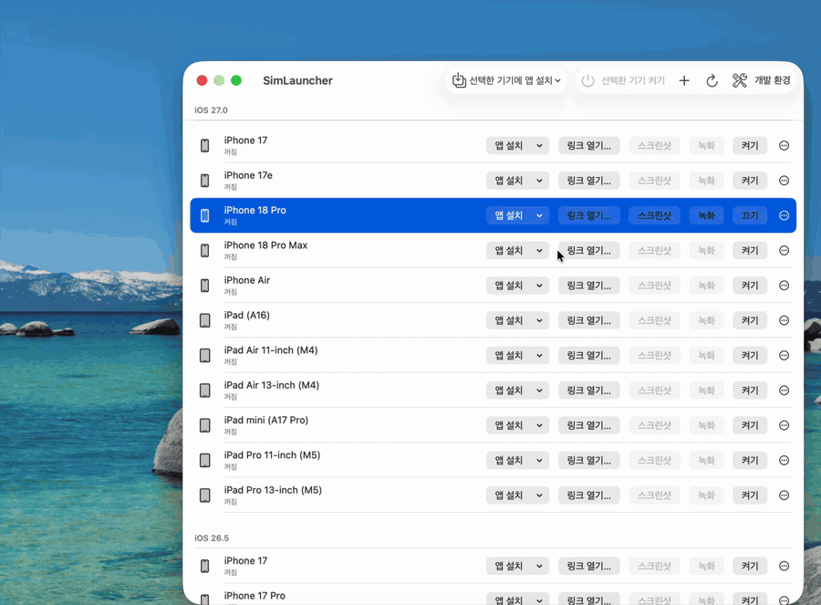

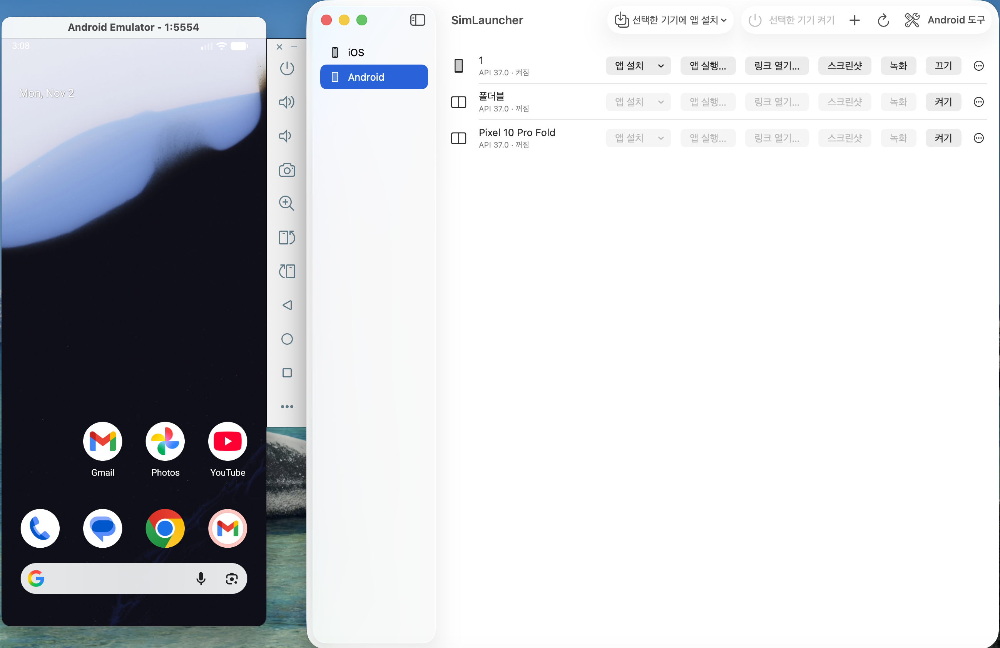

## 한눈에 보기

### 왜 만들었나
- **문제**: 개발 중인 앱을 확인하려면 테스트 기기에 빌드를 설치하거나, Xcode·Android Studio·터미널로 시뮬레이터·에뮬레이터를 직접 다뤄야 해요. 기기가 없거나 개발 도구를 쓰지 않는 기획·디자인·QA 팀원은 확인할 때마다 개발자에게 부탁해야 했어요.
- **해결**: SimLauncher 는 가상 기기를 켜고, 앱 빌드를 받아 설치·실행하는 과정을 Mac 앱의 버튼 몇 번으로 줄여요. 처음 한 번 하는 준비(Xcode 설치·라이선스 동의, Android 도구 설치)도 앱이 단계별로 안내해서, 그다음부터는 터미널 없이 쓸 수 있어요.

### 주요 기능
| 기능 | iOS (시뮬레이터) | Android (에뮬레이터) |
|---|---|---|
| 가상 기기 켜기·끄기·만들기·초기화·삭제 | ✓ | ✓ (폴더블 포함) |
| 앱 설치 (Mac 의 파일·URL·회사 빌드 목록) | `.app`, `.app` 을 담은 zip | `.apk` |
| 앱 실행·딥링크 열기 | ✓ | ✓ |
| 화면 스크린샷·녹화 | ✓ | ✓ |
| 화면 레이아웃 보기 (뷰 테두리·위치·크기) | ✓ | ✓ |
| 실행한 앱의 로그 보기 (필터) | ✓ (print·NSLog·Logger) | ✓ (logcat) |
| 여러 기기에 한 번에 설치 | ✓ | ✓ |
| 준비 안내 | Xcode 설치·라이선스·시뮬레이터 설치 | Android 도구를 앱이 직접 설치 (Android Studio·Java 필요 없음) |

**회사 빌드 목록**: 빌드 저장소 주소를 담은 `catalog.json` 하나를 등록하면 앱 이름·버전을 골라 설치할 수 있어요 ([규격](docs/CATALOG.md), GitHub Actions 예시 포함).

### 기술적으로 신경 쓴 점
- **모듈 구조**: Tuist 로 Feature 7개 · Client 12개(Interface / Impl / Testing) · Shared 로 나누고, 규칙 기반 단방향 MV 를 썼어요. 모듈 경계는 빌드와 lint 로 지켜요: Feature 끼리 의존하지 못하게 Tuist 템플릿이 막고, 부수효과(`Process`·네트워크·UserDefaults 등)는 Client Impl 에서만, Impl 은 App 에서만 import 하도록 SwiftLint 사용자 규칙으로 만들어 커밋 훅과 CI 에서 검사해요.
- **안전한 동시성과 테스트**: Swift 6 strict concurrency. Feature 는 Fake Client 로, Client Impl·도메인 규칙(Core)은 단위 테스트로 검증해 테스트가 약 2,400개예요.
- **외부 도구 다루기**: `simctl`·Android `emulator`·`adb` 를 `Process` 로 실행하고, 켜는 중·끄는 중·실패·취소 같은 상태를 화면에 그대로 보여요. Android SDK 는 Google 저장소에서 필요한 패키지만 받아 Android Studio 와 같은 형식으로 설치해, Studio 와 함께 써도 다시 받지 않아요.
- **배포**: `make release` 한 번으로 Developer ID 서명 → Apple 공증 → staple → 검사까지 마친 dmg 를 만들고, GitHub Releases 로 배포해요 ([RELEASING.md](docs/RELEASING.md)).
- **개발 흐름**: main 직접 커밋을 막는 git 훅, PR 마다 lint·테스트 CI 와 자동 코드 리뷰, 문서([아키텍처](docs/ARCHITECTURE.md)·[규칙](docs/CONVENTIONS.md)·[로드맵](docs/DEVELOPMENT_PLAN.md))를 코드와 같은 PR 에서 고치는 방식으로 개발했어요. [Claude Code](https://claude.com/claude-code) 와 함께 개발하며, 작업 규칙과 리뷰 흐름을 레포에 정의해 두었어요([CLAUDE.md](CLAUDE.md), `.claude/skills`).

### 앞으로 개선할 점
- **앱 로그 보기 넓히기**: 지금은 iOS·Android 모두 설치 후 실행하거나 **앱 실행…** 으로 실행한 앱의 로그를 창에서 보고 거를 수 있어요([앱 로그 보기](#앱-로그-보기)). 자주 쓰는 필터도 저장해 둘 수 있어요. 로그를 개발자에게 전달하기 쉽게 할 예정이에요.
- 그 밖의 후보: [로드맵의 "이후"](docs/DEVELOPMENT_PLAN.md#로드맵)

---

## 사용 안내

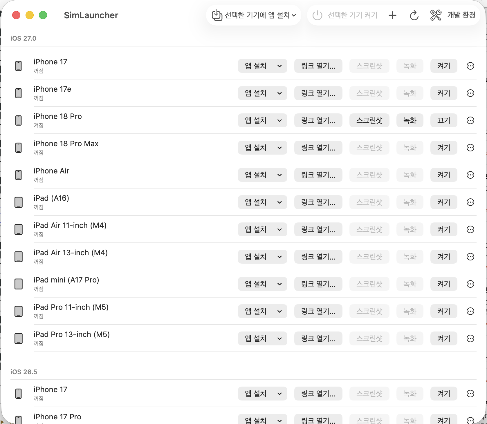

**바로 가기**: [준비물](#준비물) · [설치하기](#설치하기) · [처음 실행하기](#처음-실행하기) · [사용법](#사용법) · [Android 기기 쓰기](#android-기기-쓰기) · [회사 빌드 목록 연결하기](#회사-빌드-목록-연결하기) · [문제가 생겼을 때](#문제가-생겼을-때) · [개발자 안내](#개발자-안내)

## 준비물
- **macOS 26 이상**인 Mac
- **Xcode**: App Store 에서 무료로 받을 수 있어요. 아직 없다면 SimLauncher 가 처음 실행될 때 설치를 안내해 드려요.
- **iOS 시뮬레이터**: Xcode 에 들어 있지 않다면 SimLauncher 안에서 바로 설치할 수 있어요.
- **Android 앱을 확인하려면**: 저장 공간이 넉넉해야 해요. Android 도구는 약 2.5 GB 를 내려받고 설치하면 약 7 GB 가 되며(설치하는 동안에는 잠시 최대 약 9 GB), Android 기기는 한 대를 쓰기 시작하면 약 5 GB 를 차지해요. Android 만 쓴다면 Xcode 는 없어도 돼요.

## 설치하기
1. [GitHub Releases 최신 페이지](https://github.com/zopandagom/simlauncher-macos/releases/latest)에서 `SimLauncher-<버전>.dmg`(예: `SimLauncher-1.1.0.dmg`)를 내려받으세요.
2. 받은 dmg 를 열고 **SimLauncher** 아이콘을 **Applications**(응용 프로그램) 폴더로 끌어다 놓으세요.

   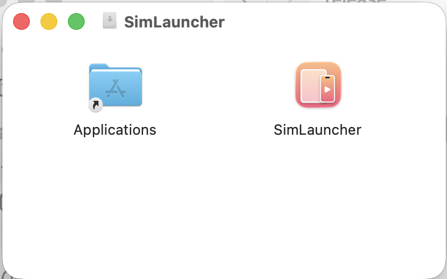

3. 응용 프로그램 폴더에서 SimLauncher 를 여세요. 인터넷에서 받은 앱이라 처음 한 번 "열겠습니까?" 하고 물어보면 **열기** 를 누르면 돼요. Apple 의 공증을 받은 앱이라 다른 경고 없이 열려요.

## 처음 실행하기
SimLauncher 창 왼쪽 사이드바에는 **iOS** 와 **Android** 가 있고, 처음에는 iOS 칸이 열려요. 이 절과 [사용법](#사용법)은 iOS 기기 이야기예요. Android 는 [Android 기기 쓰기](#android-기기-쓰기)를 보세요.

SimLauncher 를 열면 먼저 Xcode 가 준비되어 있는지 확인해요. 이미 준비되어 있다면 곧바로 기기 목록이 열려요.

준비가 덜 된 단계가 있으면 그 단계만 차례로 안내해 드려요. 안내대로 하고 SimLauncher 로 돌아오면 자동으로 다시 확인하니 따로 누를 건 없어요.

| 단계 | 이런 화면이 보이면 | 이렇게 하세요 |
|---|---|---|
| Xcode 설치 | "Xcode 를 설치하세요" | **App Store 열기** 를 눌러 Xcode 를 설치하세요. 크기가 커서 내려받는 데 시간이 좀 걸려요. |
| 라이선스 동의 | "Xcode 라이선스에 동의하세요" | **Xcode 열기** 를 누르면 Xcode 가 라이선스 동의 창을 띄워요. 안내대로 동의해 주세요. Mac 관리자 암호가 필요해요. |
| 첫 실행 준비 | "Xcode 첫 실행 준비를 마치세요" | **Xcode 열기** 를 누르면 Xcode 가 추가 구성요소를 설치하는 창을 띄워요. 끝날 때까지 기다려 주세요. 여기서도 관리자 암호가 필요해요. |
| iOS 시뮬레이터 설치 | "iOS 시뮬레이터를 설치하세요" | 이 화면에서 위 단계를 마쳤거나 기기 목록에서 이 화면을 다시 열었을 때, 지금 Xcode 의 기본 iOS 시뮬레이터가 없으면 보여요. **iOS 시뮬레이터 설치** 를 누르면 지금 Xcode 에 맞는 기본 버전 하나를 Apple 서버에서 받아 설치해요. 창을 닫아도 설치는 계속돼요. 이미 다른 iOS 버전의 기기가 있다면 설치하지 않고 넘어가도 괜찮아요. |

"준비가 끝났습니다" 가 보이면 **기기 목록 열기** 를 눌러 시작하세요.

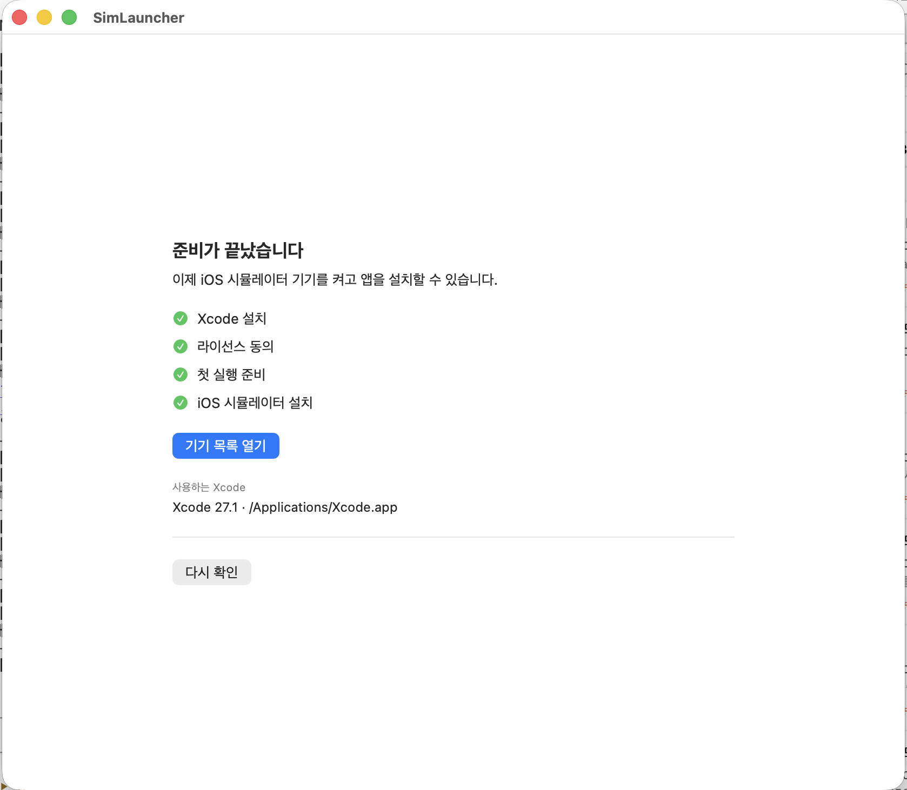

준비 상태가 궁금할 때는 언제든 기기 목록 오른쪽 위의 **개발 환경** 을 누르면 이 화면을 다시 볼 수 있어요.

### 기기 목록에 이런 안내가 보이면
Xcode 만 준비되어 있으면 iOS 시뮬레이터가 없어도 기기 목록이 바로 열려요. 이때 목록에 아래 안내가 보일 수 있어요.

| 안내 | 이렇게 하세요 |
|---|---|
| "표시할 iPhone·iPad 시뮬레이터가 없습니다" | 기기가 하나도 없는 상태예요. 화면의 **기기 만들기** 나 오른쪽 위 **+** 로 기기를 만드세요. |
| "iOS 시뮬레이터가 설치되어 있지 않습니다" | 기기도 iOS 시뮬레이터도 없는 상태예요. **iOS 설치** 를 누르면 개발 환경 화면이 열려요. 거기서 **iOS 시뮬레이터 설치** 를 누르세요. |
| "만들 수 있는 iPhone·iPad 기기 종류가 없습니다" (기기가 남아 있으면 목록 위에 "지금 이 Mac 에서 만들 수 있는 iPhone·iPad 기기 종류가 없습니다…" 로 보여요) | 설치된 iOS 시뮬레이터로 만들 수 있는 iPhone·iPad 기종이 없어(또는 쓸 수 있는 iOS 시뮬레이터가 없어) 새 기기를 만들 수 없는 상태예요. 이때는 오른쪽 위 **+** 도 꺼져 있어요. **다른 iOS 버전 설치** 를 눌러 열린 개발 환경 화면에서 지금 Xcode 의 기본 iOS 를 설치하거나, Xcode 를 최신 버전으로 업데이트한 뒤 목록을 새로 고치세요. |

## 사용법
기기 목록에는 iPhone·iPad 시뮬레이터 기기가 iOS 버전별로 모여 있어요. 각 줄 오른쪽에 그 기기에서 쓸 수 있는 버튼이 있어요.

### 기기 켜고 끄기
줄에서 **켜기** 를 누르면 기기가 켜지고, Simulator 앱 창에 iPhone·iPad 화면이 나타나요. 다 썼으면 **끄기** 를 누르세요.

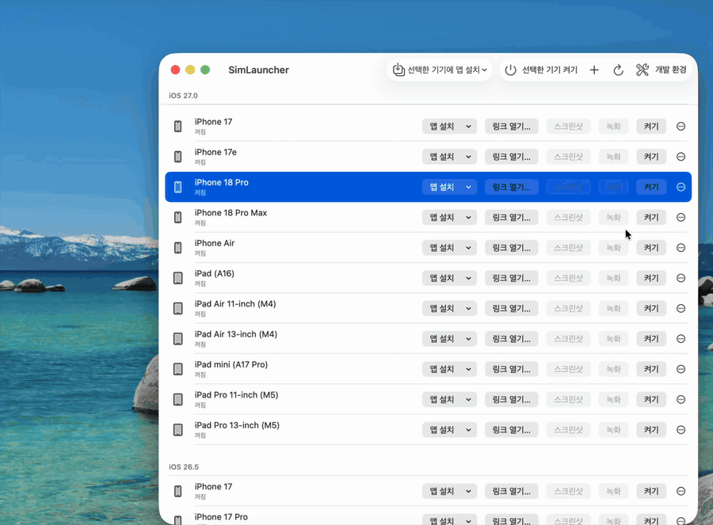

### 새 기기 만들기
원하는 기종이 목록에 없다면 오른쪽 위 **+**(기기 만들기)를 누르세요. 이름, iOS 버전(이 Mac 에 설치된 버전 중에서), 기기 종류를 고르고 **만들기** 를 누르면 돼요. 목록이 열려 있는데 **+** 가 계속 꺼져 있다면 지금 만들 수 있는 기종이 없는 거예요. [기기 목록에 이런 안내가 보이면](#기기-목록에-이런-안내가-보이면)을 보세요.

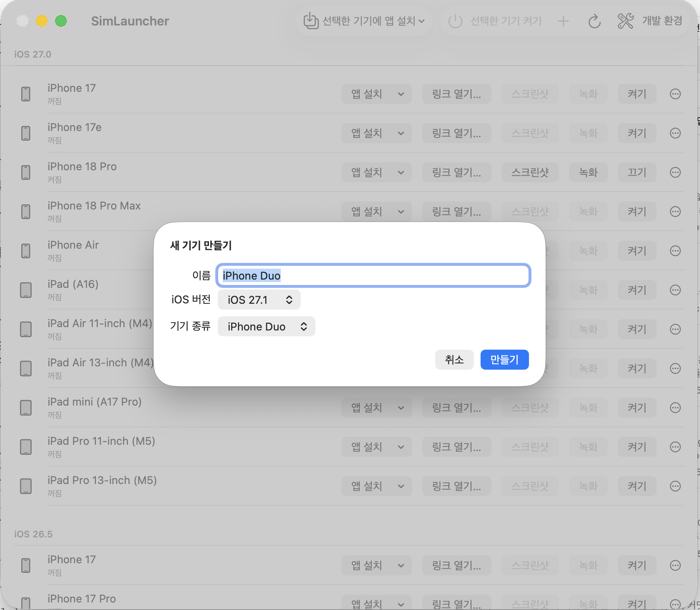

### 기기 초기화하거나 지우기
줄 끝의 **…**(기기 작업) 메뉴에서 고를 수 있어요.
- **초기화…**: 설치한 앱과 데이터, 설정을 모두 지우고 처음 산 것 같은 상태로 되돌려요.
- **삭제…**: 기기를 목록에서 아예 없애요.

둘 다 되돌릴 수 없어서 한 번 더 확인을 받아요. 그리고 기기를 끈 상태에서만 할 수 있어요. "사용할 수 없음" 기기는 초기화할 수 없고 삭제만 할 수 있어요.

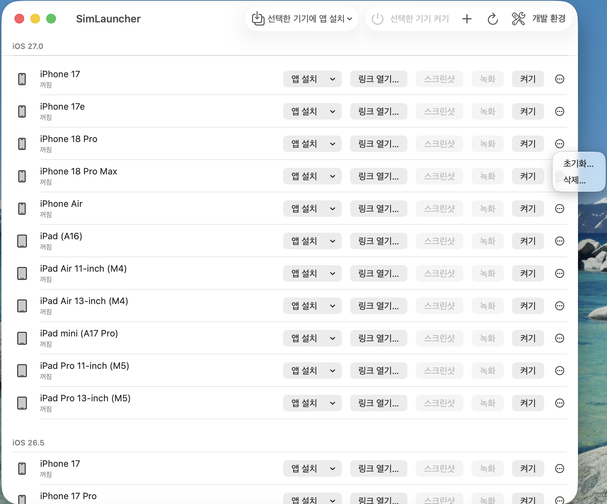

### 앱 설치하고 실행하기
줄의 **앱 설치** 메뉴에서 앱을 어디서 가져올지 고르세요. 기기가 꺼져 있어도 알아서 켜고, 설치가 끝나면 앱을 바로 실행해 줘요.

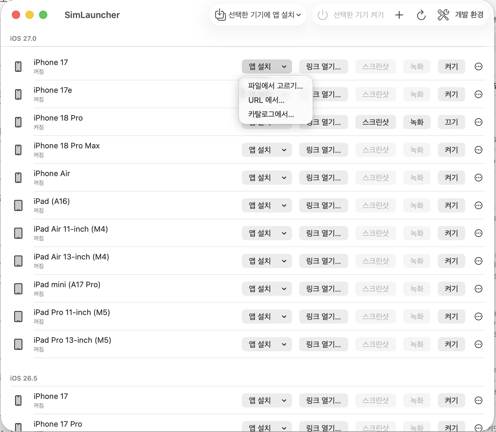

- **파일에서 고르기…**: Mac 에 받아 둔 앱 파일(.app 이나 그 .app 을 압축한 zip)을 골라요. 파일을 기기 줄 위로 끌어다 놓아도 돼요.
- **URL 에서…**: 개발자에게 받은 zip 파일의 `https://` 주소를 붙여 넣고 **받아서 설치** 를 누르세요. 받는 동안 줄에 진행률이 보이고, 언제든 취소할 수 있어요. 로그인해야 받을 수 있는 주소는 쓸 수 없어요.

  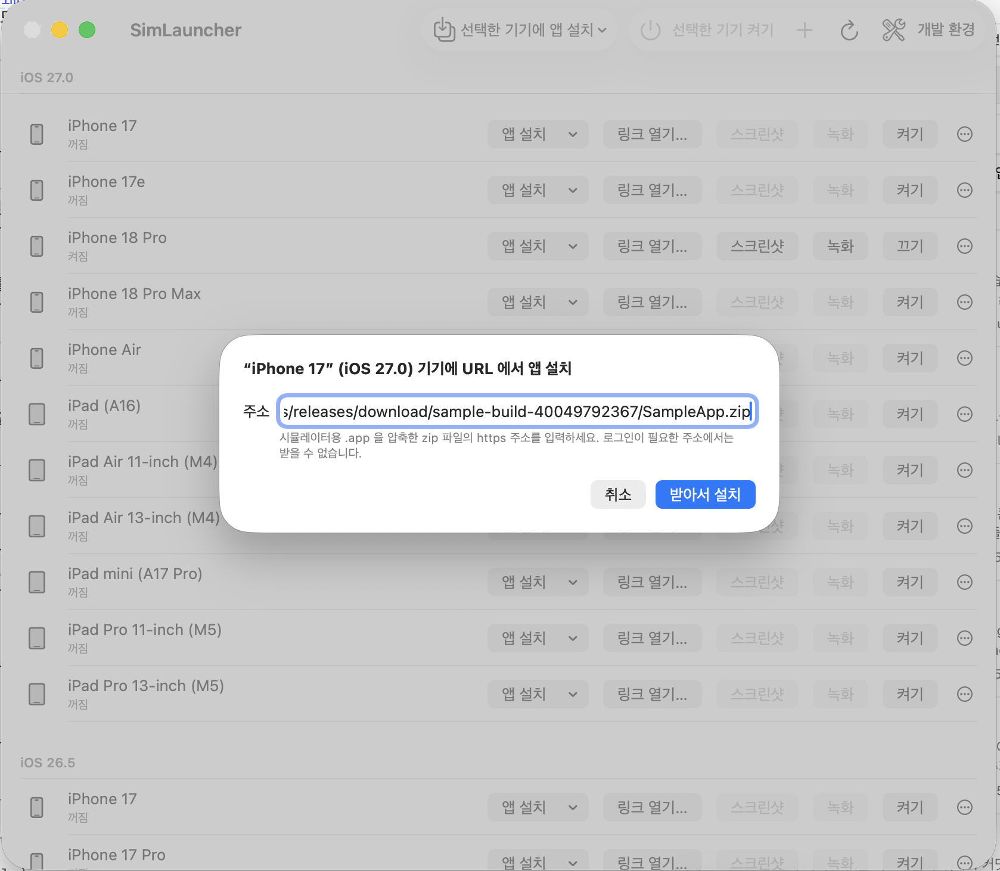

- **카탈로그에서…**: 회사에서 올려 둔 [빌드 목록](#회사-빌드-목록-연결하기)에서 앱과 버전을 골라 **받아서 설치** 를 누르면 돼요. 주소를 매번 입력하지 않아도 돼서 가장 편해요.

  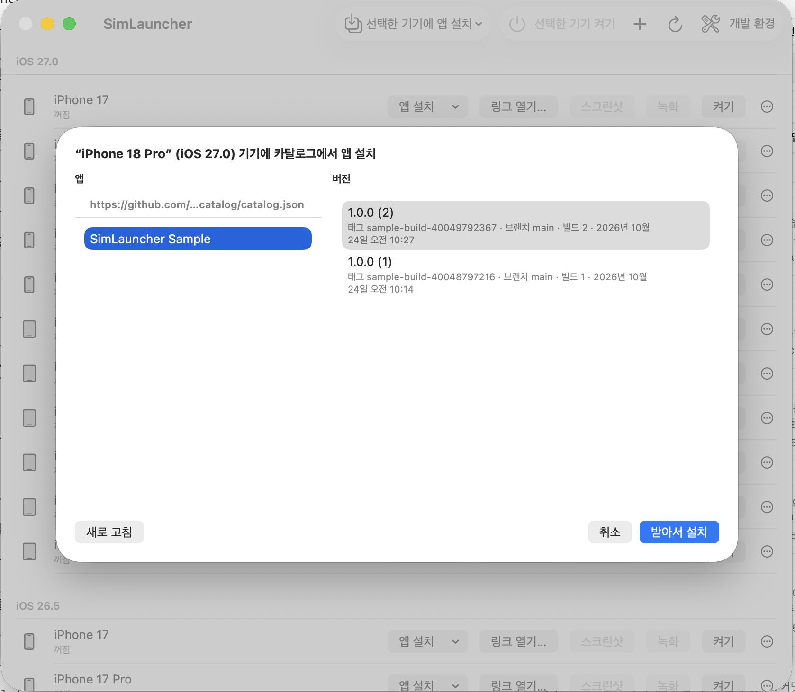

  

> **어떤 파일을 받아야 하나요?** iPhone 에 설치하는 `.ipa` 파일이나 Mac 용 앱은 시뮬레이터에 설치할 수 없어요. 개발자에게 "**시뮬레이터용으로 빌드한 .app**(또는 그 zip)을 주세요" 라고 요청하세요.

### 설치한 앱 실행하기
기기에 이미 설치해 둔 앱을 다시 실행하려면 줄의 **앱 실행…** 을 누르세요. 그 기기에 직접 설치한 앱 목록(이름·번들 ID·버전)이 뜨고, 하나를 골라 **실행** 을 누르면 로그를 받으며 실행해요. 기기가 꺼져 있으면 목록 창이 열린 채로 기기를 먼저 켜요. 이미 실행 중인 앱이면 끄고 다시 띄워요.

- SimLauncher 를 껐다 켜서 **로그 보기** 가 흐리게 바뀌었을 때, 앱을 다시 설치하지 않고 이것으로 실행하면 다시 로그를 볼 수 있어요.
- 기기에 처음부터 들어 있는 앱(설정·Safari 등)은 목록에 나오지 않아요. [레이아웃 보기](#화면-레이아웃-보기)가 기기에 잠시 설치하는 `SimLauncherLayout-Runner` 도 나오지 않아요.

### 링크 열기
앱의 특정 화면으로 바로 가는 링크(딥링크, 예: `myapp://item/1`)나 웹 주소를 기기에서 열어 볼 수 있어요. 줄의 **링크 열기…** 를 누르고 링크를 입력한 뒤 **열기** 를 누르세요. 기기가 꺼져 있으면 켜고 열어요.

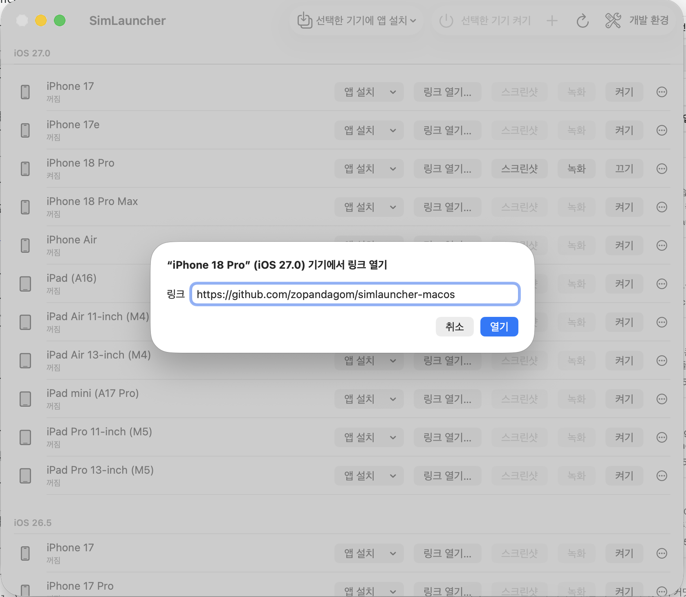

### 앱 로그 보기
SimLauncher 로 앱을 설치하고 실행하거나(여러 기기에 한 번에 설치할 때도) [**앱 실행…**](#설치한-앱-실행하기) 으로 실행하면 앱이 남기는 로그(`print`·`NSLog`·`Logger`)를 받아 두고, 그 기기 줄의 **로그 보기** 를 누를 수 있어요(그 전에는 흐리게 보여요). 누르면 그 기기의 로그 창이 열리고, 실행한 때부터의 로그가 실시간으로 쌓여요. Android 기기도 같아요: 설치 후 실행하거나 **앱 실행…** 으로 실행한 앱의 logcat 을 받아요([Android 앱 설치하고 실행하기](#android-앱-설치하고-실행하기)).

- 창을 닫아도 로그는 계속 받아요. 다시 **로그 보기** 를 누르면 닫은 동안의 로그까지 이어서 보여요. 기기마다 창은 하나예요.
- 한 기기에서 여러 앱을 실행했거나 같은 앱을 다시 설치·실행했으면 창 위쪽에서 볼 실행을 골라요.
- 앱이 끝나거나 기기가 꺼지면 창에 끝난 이유와 **다시 실행** 이 보여요. 다시 실행은 켜진 기기에서만 돼요(꺼진 기기는 켜지 않고 알려 드려요).
- **필터**: **포함**(그 글자가 든 줄)·**시작**(그 글자로 시작하는 줄. `Logger`·`NSLog` 줄은 앞의 날짜·앱 이름 다음부터, Android 줄은 앞의 날짜·번호·레벨 다음의 태그부터 봐요)·**정규식** 중에서 골라 조건을 넣어요. 조건을 여러 개 넣으면 하나라도 맞는 줄이 보이고, **제외** 를 켠 조건이 맞는 줄은 숨겨요. 맞은 부분은 강조되고, 아래에 보이는 줄 수와 전체 줄 수가 나와요. 여러 줄로 찍은 `print` 는 줄마다 따로 걸러져요.
- **저장된 필터**: 필터 줄 **조건 더하기** 옆 **저장된 필터** 메뉴에서 **지금 필터 저장…** 을 누르고 이름(40자까지)을 넣으면 지금 필터를 저장해요. 같은 이름(대소문자 무시)이 있으면 바꿀지 물어요. 메뉴에서 이름을 고르면 그 창의 필터가 저장한 필터로 통째로 바뀌고, **삭제** 에서 지울 수 있어요. 저장한 필터는 iOS·Android 모든 기기의 로그 창이 함께 써요. 50개까지 저장할 수 있고, 50개가 되면 같은 이름으로 바꾸기만 할 수 있어요. 새 로그 창은 빈 필터로 시작해요. 불러온 필터의 정규식을 읽을 수 없으면 그 조건 아래 알리고 바로 앞 결과를 보여요. 관리자가 필터를 미리 넣거나 잠그는 방법은 [docs/CATALOG.md 9절](docs/CATALOG.md#관리자가-미리-넣기)에 있어요.
- **일시정지** 하면 목록이 멈추고(그동안 온 줄 수만 보여요), **따라가기** 를 켜 두면 새 줄을 따라 맨 아래로 내려가요. **지우기** 는 지금까지 받은 줄을 창에서 지워요.
- 로그는 기기마다 최근 실행 5개, 실행마다 최근 5만 줄(또는 32 MiB)까지 보관하고, 파일로 저장하지 않아요. SimLauncher 를 종료하면 로그가 사라지고(묻지 않아요), iOS 는 로그를 받던 앱도 함께 꺼져요. Android 앱은 꺼지지 않고 그대로 남아요. 기기의 홈 화면에서 직접 켠 앱의 로그는 받지 않아요. 다시 보려면 **앱 실행…** 으로 실행하세요.
- 로그를 받으며 실행할 때는 이미 떠 있는 앱을 끄고 새로 띄워요(iOS·Android 모두).
- Android 는 앱의 메인 프로세스 로그만 보여요. 앱이 따로 띄운 프로세스(`android:process`)의 로그는 빠져요. 기기가 꺼지거나 연결이 끊기면 "기기가 꺼졌거나 연결이 끊겼습니다" 로 끝나요.

### 여러 기기에 한 번에
같은 앱을 여러 기기에서 확인하고 싶을 때 써요.
1. 목록에서 기기를 여러 대 고르세요. ⌘ 키를 누른 채 클릭하면 하나씩 더하고, ⇧ 키를 누른 채 클릭하면 사이에 있는 기기를 한꺼번에 골라요.
2. 위쪽 툴바에서 원하는 버튼을 누르세요.
   - **선택한 기기에 앱 설치**: 파일·URL·카탈로그 중 하나로 같은 앱을 고른 기기 모두에 설치하고 실행해요. 앱은 한 번만 내려받아요. 설치할 수 없는 기기는 건너뛰고, 실패한 기기는 이유와 함께 알림 하나로 모아서 알려 드려요.
   - **선택한 기기 켜기**: 고른 기기 중 꺼져 있는 기기를 한꺼번에 켜요.

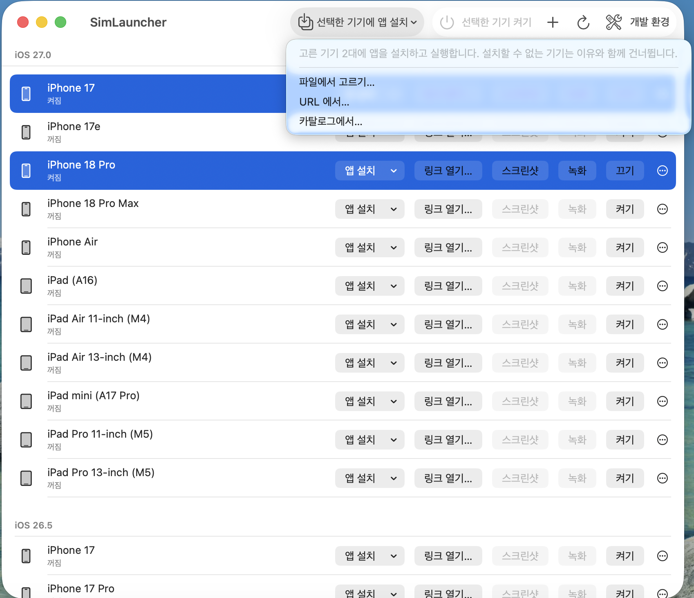


### 화면 찍기 (스크린샷)
켜진 기기 줄의 **스크린샷** 을 누르면 기기 화면을 PNG 로 저장하고 Finder 에서 바로 보여 줘요. 파일은 **사진** 폴더 안의 `SimLauncher` 폴더에 모여요.

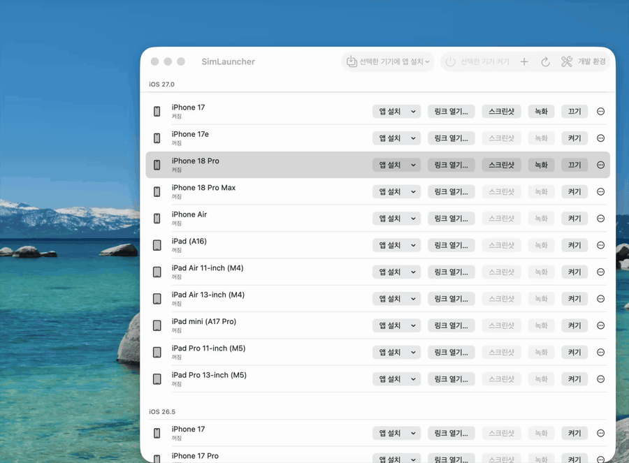

### 화면 녹화하기
켜진 기기 줄의 **녹화** 를 누르면 녹화가 시작되고, 줄에 녹화 시간과 **중지** 버튼이 보여요. **중지** 를 누르면 **동영상** 폴더 안의 `SimLauncher` 폴더에 저장하고 Finder 에서 보여 줘요.

- 녹화하는 동안에는 그 기기를 끄거나 초기화·삭제할 수 없어요.
- 녹화 중에 SimLauncher 를 종료하면, 녹화를 저장하고 종료할지 먼저 물어봐요.

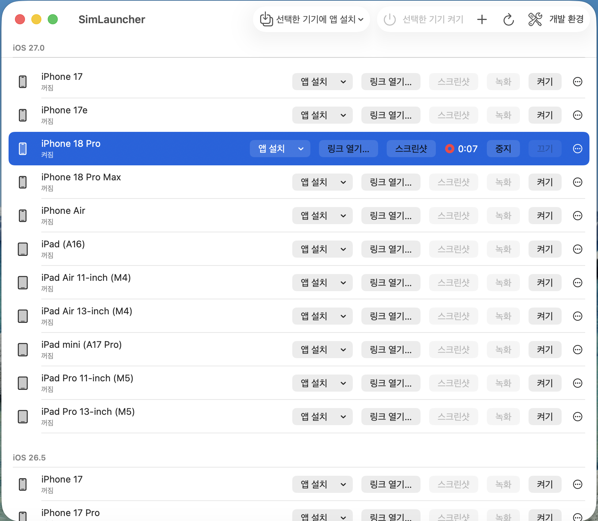

### 화면 레이아웃 보기
디자이너가 개발 도구 없이 실제 앱 화면의 뷰 위치·크기를 확인할 수 있어요. 켜진 기기 줄의 **레이아웃 보기** 를 누르면 그 기기의 레이아웃 창이 열리고, 지금 화면의 스크린샷 위에 뷰마다 얇은 테두리가 그려져요. 같은 기기는 창이 하나라 다시 누르면 열린 창이 앞으로 와요. Android 기기도 같은 창을 써요([Android 화면 레이아웃 보기](#android-화면-레이아웃-보기)).

- **처음 한 번은 준비에 1~2분** 걸려요("iOS 레이아웃 보기를 준비하고 있습니다" 가 보여요). SimLauncher 가 Mac 에서 화면 정보를 읽는 작은 테스트 앱(`SimLauncherLayout-Runner`)을 빌드해 기기에 설치하고 띄워요. 그다음부터는 1~2초 안에 읽어요. 테스트 앱이 멈춘 뒤(레이아웃을 10분 동안 읽지 않았을 때, 기기를 끄거나 다시 켰을 때)와 Xcode 를 바꾸거나 업데이트한 뒤에는 다시 준비해요(몇 초에서 1분 남짓).
- iOS 17 이상 기기에서만 쓸 수 있어요. 그보다 낮은 iOS 기기는 **레이아웃 보기** 가 꺼지고, 버튼에 마우스를 올리면 이유가 보여요.
- 화면을 클릭하면 그 자리의 가장 안쪽(가장 작은) 뷰가 강조되고, 오른쪽 **이 위치의 뷰** 목록에 그 자리를 덮는 뷰가 바깥→안쪽 순서로 보여요. 목록에서 다른 뷰를 고를 수도 있어요.
- 아래 **속성** 에 고른 뷰의 종류·식별자(accessibilityIdentifier)·텍스트·설명(접근성 label)과 x·y·너비·높이가 보여요. 값은 pt(포인트, 개발자가 화면을 짤 때 쓰는 단위)로 보이고 괄호 안에 화면 픽셀(px)이 함께 보여요.
- 실시간으로 따라가지 않아요. 기기에서 화면을 바꾼 뒤 **새로 고침** 을 누르세요. 새로 고치는 동안에는 이전 화면이 그대로 보이고, 새로 고친 뒤에도 클릭했던 자리의 뷰를 다시 골라 줘요.
- 앞에 앱이 없으면(홈 화면·잠금 화면·알림 창) 그 화면의 레이아웃이 보여요(안내가 함께 보여요). 이때는 상태 막대(시각·배터리 등)에도 테두리가 그려져요. 앱 화면에서는 상태 막대가 따로 잡히지 않고 앱의 위쪽 영역에 포함돼요. 키보드가 올라와 있으면 키보드에도 테두리가 그려질 수 있어요.
- 테스트 앱은 레이아웃을 마지막으로 읽고 10분이 지나거나, SimLauncher 에서 그 기기를 **끄거나**, SimLauncher 를 종료하면 저절로 멈추고 기기에서 지워져요(그래서 끄기·종료가 1~2초 늦어질 수 있어요). Simulator 앱 메뉴 등 SimLauncher 밖에서 기기를 끄면 홈 화면에 테스트 앱 아이콘이 남을 수 있는데, 그 기기를 다시 켜고 SimLauncher 기기 목록이 새로 읽으면 지워져요.
- 같은 기기에서 UI 테스트를 함께 돌리지 마세요. 둘 다 같은 방식으로 화면 정보를 읽어서 서로 방해할 수 있어요.
- 읽은 화면은 창에만 보이고 파일로 남기지 않아요. 창을 닫으면 사라져요. 빌드한 테스트 앱은 `~/Library/Caches/<SimLauncher 번들 ID>/LayoutRunner` 에 두어요(약 3 MB). 지워도 다음에 다시 빌드해요.
- 인터넷은 쓰지 않아요.

## Android 기기 쓰기
사이드바에서 **Android** 를 누르면 Android 칸이 열려요. 이 칸은 Xcode 와 상관없이 쓸 수 있어요.

### Android 도구 준비하기
Android 기기를 쓰려면 Android 도구 세 가지(플랫폼 도구 `platform-tools`, 에뮬레이터 `emulator`, 시스템 이미지 `system-images`)가 필요해요. Android 칸을 열면 SimLauncher 가 먼저 도구가 있는지 확인해요.

- 셋 다 설치되어 있으면 곧바로 Android 기기 목록이 열려요.
- 하나라도 없으면 "Android 도구를 설치하세요" 화면이 보여요. 도구마다 "설치됨"·"없음"·"쓸 수 없음" 과 설치할 위치(SDK 위치)가 보여요.

설치는 이렇게 해요.
1. **Android 도구 설치** 를 누르세요. SimLauncher 가 Google 서버에서 지금 받을 수 있는 도구 목록을 받아 와요.
2. "Android SDK 라이선스에 동의하세요" 창에서 받을 크기·설치 후 크기·필요한 저장 공간과 라이선스 원문을 확인하고 **동의하고 설치** 를 누르세요. 한 번 동의한 라이선스는 다시 묻지 않아요.

3. 없는 도구만 차례로 받아 설치해요. 몇 번째 도구를 받는 중인지와 진행률이 보이고, **취소** 로 멈출 수 있어요(이미 설치를 마친 도구는 남아요). 마무리하는 중에는 곧 끝나서 취소할 수 없어요. 창을 닫거나 iOS 칸으로 가도 설치는 계속돼요.

   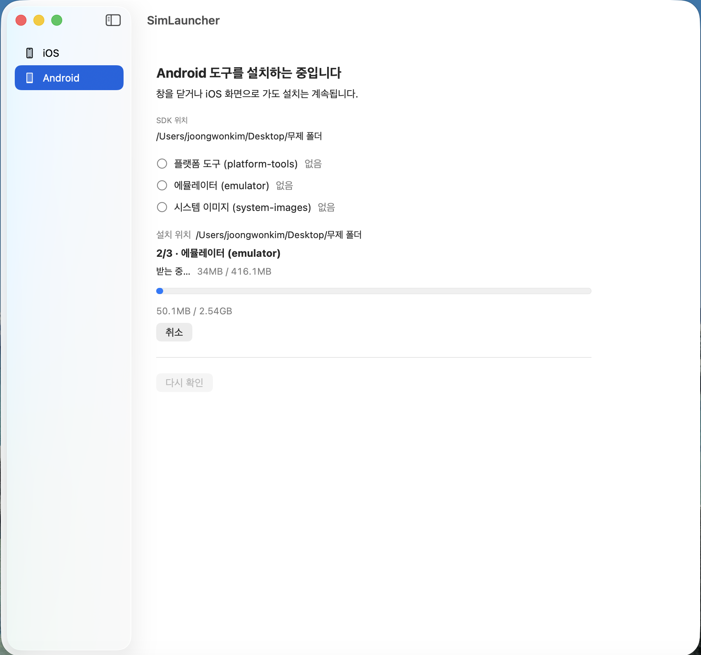

4. 설치가 끝나면 다시 확인한 결과가 보여요. **기기 목록 열기** 를 누르세요.

도구가 다 설치되지 않았어도 확인이 끝나면 **기기 목록 열기** 를 누를 수 있어요. 이때 목록에서는 꺼진 기기를 삭제하는 것만 할 수 있어요. 기기 목록에서 다시 이 화면으로 오려면 오른쪽 위 **Android 도구** 를 누르세요.

**SDK 위치**: 기본은 Android Studio 와 같은 `~/Library/Android/sdk` 예요. Android Studio 를 이미 쓰고 있다면 그 도구를 그대로 쓰고, 없는 것만 설치해요. 다른 곳(외장 디스크 등)에 두고 싶다면 메뉴 막대의 **SimLauncher > 설정…**(⌘,) 의 **Android SDK 위치** 에서 **다른 폴더 고르기…** 로 빈 폴더나 Android SDK 폴더를 고르세요. **기본 위치로 되돌리기** 로 되돌릴 수 있어요.

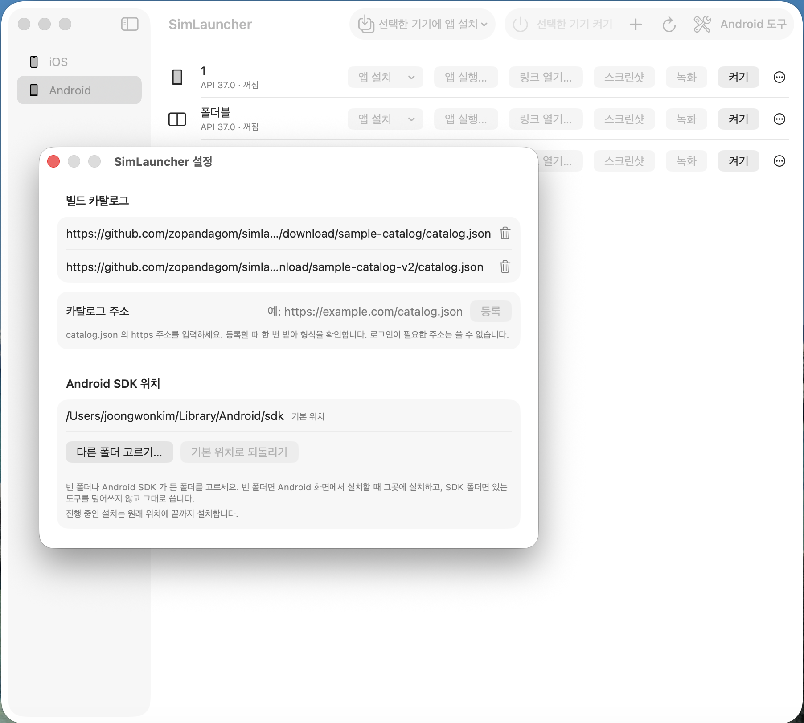

### Android 기기 목록
목록에는 Android 기기(에뮬레이터)가 줄마다 이름·Android 버전(API)·종류(휴대전화·태블릿·폴더블 아이콘)·상태와 함께 보여요. Android Studio 로 만든 기기도 함께 보여요.


- **켜기** / **끄기**: 켜면 에뮬레이터 창에 Android 화면이 나타나요. 처음 켤 때는 1분 안팎(길면 몇 분) 걸려요. 켜는 중에는 끌 수 없어요. 끄면 지금 상태를 저장해 두어서 다음에는 몇 초 만에 켜져요.
- **기기 만들기**: 오른쪽 위 **+** 를 누르고 이름(한글도 돼요), 시스템 이미지, 화면(휴대전화·작은 휴대전화·태블릿·폴더블)을 고른 뒤 **만들기** 를 누르세요. 폴더블은 폴더블 설정이 들어 있는 시스템 이미지로만 만들 수 있어요. 켠 폴더블은 에뮬레이터 창 도구 막대의 **Change posture** 로 접고 펼 수 있어요. 다른 크기·모양의 기기가 필요하면 Android Studio 의 기기 관리자(Device Manager)에서 만들면 이 목록에 보여요.

  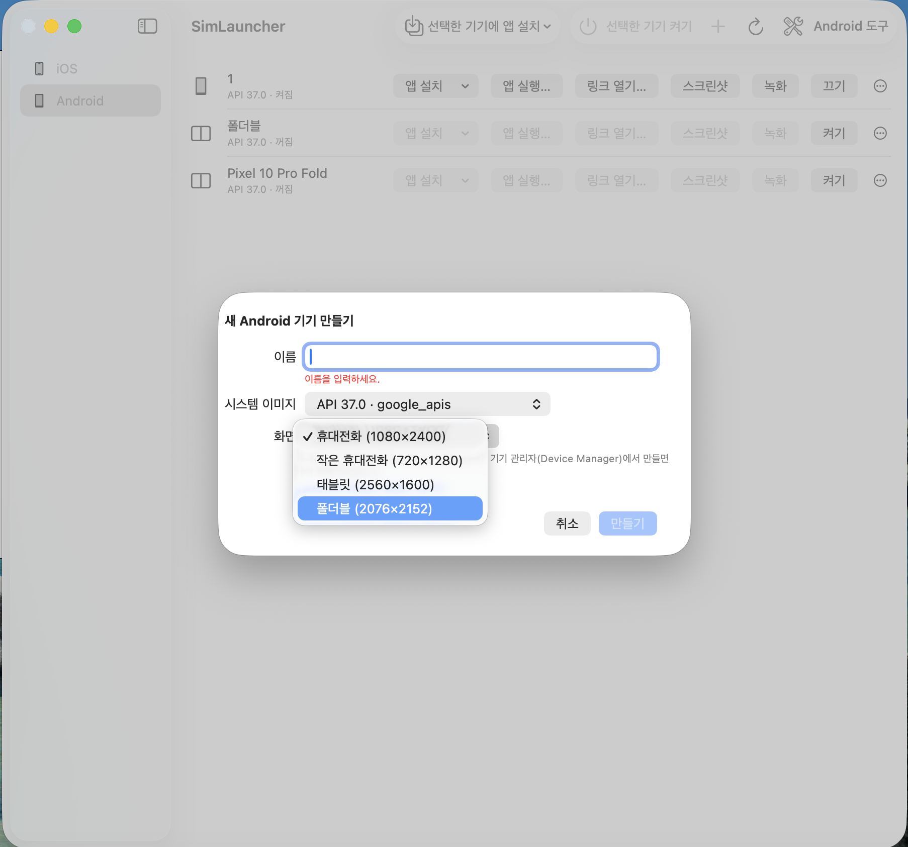

- **초기화…** / **삭제…**: 줄 끝 **…**(기기 작업) 메뉴에 있어요. 기기를 끈 상태에서만 할 수 있고, 되돌릴 수 없어서 한 번 더 확인을 받아요. 초기화하면 설치한 앱과 데이터가 지워지고 다음 켜기가 처음처럼 오래 걸려요. Android Studio 로 만든 기기도 지울 수 있으니 조심하세요.
- **"사용할 수 없음"**: 켤 수 없는 기기예요(이름에 영문·숫자·`. _ -` 밖의 문자가 있거나, 지금 SDK 위치에 그 시스템 이미지가 없거나, 이 Mac 에서 돌 수 없는 시스템 이미지 등). 줄에 이유가 보이고, 삭제만 할 수 있어요.
- SimLauncher 를 종료해도 켜 둔 Android 기기는 꺼지지 않아요.

### Android 앱 설치하고 실행하기
Android 기기에서는 **켜진 기기에만** 앱을 설치할 수 있어요. iOS 와 달리 꺼진 기기를 알아서 켜지 않으니, 먼저 **켜기** 를 누르고 다 켜질 때까지 기다리세요.

줄의 **앱 설치** 메뉴에서 앱을 어디서 가져올지 고르세요. 설치가 끝나면 앱을 바로 실행하고 로그를 받아요(이미 떠 있으면 끄고 새로 띄워요).

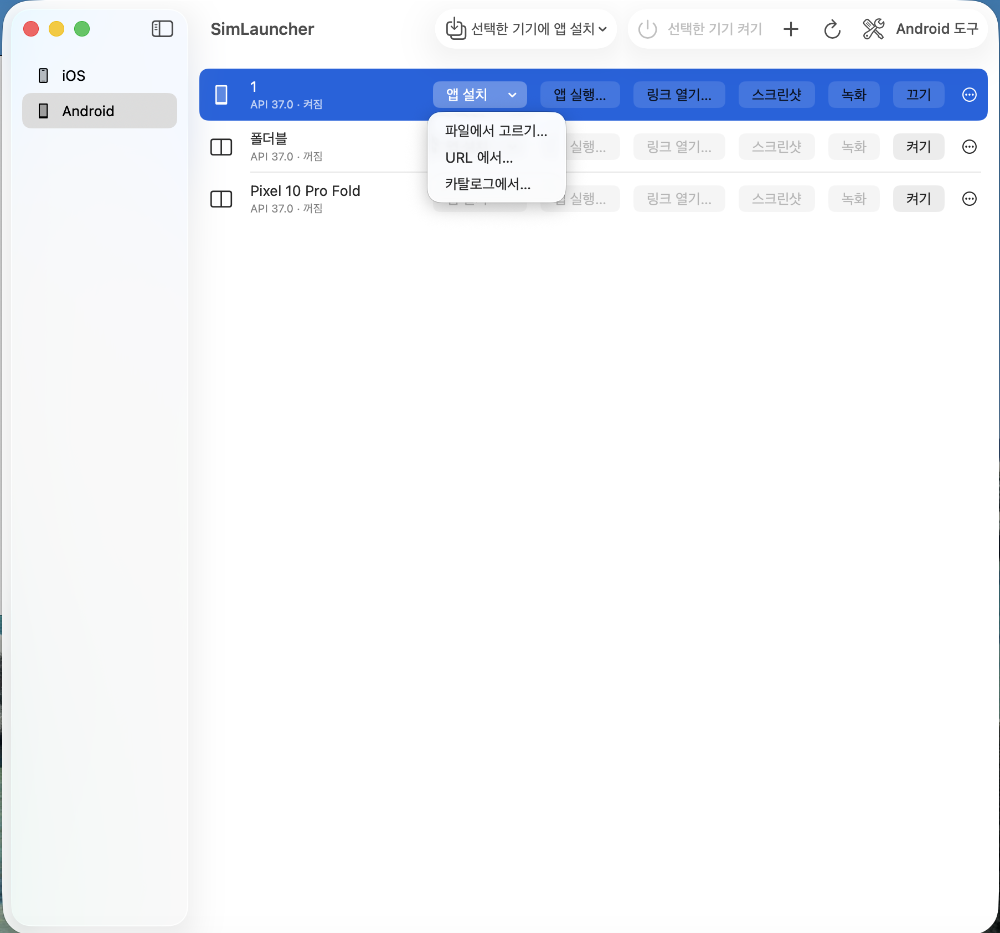

- **파일에서 고르기…**: Mac 에 받아 둔 `.apk` 파일을 골라요. 파일을 기기 줄 위로 끌어다 놓아도 돼요.
- **URL 에서…**: `.apk` 파일의 `https://` 주소를 넣고 **받아서 설치** 를 누르세요. 받는 동안 줄에 진행률과 취소 버튼이 보여요.
- **카탈로그에서…**: [빌드 목록](#회사-빌드-목록-연결하기)의 Android 앱에서 앱과 버전을 골라 **받아서 설치** 를 누르세요. 이 목록에는 Android 앱만 보여요.

같은 앱이 이미 있으면 덮어써요(이전 버전으로도 바꿀 수 있어요). 그 밖에 줄에서 이런 것도 할 수 있어요.
- **앱 실행…**: 이 기기에 설치한 앱 중 하나를 골라 로그를 받으며 실행해요. 이미 실행 중인 앱이면 끄고 다시 띄워요.
- **링크 열기…**: 딥링크(예: `myapp://item/1`)나 웹 주소를 이 기기에서 열어요.
- **로그 보기**: SimLauncher 로 이 기기에서 실행한 앱의 로그 창을 열어요([앱 로그 보기](#앱-로그-보기)). 실행하기 전에는 흐리게 보여요.
- **레이아웃 보기**: 켜진 기기 화면의 뷰 테두리와 위치·크기를 창에서 봐요([Android 화면 레이아웃 보기](#android-화면-레이아웃-보기)).

> **어떤 파일을 받아야 하나요?** 설치할 수 있는 건 `.apk` 파일 하나예요. Google Play 에 올리는 `.aab` 나 여러 apk 를 묶은 `.apks`·`.xapk`·`.apkm` 은 설치할 수 없어요. 개발자에게 "**설치용 .apk**(디버그 서명도 괜찮아요)를 주세요" 라고 요청하세요.

### Android 화면 찍기·녹화하기
켜진 기기 줄의 **스크린샷**·**녹화** 는 iOS 와 같아요([화면 찍기](#화면-찍기-스크린샷), [화면 녹화하기](#화면-녹화하기)). 스크린샷은 **사진** 폴더, 녹화는 **동영상** 폴더 안의 `SimLauncher` 폴더에 저장하고 Finder 에서 보여 줘요. Android 녹화는 `.mp4` 파일이에요.

- Android 13(API 33) 이하 기기는 녹화가 3분이 되면 스스로 멈추고 저장해요.
- 폴더블 기기의 화면이 꺼져 있으면 녹화를 시작할 수 없어요. 에뮬레이터 창의 전원 버튼으로 화면을 켠 뒤 다시 녹화하세요.
- 녹화하는 동안 에뮬레이터 창을 닫는 등 SimLauncher 밖에서 기기를 끄면 녹화를 저장하지 못해요. 녹화를 먼저 멈춘 뒤 끄세요.

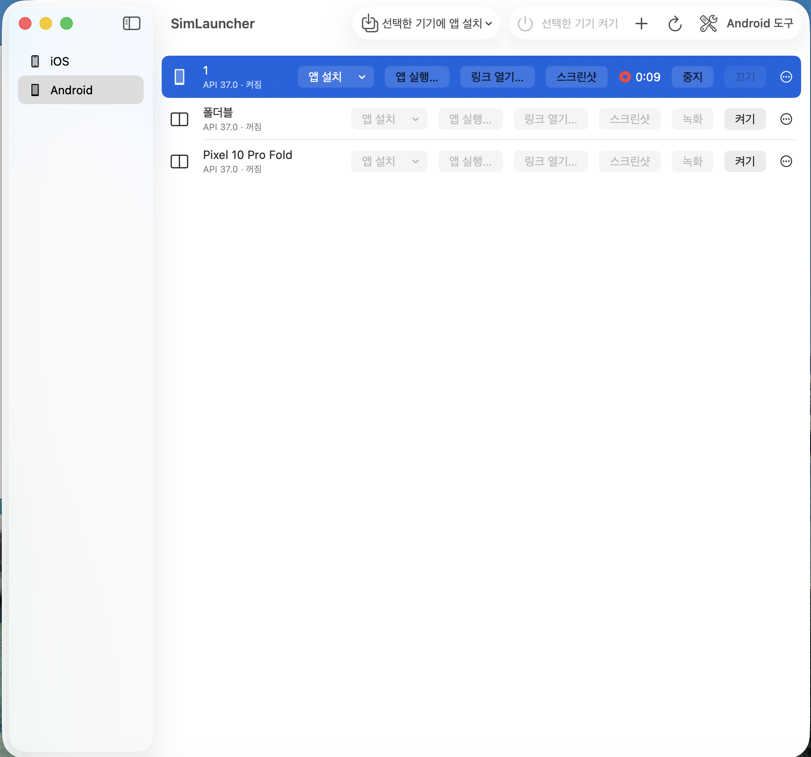

### Android 화면 레이아웃 보기
켜진 기기 줄의 **레이아웃 보기** 는 iOS 와 같은 창이에요([화면 레이아웃 보기](#화면-레이아웃-보기)). 클릭해 뷰 고르기·**새로 고침** 도 같아요. 준비 없이 몇 초 안에 읽어요. Android 에서 다른 점은 아래와 같아요.

- **속성** 에 고른 뷰의 종류(class)·식별자(resource-id)·텍스트·설명(content-desc)과 x·y·너비·높이가 보여요. 값은 dp 로 보이고 괄호 안에 화면 픽셀(px)이 함께 보여요.
- 화면이 계속 움직이면(애니메이션·동영상) 읽지 못해요. 화면이 멈춘 뒤 새로 고치세요. 화면이 꺼져 있으면 에뮬레이터 창의 전원 버튼으로 켠 뒤 새로 고치세요.
- 잠금 화면이나 알림 창이 앞에 있으면 그 화면의 레이아웃이 보여요(안내가 함께 보여요). 상태 막대·키보드에는 테두리가 그려지지 않아요.
- UI 테스트처럼 기기 화면 정보를 읽는 다른 자동화 도구가 돌고 있으면 레이아웃을 읽지 못해요. 반대로 레이아웃을 읽는 몇 초 동안 그런 도구를 시작하면 그 도구가 실패할 수 있어요.
- 읽은 화면은 창에만 보이고 파일로 남기지 않아요. 창을 닫으면 사라져요.

### 여러 Android 기기에 한 번에
iOS 와 같이 ⌘·⇧ 키를 누른 채 기기를 여러 대 고르고, 위쪽 툴바의 **선택한 기기에 앱 설치**(파일·URL·카탈로그) 나 **선택한 기기 켜기** 를 누르세요([여러 기기에 한 번에](#여러-기기에-한-번에)). 꺼진 기기에는 설치하지 않고 건너뛰니, 먼저 **선택한 기기 켜기** 로 켜 두세요.

### Android Studio 와 함께 쓸 때
SimLauncher 와 Android Studio 는 SDK 폴더(`~/Library/Android/sdk`)와 기기 폴더(`~/.android/avd`)를 함께 써요.
- SimLauncher 가 설치한 도구는 Android Studio 도 설치된 것으로 알아봐서, Studio 가 같은 도구를 다시 받지 않고 그대로 업데이트해요.
- 라이선스 동의는 SimLauncher 에만 기록돼요. 그래서 Android Studio 로 다른 도구를 설치할 때 Studio 가 라이선스 동의를 다시 물을 수 있어요.
- Android Studio 로 만든 기기도 SimLauncher 목록에 보여요. 반대로 SimLauncher 에서 기기를 지우면 Studio 에서도 없어져요.

## 회사 빌드 목록 연결하기
회사에서 테스트할 앱 빌드를 모아 둔 목록(**빌드 카탈로그**, `catalog.json` 파일)이 있다면 SimLauncher 에 한 번만 등록해 두세요. 그다음부터는 주소를 입력할 필요 없이 "카탈로그에서…" 목록에서 골라 설치할 수 있어요.

1. 메뉴 막대에서 **SimLauncher > 설정…** 을 여세요 (단축키 ⌘,).
2. **빌드 카탈로그** 의 "카탈로그 주소" 칸에 담당자에게 받은 `https://` 주소를 넣고 **등록** 을 누르세요.
3. SimLauncher 가 주소를 한 번 받아서 올바른 목록인지 확인해요. "등록했습니다. 앱 N개가 있습니다." 가 보이면 끝이에요.

카탈로그는 여러 개 등록할 수 있고, 필요 없어진 것은 휴지통 버튼으로 지우면 돼요.

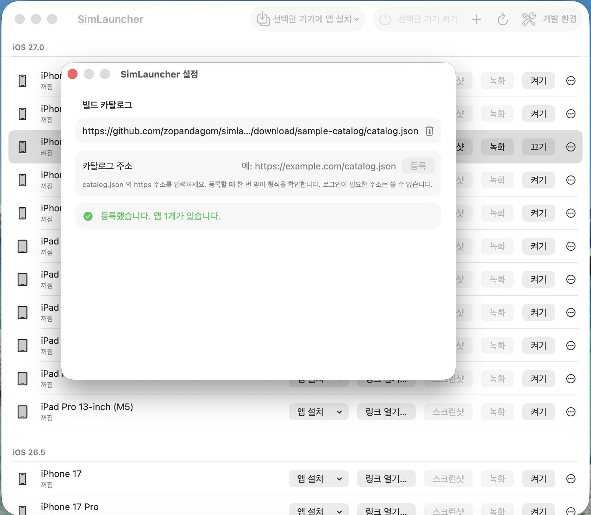

**먼저 체험해 보고 싶다면** 아래 샘플 카탈로그 주소를 등록해 보세요. iOS 기기에는 샘플 iOS 앱을, Android 기기에는 샘플 Android 앱을 설치해 볼 수 있어요. 이 주소는 SimLauncher 1.1.0 이상에서 쓸 수 있어요.

```
https://github.com/zopandagom/simlauncher-macos/releases/download/sample-catalog-v2/catalog.json
```

- 회사에서 카탈로그 목록을 미리 정해 두었다면 설정 창에 "관리자가 정한 목록이라 이 Mac 에서 바꿀 수 없습니다." 가 보이고, 직접 등록하거나 지울 수 없어요.
- 카탈로그를 만들어 올리는 분(개발자·관리자)은 [빌드 카탈로그 규격](docs/CATALOG.md)을 봐 주세요. 로그인 없이 받을 수 있는 `https://` 주소라면 GitHub Releases·S3·사내 웹 서버 어디에 두어도 돼요.

## 문제가 생겼을 때
문제가 생기면 SimLauncher 가 알림이나 안내 문구로 이유와 해결 방법을 함께 알려 드려요. 자주 만나는 경우를 모았어요.

| 이럴 때 | 이렇게 해 보세요 |
|---|---|
| 기기가 켜지지 않아요 | 오른쪽 위 **개발 환경** 을 눌러 Xcode 준비 상태를 확인하세요. 그래도 안 되면 Mac 을 재시동해 보세요. |
| 기기 목록이 비어 있거나 목록 위에 안내가 떠요 | 안내 문구에 따라 [기기 목록에 이런 안내가 보이면](#기기-목록에-이런-안내가-보이면)을 보고 따라 하세요. |
| 기기 줄에 "사용할 수 없음" 이라고 떠요 | 그 기기에 필요한 iOS 버전이 이 Mac 에 없거나, 지금 Xcode 가 그 기종을 지원하지 않는 경우예요. SimLauncher 는 지금 Xcode 의 기본 iOS 만 설치할 수 있어요. 필요한 버전이 그 기본 버전이라면 **개발 환경** 에서 설치하면 다시 쓸 수 있어요. 그렇지 않다면 다른 기기를 쓰거나 새 기기를 만들어 쓰세요 (**+** 가 계속 꺼져 있으면 [기기 목록에 이런 안내가 보이면](#기기-목록에-이런-안내가-보이면)을 보세요). 이 기기는 초기화할 수 없고, 쓸 일이 없다면 기기 작업 메뉴에서 삭제할 수 있어요. |
| "iOS 시뮬레이터용 빌드가 아닙니다", ".ipa 파일은 설치할 수 없습니다" 가 떠요 | 개발자에게 시뮬레이터용으로 빌드한 .app(또는 그 zip)을 요청하세요. |
| "이 앱은 iOS … 이상에서 실행됩니다" 가 떠요 | 더 높은 iOS 버전의 기기에 설치하세요. 새 기기는 이 Mac 에 설치된 iOS 버전으로만 만들 수 있어요. 맞는 버전이 없다면 **개발 환경** 에서 지금 Xcode 의 기본 iOS 를 설치하고, 그 버전이 충분히 높으면 그걸로 새 기기를 만드세요. 기본 iOS 보다 높은 버전이 필요하다면 Xcode 를 업데이트해야 해요. |
| "zip 맨 위에 .app 이 없습니다" / "여러 개 있습니다" 가 떠요 | .app 하나만 바로 압축한 zip 이어야 해요. 파일을 준 분께 알려 주세요. |
| 앱이나 카탈로그를 받지 못해요 ("서버 주소를 찾지 못했습니다", "서버에 연결하지 못했습니다") | 주소 철자를 확인하세요. 회사 안에서만 열리는 주소라면 사내망(VPN 등)에 연결되어 있는지 확인하세요. |
| "서버가 로그인이나 접근 권한을 요구해 받지 못했습니다" 가 떠요 | 로그인이 필요한 주소는 쓸 수 없어요. 로그인 없이 받을 수 있는 주소를 담당자에게 요청하세요. |
| "https:// 로 시작하는 주소만 …" 이 떠요 | `http://` 주소는 쓸 수 없어요. `https://` 주소를 써 주세요. |
| 카탈로그가 "형식이 맞지 않아 읽지 않았습니다", "카탈로그(JSON 객체)로 읽지 못했습니다" 라고 해요 | 주소가 로그인 페이지 같은 웹 페이지가 아니라 `catalog.json` 파일을 바로 가리키는지 확인하세요. 주소가 맞다면 카탈로그를 만든 분께 알려 주세요. |
| "이 카탈로그는 이 앱보다 새 규격 …" 이라고 해요 | SimLauncher 를 [최신 버전](https://github.com/zopandagom/simlauncher-macos/releases/latest)으로 업데이트하세요. |
| 설치 뒤 "앱이 시작되지 않았거나 시작하자마자 종료되었습니다" 가 떠요 | 시뮬레이터 화면에서 앱 아이콘을 눌러 다시 실행해 보세요. 계속 그렇다면 앱 개발자에게 알려 주세요. |
| 기기를 끄거나 초기화·삭제할 수 없어요 | 녹화 중이라면 녹화를 먼저 멈춰 주세요. 초기화·삭제는 기기를 끈 뒤에 할 수 있어요. "사용할 수 없음" 기기는 초기화할 수 없고 삭제만 할 수 있어요. |
| 레이아웃 창에 "iOS 레이아웃 보기를 준비하지 못했습니다" 나 "Xcode 가 준비되지 않아…" 가 떠요 | 오른쪽 위 **개발 환경** 을 눌러 Xcode 설치·라이선스 동의·첫 실행 준비가 끝났는지 확인하세요. 기기가 다 켜진 뒤 레이아웃 창의 **다시 시도** 를 누르세요. |

받기·카탈로그 문제(위 표의 주소·로그인·https·카탈로그 형식 줄)는 Android 에서도 같아요. Android 에서만 만나는 경우는 아래와 같아요.

| 이럴 때 (Android) | 이렇게 해 보세요 |
|---|---|
| 도구 줄에 "쓸 수 없음" 이라고 떠요 | 그 도구 폴더가 망가져 있어요. SimLauncher 는 이미 있는 폴더를 덮어쓰지 않아요. 설정(⌘,)의 **Android SDK 위치** 에서 빈 폴더를 골라 다시 설치하거나, Android Studio 의 SDK Manager 로 그 도구를 다시 설치하세요. |
| "SDK 폴더를 쓸 수 없습니다", "이 디스크 형식(exFAT 등)에는 설치할 수 없습니다" 가 떠요 | 설정(⌘,)의 **Android SDK 위치** 에서 쓸 수 있는 다른 폴더(APFS 나 Mac OS 확장 디스크)를 고르세요. |
| Android 기기가 켜지지 않거나 켜다가 멈춰요 | Mac 의 저장 공간과 메모리를 확인하고 다른 Android 기기를 꺼 보세요. 켜는 도중에 에뮬레이터 창을 닫아 끈 적이 있다면 **…** 메뉴의 **초기화…** 로 되돌릴 수 있어요. |
| 목록에 "만들 수 있는 시스템 이미지가 없습니다", "Android 도구를 찾지 못했습니다" 가 떠요 | 오른쪽 위 **Android 도구** 를 눌러 도구 상태를 확인하고, 없는 도구를 설치하세요. |
| **앱 설치**·**앱 실행…**·**링크 열기…** 가 꺼져 있어요 | 켜진 기기에서만 쓸 수 있어요. 기기를 켜고 다 켜질 때까지 기다리세요. |
| ".aab(App Bundle) 파일은 기기에 바로 설치할 수 없습니다", "여러 apk 를 묶은 파일…", "서명되지 않은 apk…" 가 떠요 | 개발자에게 서명된 설치용 `.apk`(디버그 서명도 돼요)를 요청하세요. |
| "기기에 서명이 다른 같은 앱이 이미 있습니다" 가 떠요 | 다른 컴퓨터나 다른 키로 서명한 같은 앱이 기기에 있어요. 기기에서 그 앱 아이콘을 길게 눌러 지운 뒤 다시 설치하세요. 그 앱의 데이터도 함께 지워져요. |
| "이 앱은 이 기기보다 높은 Android API 에서 실행됩니다" 가 떠요 | 더 높은 API 의 시스템 이미지로 기기를 만들어 설치하세요. |
| "이 앱에는 이 기기에서 실행할 코드가 없습니다" 가 떠요 | 이 Mac 의 기기에서 돌 수 있는 코드(ABI)가 빠진 apk 예요. 개발자에게 알려 주세요. |
| "기기의 저장 공간이 부족합니다" 가 떠요 | 기기에서 쓰지 않는 앱을 지우거나 기기를 초기화한 뒤 다시 설치하세요. |

## 인터넷은 언제 쓰나요?
SimLauncher 는 아래 다섯 가지 경우에만 인터넷을 써요.
- 등록한 빌드 카탈로그(`catalog.json`)를 받을 때
- 고르거나 입력한 주소에서 앱 빌드(iOS 는 .app 또는 .app 을 담은 zip, Android 는 .apk)를 받을 때
- 설치하기로 고른 iOS 시뮬레이터를 Apple 서버에서 받을 때
- Android 도구(SDK)를 설치하기로 골랐을 때 Google 의 Android SDK 저장소에서 받을 때
- Android 기기를 켤 때, 그리고 에뮬레이터 창의 지도 같은 기능을 쓸 때 Android 에뮬레이터가 스스로 Google 서버에서 업데이트 정보와 설정을 받을 때 (SimLauncher 가 끌 수 없어요. 사용 통계·오류 보고는 꺼요)

에뮬레이터 안의 Android 는 실제 기기처럼 인터넷을 써요 (테스트하는 앱과 Android 의 Google 서비스). SimLauncher 가 보내는 데이터는 아니에요.

---

## 개발자 안내
SimLauncher 는 공개 레포라서, 어느 회사든 자기 빌드 저장소에 맞춰 쓸 수 있어요.

### 기술 스택
- SwiftUI (규칙 기반 단방향 MV), Swift 6 strict concurrency, macOS 26.0+
- Tuist 모듈러 아키텍처 (Feature / Client Interface·Impl·Testing / Shared)
- Foundation `Process` 로 `xcrun simctl`·Android `emulator`·`adb` 등 실행 (Command Client Impl)
- Foundation `URLSession` 으로 카탈로그·빌드 다운로드와 Android SDK 저장소 목록·패키지 받기 (Download Client Impl. Android SDK 설치는 AndroidSDK Client Impl 이 Download Client 를 거쳐 받는다)
- Foundation `UserDefaults` 로 사용자 설정(카탈로그 주소, Android SDK 위치, Android SDK 라이선스 동의 기록) 저장 (Preferences Client Impl)
- AppKit `NSWorkspace` 로 Finder 에서 보이기, Foundation `FileManager` 로 사진·동영상 폴더에 스크린샷·녹화 저장 폴더 준비·파일 이름 예약 (Workspace Client Impl)

### 시작하기
```bash
make bootstrap   # mise 로 tuist·swiftlint·swiftformat·xcbeautify 설치, git 훅(pre-commit: main 커밋 차단·String Catalog stale 표시 차단·lint, pre-merge-commit: main 머지 커밋 차단, pre-push: main push 차단) 연결
make generate    # SimLauncher.xcworkspace 생성 후 Xcode 로 열기
make test        # 전체 모듈 빌드 + 테스트 + git 훅 테스트
make test-hooks  # git 훅 동작 테스트만 (임시 레포에서 main 커밋·머지 커밋·push 차단, String Catalog stale 표시 커밋 차단과 기능 브랜치 통과 확인)
make lint        # 포맷·아키텍처 규칙 검사 (make format 으로 자동 수정)
make sample      # 샘플 iOS 앱을 시뮬레이터용으로 빌드해 build/SampleApp.zip 으로 묶기 (SAMPLE_BUILD_NUMBER=42 로 빌드 번호)
make catalog-check CATALOG=catalog.json   # catalog.json 하나를 앱과 같은 규칙으로 검사
make catalog-test  # 샘플 카탈로그 생성기·검증기 회귀 테스트
make layout-runner-check  # iOS 레이아웃 러너 소스를 내보내 실제로 빌드해 보기 (러너 소스·Xcode 를 바꿀 때, make test·CI 밖)
make release     # 서명·공증 dmg 만들기 (준비: docs/RELEASING.md)
```

### 샘플 카탈로그 운영
레포의 GitHub Actions 예시 워크플로가 샘플 iOS·Android 앱을 빌드해 Releases 에 올리고 카탈로그를 만들어요 ([주소는 위](#회사-빌드-목록-연결하기)).

- 새 빌드 올리기: Actions > Sample Catalog > Run workflow 를 **main 에서** 실행하세요. 워크플로 파일이 main 과 다른 브랜치에서 실행하면 GitHub 이 릴리스 생성을 거절해요. 이때 draft 릴리스가 남을 수 있는데, 카탈로그에는 영향이 없으니 손으로 지우면 돼요.
- 동작, 자기 앱에 맞게 바꿀 곳, 다시 실행·정리하는 방법: [CATALOG.md 11절](docs/CATALOG.md#11-github-actions-예시)

### 문서
- [아키텍처](docs/ARCHITECTURE.md)
- [개발 규칙: 해야 할 것 / 하지 말아야 할 것](docs/CONVENTIONS.md)
- [개발 계획과 로드맵](docs/DEVELOPMENT_PLAN.md)
- [빌드 카탈로그 규격](docs/CATALOG.md)
- [배포(서명·공증)](docs/RELEASING.md)
- [Claude Code 작업 안내](CLAUDE.md)

이 프로젝트는 [ios-harness](https://github.com/zopandagom/ios-harness) 템플릿으로 만들었어요 (`.harness-version`).

## 라이선스
[MIT](LICENSE)
