# SimLauncher

**iPhone·iPad 가 없어도 Mac 하나로 개발 중인 iOS 앱을 써 볼 수 있어요.**

SimLauncher 는 Mac 에서 iPhone·iPad 시뮬레이터(가상 기기)를 켜고, 개발자에게 받은 앱 빌드를 설치해 바로 실행해 주는 앱이에요. 터미널이나 Xcode 를 다룰 줄 몰라도 괜찮아요. Xcode 를 설치하고 처음 한 번 준비하는 과정은 앱이 단계별로 안내하고, 그다음부터는 버튼 몇 번으로 앱을 설치하고 확인할 수 있어요.

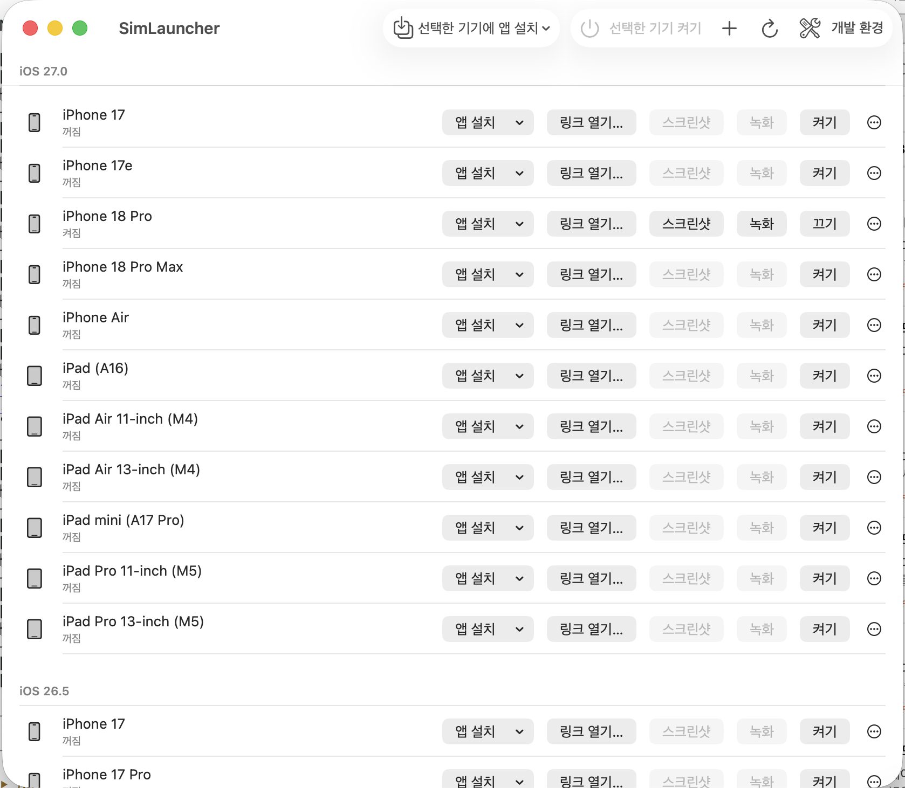

**바로 가기**: [준비물](#준비물) · [설치하기](#설치하기) · [처음 실행하기](#처음-실행하기) · [사용법](#사용법) · [회사 빌드 목록 연결하기](#회사-빌드-목록-연결하기) · [문제가 생겼을 때](#문제가-생겼을-때) · [개발자 안내](#개발자-안내)

## 준비물
- **macOS 26 이상**인 Mac
- **Xcode**: App Store 에서 무료로 받을 수 있어요. 아직 없다면 SimLauncher 가 처음 실행될 때 설치를 안내해 드려요.
- **iOS 시뮬레이터**: Xcode 에 들어 있지 않다면 SimLauncher 안에서 바로 설치할 수 있어요.

## 설치하기
1. [GitHub Releases 최신 페이지](https://github.com/zopandagom/simlauncher-macos/releases/latest)에서 `SimLauncher-<버전>.dmg`(예: `SimLauncher-1.0.0.dmg`)를 내려받으세요.
2. 받은 dmg 를 열고 **SimLauncher** 아이콘을 **Applications**(응용 프로그램) 폴더로 끌어다 놓으세요.

   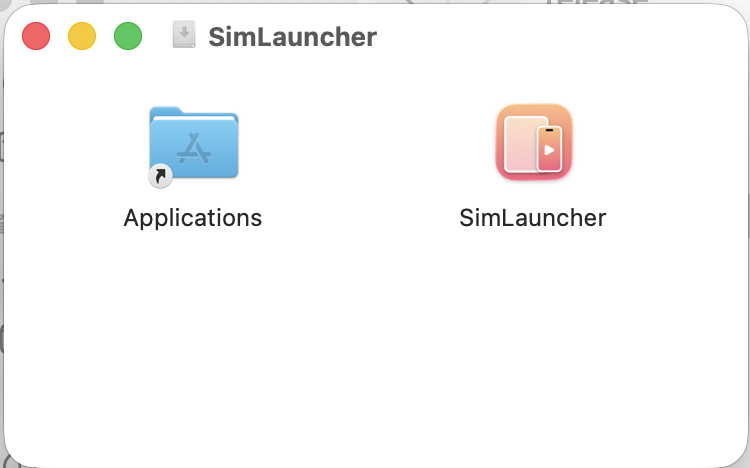

3. 응용 프로그램 폴더에서 SimLauncher 를 여세요. 인터넷에서 받은 앱이라 처음 한 번 "열겠습니까?" 하고 물어보면 **열기** 를 누르면 돼요. Apple 의 공증을 받은 앱이라 다른 경고 없이 열려요.

## 처음 실행하기
SimLauncher 를 열면 먼저 Xcode 가 준비되어 있는지 확인해요. 이미 준비되어 있다면 곧바로 기기 목록이 열려요.

준비가 덜 된 단계가 있으면 그 단계만 차례로 안내해 드려요. 안내대로 하고 SimLauncher 로 돌아오면 자동으로 다시 확인하니 따로 누를 건 없어요.

| 단계 | 이런 화면이 보이면 | 이렇게 하세요 |
|---|---|---|
| Xcode 설치 | "Xcode 를 설치하세요" | **App Store 열기** 를 눌러 Xcode 를 설치하세요. 크기가 커서 내려받는 데 시간이 좀 걸려요. |
| 라이선스 동의 | "Xcode 라이선스에 동의하세요" | **Xcode 열기** 를 누르면 Xcode 가 라이선스 동의 창을 띄워요. 안내대로 동의해 주세요. Mac 관리자 암호가 필요해요. |
| 첫 실행 준비 | "Xcode 첫 실행 준비를 마치세요" | **Xcode 열기** 를 누르면 Xcode 가 추가 구성요소를 설치하는 창을 띄워요. 끝날 때까지 기다려 주세요. 여기서도 관리자 암호가 필요해요. |
| iOS 시뮬레이터 설치 | "iOS 시뮬레이터를 설치하세요" | 이 화면에서 위 단계를 마쳤거나 기기 목록에서 이 화면을 다시 열었을 때, 지금 Xcode 의 기본 iOS 시뮬레이터가 없으면 보여요. **iOS 시뮬레이터 설치** 를 누르면 지금 Xcode 에 맞는 기본 버전 하나를 Apple 서버에서 받아 설치해요. 창을 닫아도 설치는 계속돼요. 이미 다른 iOS 버전의 기기가 있다면 설치하지 않고 넘어가도 괜찮아요. |

"준비가 끝났습니다" 가 보이면 **기기 목록 열기** 를 눌러 시작하세요.

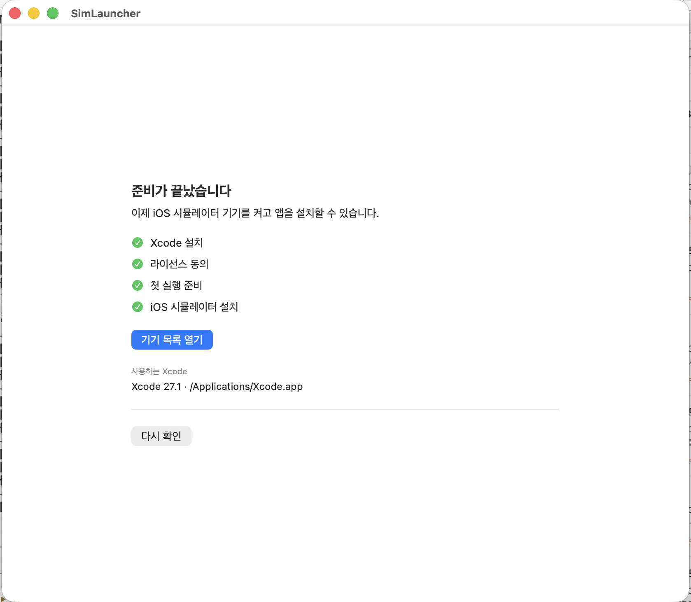

> Xcode 는 준비됐는데 iOS 시뮬레이터가 없으면 기기 목록이 바로 열리고 "iOS 시뮬레이터가 설치되어 있지 않습니다" 가 보여요. 이때는 그 아래 **iOS 설치** 를 누르면 개발 환경 화면이 열려요. 거기서 **iOS 시뮬레이터 설치** 를 누르세요. 그 밖에도 준비 상태가 궁금할 때는 언제든 기기 목록 오른쪽 위의 **개발 환경** 을 누르면 이 화면을 다시 볼 수 있어요.

## 사용법
기기 목록에는 iPhone·iPad 시뮬레이터 기기가 iOS 버전별로 모여 있어요. 각 줄 오른쪽에 그 기기에서 쓸 수 있는 버튼이 있어요.

### 기기 켜고 끄기
줄에서 **켜기** 를 누르면 기기가 켜지고, Simulator 앱 창에 iPhone·iPad 화면이 나타나요. 다 썼으면 **끄기** 를 누르세요.

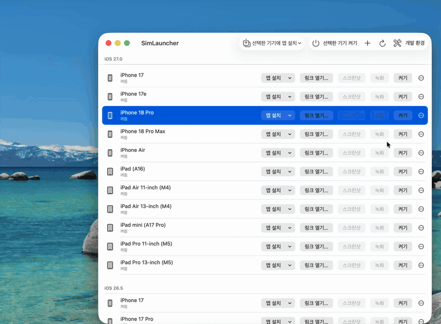

### 새 기기 만들기
원하는 기종이 목록에 없다면 오른쪽 위 **+**(기기 만들기)를 누르세요. 이름, iOS 버전(이 Mac 에 설치된 버전 중에서), 기기 종류를 고르고 **만들기** 를 누르면 돼요.

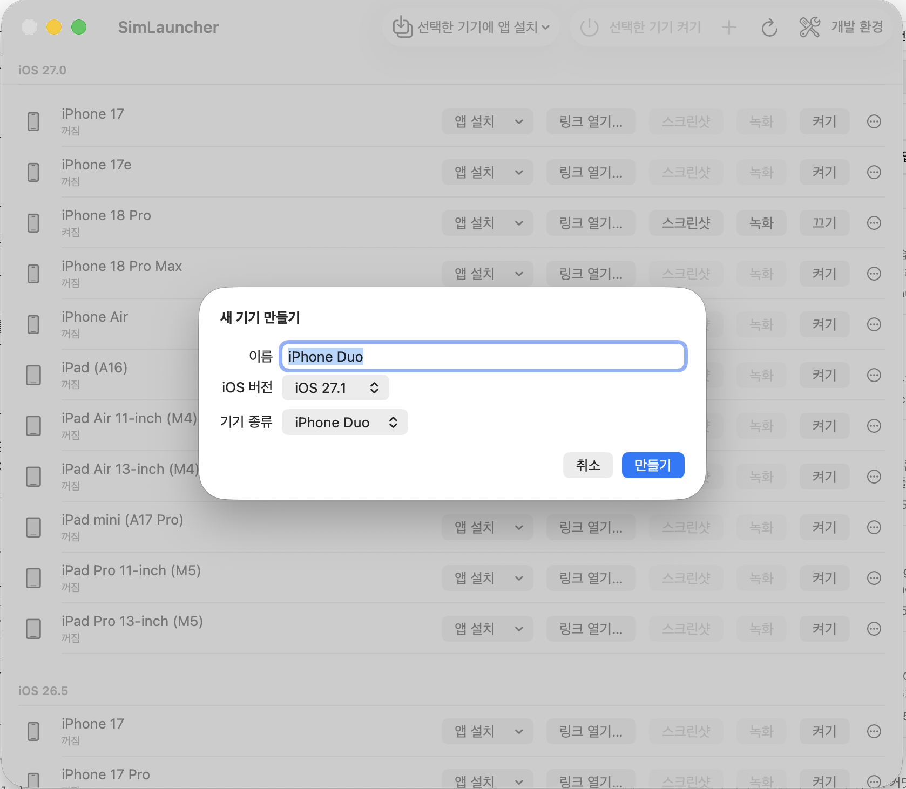

### 기기 초기화하거나 지우기
줄 끝의 **…**(기기 작업) 메뉴에서 고를 수 있어요.
- **초기화…**: 설치한 앱과 데이터, 설정을 모두 지우고 처음 산 것 같은 상태로 되돌려요.
- **삭제…**: 기기를 목록에서 아예 없애요.

둘 다 되돌릴 수 없어서 한 번 더 확인을 받아요. 그리고 기기를 끈 상태에서만 할 수 있어요.

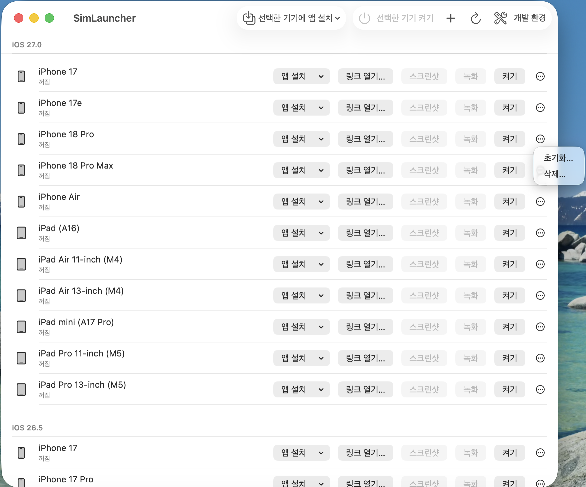

### 앱 설치하고 실행하기
줄의 **앱 설치** 메뉴에서 앱을 어디서 가져올지 고르세요. 기기가 꺼져 있어도 알아서 켜고, 설치가 끝나면 앱을 바로 실행해 줘요.

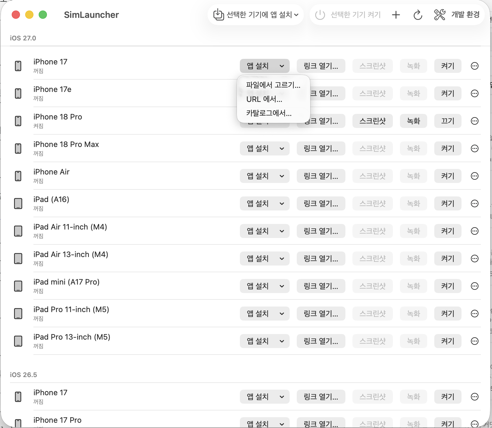

- **파일에서 고르기…**: Mac 에 받아 둔 앱 파일(.app 이나 그 .app 을 압축한 zip)을 골라요. 파일을 기기 줄 위로 끌어다 놓아도 돼요.
- **URL 에서…**: 개발자에게 받은 zip 파일의 `https://` 주소를 붙여 넣고 **받아서 설치** 를 누르세요. 받는 동안 줄에 진행률이 보이고, 언제든 취소할 수 있어요. 로그인해야 받을 수 있는 주소는 쓸 수 없어요.

  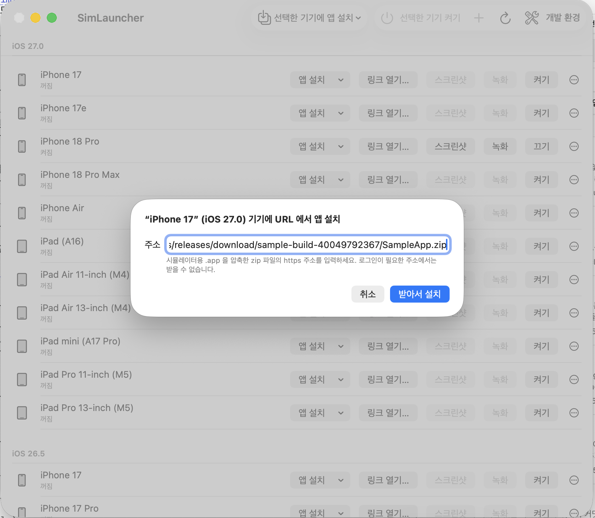

- **카탈로그에서…**: 회사에서 올려 둔 [빌드 목록](#회사-빌드-목록-연결하기)에서 앱과 버전을 골라 **받아서 설치** 를 누르면 돼요. 주소를 매번 입력하지 않아도 돼서 가장 편해요.

  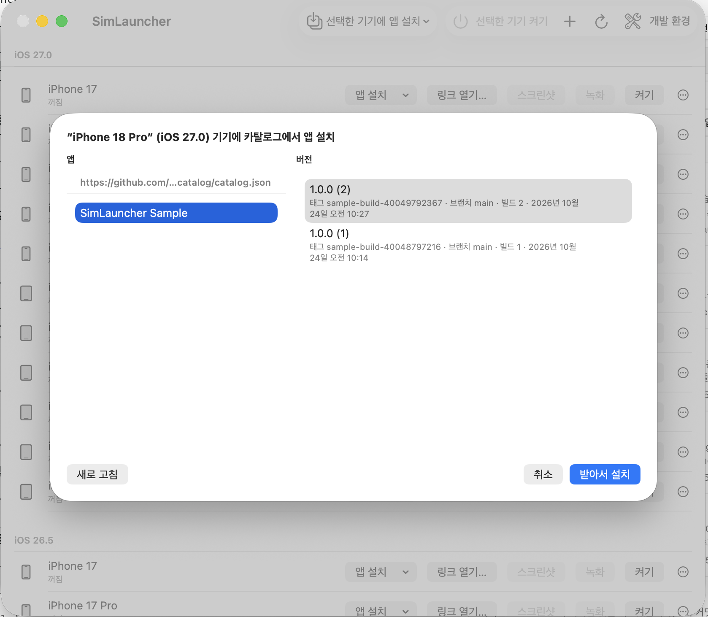

  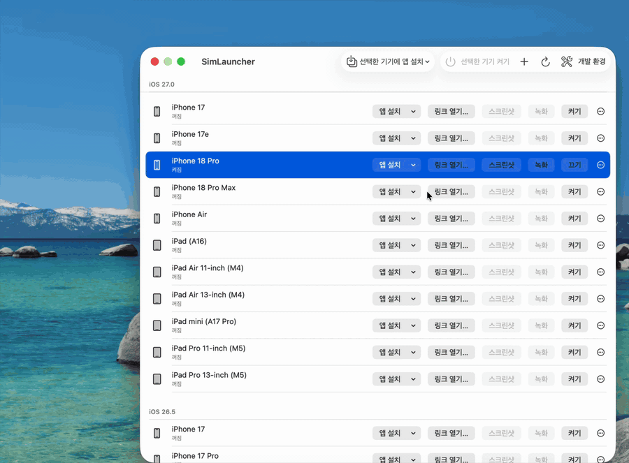

> **어떤 파일을 받아야 하나요?** iPhone 에 설치하는 `.ipa` 파일이나 Mac 용 앱은 시뮬레이터에 설치할 수 없어요. 개발자에게 "**시뮬레이터용으로 빌드한 .app**(또는 그 zip)을 주세요" 라고 요청하세요.

### 링크 열기
앱의 특정 화면으로 바로 가는 링크(딥링크, 예: `myapp://item/1`)나 웹 주소를 기기에서 열어 볼 수 있어요. 줄의 **링크 열기…** 를 누르고 링크를 입력한 뒤 **열기** 를 누르세요. 기기가 꺼져 있으면 켜고 열어요.

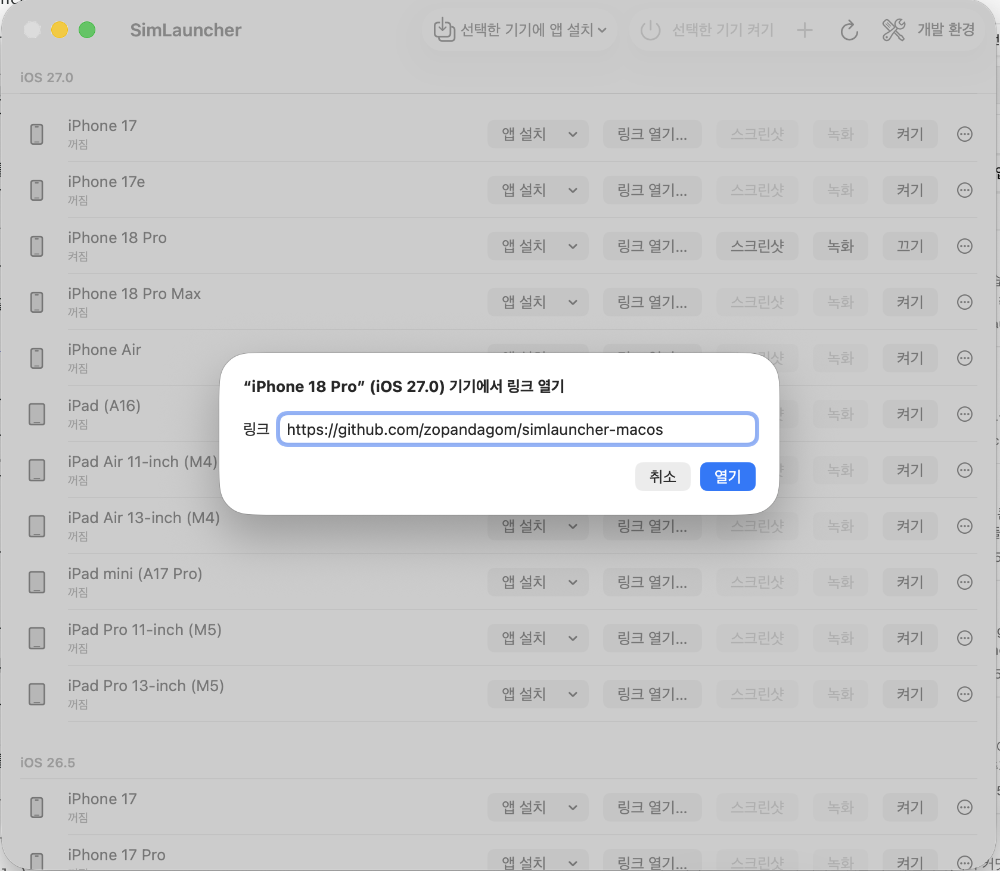

### 여러 기기에 한 번에
같은 앱을 여러 기기에서 확인하고 싶을 때 써요.
1. 목록에서 기기를 여러 대 고르세요. ⌘ 키를 누른 채 클릭하면 하나씩 더하고, ⇧ 키를 누른 채 클릭하면 사이에 있는 기기를 한꺼번에 골라요.
2. 위쪽 툴바에서 원하는 버튼을 누르세요.
   - **선택한 기기에 앱 설치**: 파일·URL·카탈로그 중 하나로 같은 앱을 고른 기기 모두에 설치하고 실행해요. 앱은 한 번만 내려받아요. 설치할 수 없는 기기는 건너뛰고, 실패한 기기는 이유와 함께 알림 하나로 모아서 알려 드려요.
   - **선택한 기기 켜기**: 고른 기기 중 꺼져 있는 기기를 한꺼번에 켜요.

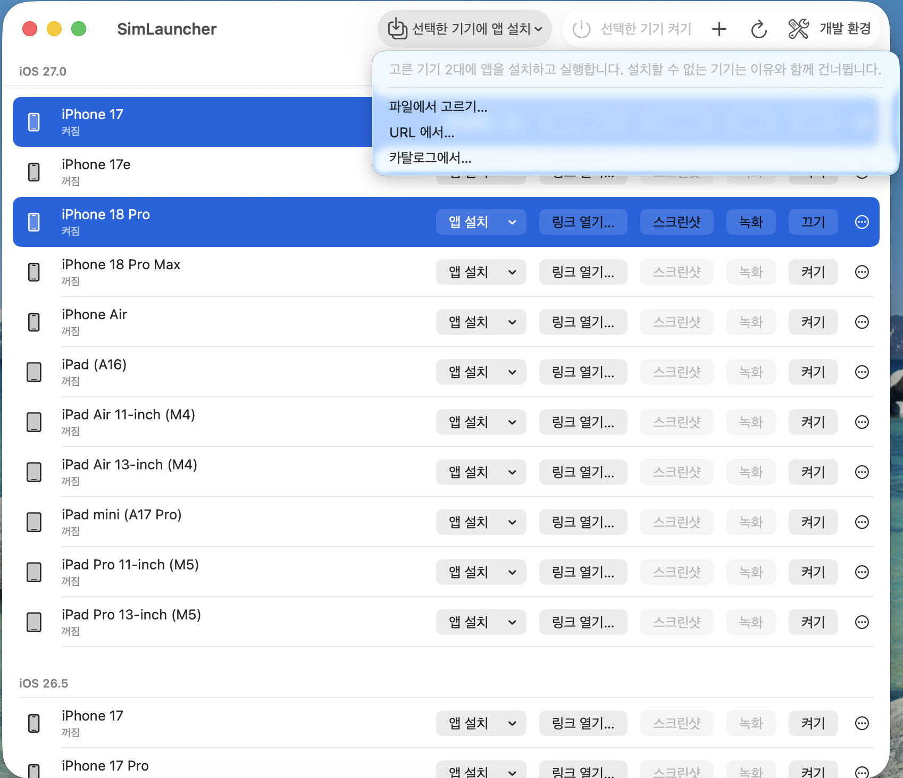


### 화면 찍기 (스크린샷)
켜진 기기 줄의 **스크린샷** 을 누르면 기기 화면을 PNG 로 저장하고 Finder 에서 바로 보여 줘요. 파일은 **사진** 폴더 안의 `SimLauncher` 폴더에 모여요.

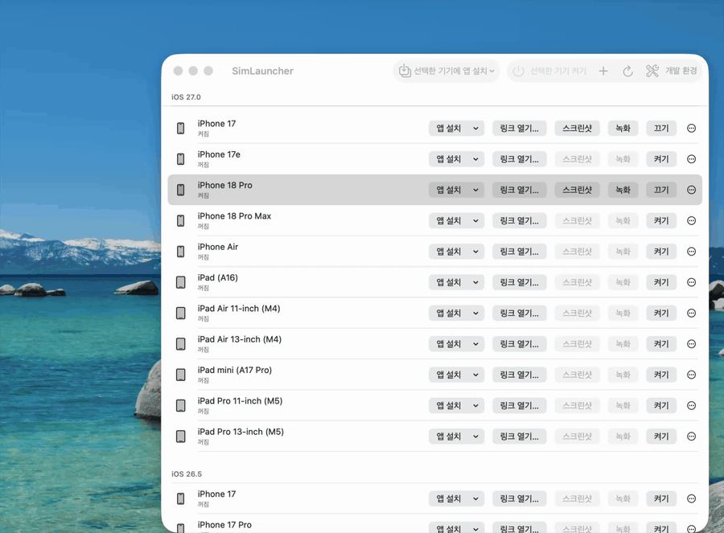

### 화면 녹화하기
켜진 기기 줄의 **녹화** 를 누르면 녹화가 시작되고, 줄에 녹화 시간과 **중지** 버튼이 보여요. **중지** 를 누르면 **동영상** 폴더 안의 `SimLauncher` 폴더에 저장하고 Finder 에서 보여 줘요.

- 녹화하는 동안에는 그 기기를 끄거나 초기화·삭제할 수 없어요.
- 녹화 중에 SimLauncher 를 종료하면, 녹화를 저장하고 종료할지 먼저 물어봐요.

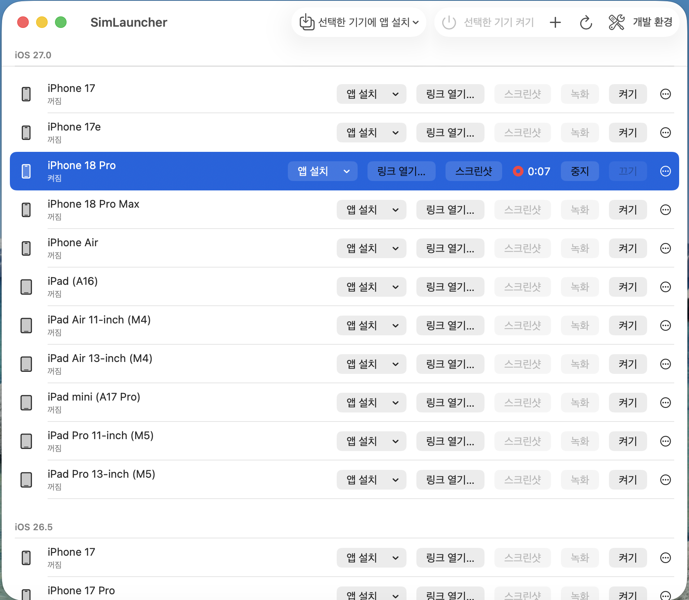

## 회사 빌드 목록 연결하기
회사에서 테스트할 앱 빌드를 모아 둔 목록(**빌드 카탈로그**, `catalog.json` 파일)이 있다면 SimLauncher 에 한 번만 등록해 두세요. 그다음부터는 주소를 입력할 필요 없이 "카탈로그에서…" 목록에서 골라 설치할 수 있어요.

1. 메뉴 막대에서 **SimLauncher > 설정…** 을 여세요 (단축키 ⌘,).
2. **빌드 카탈로그** 의 "카탈로그 주소" 칸에 담당자에게 받은 `https://` 주소를 넣고 **등록** 을 누르세요.
3. SimLauncher 가 주소를 한 번 받아서 올바른 목록인지 확인해요. "등록했습니다. 앱 N개가 있습니다." 가 보이면 끝이에요.

카탈로그는 여러 개 등록할 수 있고, 필요 없어진 것은 휴지통 버튼으로 지우면 돼요.

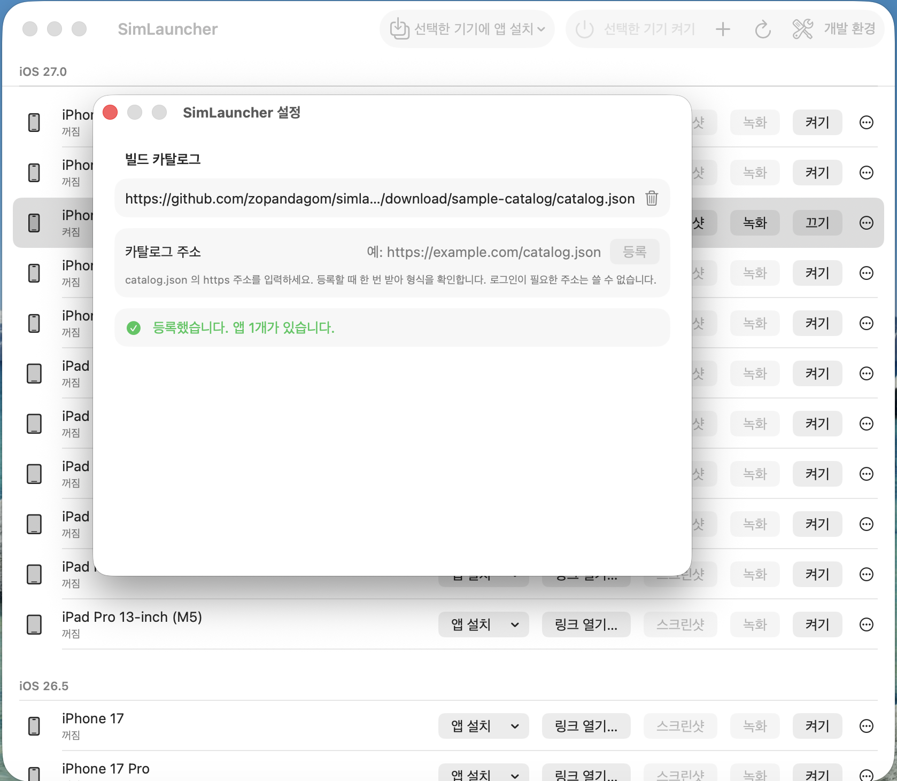

**먼저 체험해 보고 싶다면** 아래 샘플 카탈로그 주소를 등록해 보세요. 샘플 앱을 설치해 볼 수 있어요.

```
https://github.com/zopandagom/simlauncher-macos/releases/download/sample-catalog/catalog.json
```

- 회사에서 카탈로그 목록을 미리 정해 두었다면 설정 창에 "관리자가 정한 목록이라 이 Mac 에서 바꿀 수 없습니다." 가 보이고, 직접 등록하거나 지울 수 없어요.
- 카탈로그를 만들어 올리는 분(개발자·관리자)은 [빌드 카탈로그 규격](docs/CATALOG.md)을 봐 주세요. 로그인 없이 받을 수 있는 `https://` 주소라면 GitHub Releases·S3·사내 웹 서버 어디에 두어도 돼요.

## 문제가 생겼을 때
문제가 생기면 SimLauncher 가 알림이나 안내 문구로 이유와 해결 방법을 함께 알려 드려요. 자주 만나는 경우를 모았어요.

| 이럴 때 | 이렇게 해 보세요 |
|---|---|
| 기기가 켜지지 않거나 목록이 비어 있어요 | 오른쪽 위 **개발 환경** 을 눌러 Xcode 준비 상태를 확인하세요. 그래도 안 되면 Mac 을 재시동해 보세요. |
| 기기 줄에 "사용할 수 없음" 이라고 떠요 | 그 기기에 필요한 iOS 버전이 이 Mac 에 없거나, 지금 Xcode 가 그 기종을 지원하지 않는 경우예요. SimLauncher 는 지금 Xcode 의 기본 iOS 만 설치할 수 있어요. 필요한 버전이 그 기본 버전이라면 **개발 환경** 에서 설치하면 다시 쓸 수 있어요. 그렇지 않다면 다른 기기를 쓰거나 새 기기를 만들어 쓰세요. 쓸 일이 없는 기기는 기기 작업 메뉴에서 삭제해도 돼요. |
| "iOS 시뮬레이터용 빌드가 아닙니다", ".ipa 파일은 설치할 수 없습니다" 가 떠요 | 개발자에게 시뮬레이터용으로 빌드한 .app(또는 그 zip)을 요청하세요. |
| "이 앱은 iOS … 이상에서 실행됩니다" 가 떠요 | 더 높은 iOS 버전의 기기에 설치하세요. 새 기기는 이 Mac 에 설치된 iOS 버전으로만 만들 수 있어요. 맞는 버전이 없다면 **개발 환경** 에서 지금 Xcode 의 기본 iOS 를 설치하고, 그 버전이 충분히 높으면 그걸로 새 기기를 만드세요. 기본 iOS 보다 높은 버전이 필요하다면 Xcode 를 업데이트해야 해요. |
| "zip 맨 위에 .app 이 없습니다" / "여러 개 있습니다" 가 떠요 | .app 하나만 바로 압축한 zip 이어야 해요. 파일을 준 분께 알려 주세요. |
| 앱이나 카탈로그를 받지 못해요 ("서버 주소를 찾지 못했습니다", "서버에 연결하지 못했습니다") | 주소 철자를 확인하세요. 회사 안에서만 열리는 주소라면 사내망(VPN 등)에 연결되어 있는지 확인하세요. |
| "서버가 로그인이나 접근 권한을 요구해 받지 못했습니다" 가 떠요 | 로그인이 필요한 주소는 쓸 수 없어요. 로그인 없이 받을 수 있는 주소를 담당자에게 요청하세요. |
| "https:// 로 시작하는 주소만 …" 이 떠요 | `http://` 주소는 쓸 수 없어요. `https://` 주소를 써 주세요. |
| 카탈로그가 "형식이 맞지 않아 읽지 않았습니다", "카탈로그(JSON 객체)로 읽지 못했습니다" 라고 해요 | 주소가 로그인 페이지 같은 웹 페이지가 아니라 `catalog.json` 파일을 바로 가리키는지 확인하세요. 주소가 맞다면 카탈로그를 만든 분께 알려 주세요. |
| "이 카탈로그는 이 앱보다 새 규격 …" 이라고 해요 | SimLauncher 를 [최신 버전](https://github.com/zopandagom/simlauncher-macos/releases/latest)으로 업데이트하세요. |
| 설치 뒤 "앱이 시작되지 않았거나 시작하자마자 종료되었습니다" 가 떠요 | 시뮬레이터 화면에서 앱 아이콘을 눌러 다시 실행해 보세요. 계속 그렇다면 앱 개발자에게 알려 주세요. |
| 기기를 끄거나 초기화·삭제할 수 없어요 | 녹화 중이라면 녹화를 먼저 멈춰 주세요. 초기화·삭제는 기기를 끈 뒤에 할 수 있어요. |

## 인터넷은 언제 쓰나요?
SimLauncher 는 아래 세 가지 경우에만 인터넷을 써요.
- 등록한 빌드 카탈로그(`catalog.json`)를 받을 때
- 고르거나 입력한 주소에서 앱 빌드(.app 또는 .app 을 담은 zip)를 받을 때
- 설치하기로 고른 iOS 시뮬레이터를 Apple 서버에서 받을 때

---

## 개발자 안내
SimLauncher 는 공개 레포라서, 어느 회사든 자기 빌드 저장소에 맞춰 쓸 수 있어요.

### 기술 스택
- SwiftUI (규칙 기반 단방향 MV), Swift 6 strict concurrency, macOS 26.0+
- Tuist 모듈러 아키텍처 (Feature / Client Interface·Impl·Testing / Shared)
- Foundation `Process` 로 `xcrun simctl` 등 실행 (Command Client Impl)
- Foundation `URLSession` 으로 카탈로그·빌드 다운로드 (Download Client Impl)
- Foundation `UserDefaults` 로 사용자 설정(카탈로그 주소) 저장 (Preferences Client Impl)
- AppKit `NSWorkspace` 로 Finder 에서 보이기, Foundation `FileManager` 로 사진·동영상 폴더에 스크린샷·녹화 저장 폴더 준비·파일 이름 예약 (Workspace Client Impl)

### 시작하기
```bash
make bootstrap   # mise 로 tuist·swiftlint·swiftformat·xcbeautify 설치, git 훅(pre-commit: main 커밋 차단·String Catalog stale 표시 차단·lint, pre-merge-commit: main 머지 커밋 차단, pre-push: main push 차단) 연결
make generate    # SimLauncher.xcworkspace 생성 후 Xcode 로 열기
make test        # 전체 모듈 빌드 + 테스트 + git 훅 테스트
make test-hooks  # git 훅 동작 테스트만 (임시 레포에서 main 커밋·머지 커밋·push 차단, String Catalog stale 표시 커밋 차단과 기능 브랜치 통과 확인)
make lint        # 포맷·아키텍처 규칙 검사 (make format 으로 자동 수정)
make sample      # 샘플 iOS 앱을 시뮬레이터용으로 빌드해 build/SampleApp.zip 으로 묶기 (SAMPLE_BUILD_NUMBER=42 로 빌드 번호)
make catalog-check CATALOG=catalog.json   # catalog.json 하나를 앱과 같은 규칙으로 검사
make catalog-test  # 샘플 카탈로그 생성기·검증기 회귀 테스트
make release     # 서명·공증 dmg 만들기 (준비: docs/RELEASING.md)
```

### 샘플 카탈로그 운영
레포의 GitHub Actions 예시 워크플로가 샘플 iOS 앱을 빌드해 Releases 에 올리고 카탈로그를 만들어요 ([주소는 위](#회사-빌드-목록-연결하기)).

- 새 빌드 올리기: Actions > Sample Catalog > Run workflow 를 **main 에서** 실행하세요. 워크플로 파일이 main 과 다른 브랜치에서 실행하면 GitHub 이 릴리스 생성을 거절해요. 이때 draft 릴리스가 남을 수 있는데, 카탈로그에는 영향이 없으니 손으로 지우면 돼요.
- 동작, 자기 앱에 맞게 바꿀 곳, 다시 실행·정리하는 방법: [CATALOG.md 11절](docs/CATALOG.md#11-github-actions-예시)

### 문서
- [아키텍처](docs/ARCHITECTURE.md)
- [개발 규칙: 해야 할 것 / 하지 말아야 할 것](docs/CONVENTIONS.md)
- [개발 계획과 로드맵](docs/DEVELOPMENT_PLAN.md)
- [빌드 카탈로그 규격](docs/CATALOG.md)
- [배포(서명·공증)](docs/RELEASING.md)
- [Claude Code 작업 안내](CLAUDE.md)

이 프로젝트는 [ios-harness](https://github.com/zopandagom/ios-harness) 템플릿으로 만들었어요 (`.harness-version`).

## 라이선스
[MIT](LICENSE)
