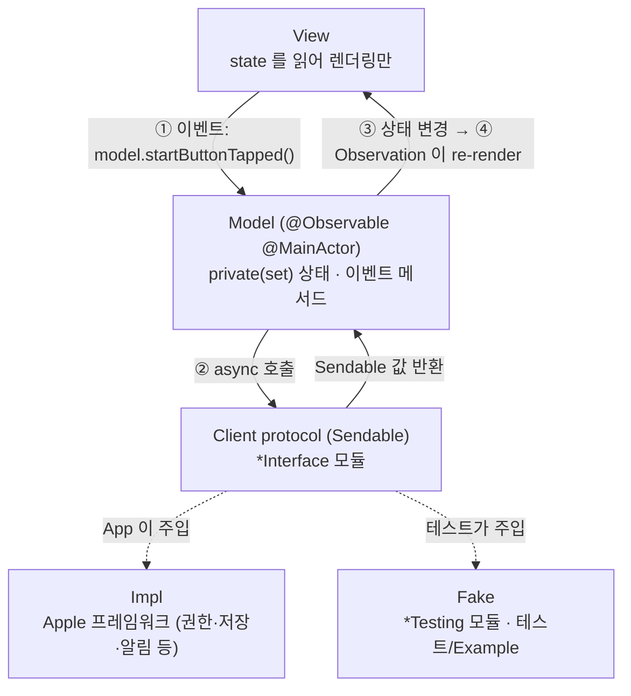
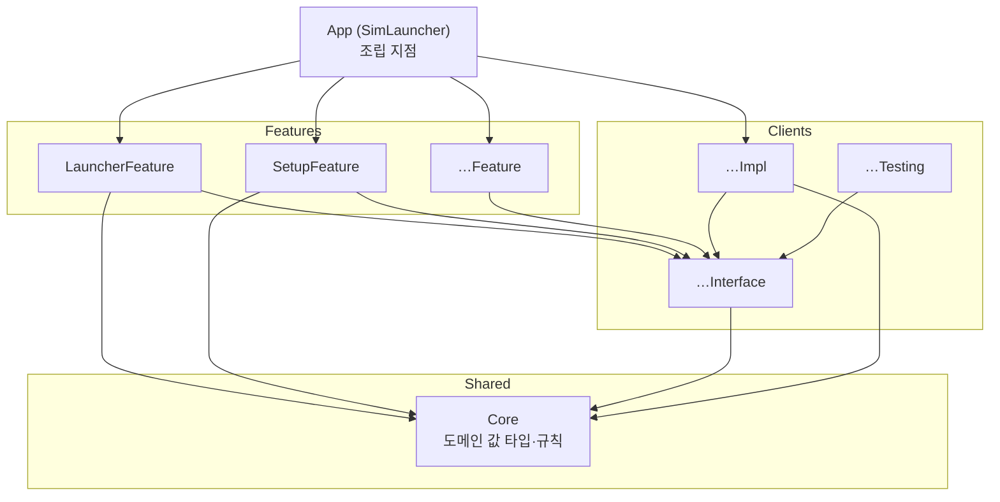

# 아키텍처

두 가지 결정 위에 서 있다.

1. **규칙 기반 단방향 MV.** SwiftUI 의 `@Observable` 모델을 View 에 직접 연결한다(Apple 샘플과 같은 방식). 단방향 흐름은 프레임워크가 아니라 규칙과 lint 로 강제한다.
2. **모듈러 아키텍처.** 외부 시스템은 Client 모듈로 감싸고, 각 Client 를 Interface / Impl / Testing 으로 나눈다. Feature 는 Interface 에만 의존한다.

## 1. 실행 흐름



### 단방향 규칙
| # | 규칙 | lint 로 강제 |
|---|---|---|
| 1 | Model 의 상태 프로퍼티는 모두 `public private(set) var` | 리뷰 |
| 2 | View 는 Model 의 **이벤트 메서드**만 호출한다. 이름은 "무슨 일이 일어났는가"로 짓는다: `onAppear()`, `startButtonTapped()`, `queryChanged(_:)` | 리뷰 |
| 3 | 입력 컨트롤은 `Binding(get: { model.query }, set: { model.queryChanged($0) })` 으로 연결한다. 목록 다중 선택도 같다: `List(selection: Binding(get: { model.selection }, set: { model.selectionChanged($0) }))` (선택은 툴바 동작의 대상이고 목록을 다시 읽을 때 사라진 기기를 빼는 규칙이 있어 Model 상태다, 규칙 8). `$model.query`·`$catalogModel.query` 처럼 Model 프로퍼티의 `$` 바인딩 금지 | `no_two_way_model_binding` (`$model.`·`$…Model.` 을 잡는다) |
| 4 | 부수효과(권한, 저장, 알림, 결제)는 Model 메서드 안에서 Client 를 통해서만 실행한다 (Model 이 소유한 흐름 타입이 그 메서드 안에서 Client 를 부르는 것도 여기에 든다, 아래 흐름 타입 문단). View 에서 `Task { UNUserNotificationCenter… }` 금지 | `system_framework_only_in_impl`, `preferences_only_in_preferences_impl`(사용자 설정 저장) |
| 5 | Model 은 `@MainActor`, Client 가 주고받는 값은 `Sendable`. 비 Sendable 프레임워크 객체는 식별자나 Core 의 `Sendable` 값 타입으로 바꿔서 넘긴다 | 컴파일러 (Swift 6 strict) |
| 6 | Model 끼리 직접 참조하지 않는다. 화면 간 흐름은 App 이 조립하거나 공유 Client 를 거친다 | 모듈 경계 |
| 7 | Model 은 App(또는 Example 앱)이 `@State` 로 **소유**하고, View 는 `let model: XxxModel` 로 **참조**만 한다. View 안에서 Model 을 생성하거나 `@State` 로 다시 감싸지 않는다. 한 View 가 Model 을 둘 받을 수 있다(예: `LauncherView(model:catalogModel:)`). View 의 Model 프로퍼티 이름은 `model` 또는 `…Model` 로 짓는다(lint `no_two_way_model_binding` 이 그 이름으로 잡는다) | 리뷰 |
| 8 | View 전용 일시 상태(애니메이션, 포커스, 시트 표시 여부)는 View 의 `@State private var` 로 둬도 된다. 화면에만 걸린 시스템 UI 설정(예: 자동 잠금 끄기 `isIdleTimerDisabled`)도 View 가 맡는다. 저장·외부로 남지 않고 화면을 떠나면 되돌리므로 규칙 4 의 부수효과가 아니다. 비즈니스 의미가 있으면 Model 로 옮긴다 | 리뷰 |

같은 화면의 상태(기기 목록·진행 작업·알림)를 함께 쓰는 흐름은 하위 Model 로 나누지 않고, 공유 상태와 규칙을 Feature 의 값 타입(예: `LauncherNotices`·`DeviceActivity`(기기별 진행 작업과 URL 설치의 받기 단계. 여러 기기가 한 받기를 함께 보이고 어느 행에서든 함께 취소하는 받기 묶음, 여러 기기 동작을 시작할 때 대상마다 내린 판정 `InstallStart`(시작한 기기·건너뛴 기기와 이유·소유자 번호), 묶음이 시작한 기록만 지우는 소유자 번호)·`ScreenshotActivity`(기기별 촬영 중. 기기 작업과 겹칠 수 있다)·`RecordingActivity`(기기별 녹화 단계: 시작 중·녹화 중(시작 시각)·저장 중과 멈춘 이유. 기기 작업과 겹칠 수 있다))으로 떼어 별도 파일에 둔다. 다른 흐름과 공유하지 않는 독립 상태(예: 생성 시트 초안 `DeviceCreationDraft`, URL 설치 시트 초안 `InstallURLDraft`)도 값 타입으로 둔다. Model 은 그 값을 `public private(set) var` 로 갖고 mutating 메서드만 부른다 (View 는 setter 가 없어 부를 수 없다). `private(set)` 은 같은 파일에서만 바꿀 수 있으므로 Model 상태를 직접 바꾸는 부분(진행 기록의 시작·끝, 시트 초안, Model 이 소유한 Task)은 Model 파일에 둔다. Model 파일이 아래 `file_length` 경고 기준을 넘으면, 흐름에서 Model 상태를 직접 바꾸지 않고(바꾸는 것은 창구로만) Client 호출을 잇는 부분을 같은 Feature 의 흐름 타입으로 뺀다 (예: 앱 설치의 `AppInstallFlow`: 풀기 → 검사·판정 → 켜기 → 설치 → 실행. 여러 기기면 받기·풀기·검사는 한 번만 하고 기기별 판정 → 켜기 → 설치 → 실행을 동시에 돌려 결과를 알림 하나에 모은다. 같은 창구를 쓰는 링크 열기와 받기 결과 해석도 맡는다. 기기 명령의 `DeviceCommandFlow`: 끄기·만들기·삭제·초기화 → 실패면 알림 → 다시 읽기. 창구는 `AppInstallFlow.Host` 를 함께 쓴다. 스크린샷·녹화의 `ScreenCaptureFlow`: 저장 파일 예약 → 캡처 → 실패면 빈 예약 파일 지우기·알림, 성공이면 Finder 보이기). 흐름 타입은 필요한 Client 만 갖는 internal `@MainActor struct` 이고, Model 이 `@ObservationIgnored private let` 으로 소유해 진행 기록을 시작한 Model 메서드(이벤트 메서드와 그것이 부르는 private 도우미, 그 메서드가 만들어 Model 이 소유한 Task 안 포함. 예: 녹화) 안에서만 부른다 (그래서 Client 호출은 여전히 Model 메서드 안에서 시작한다, 규칙 4). Model 상태에는 Model 이 부를 때마다 넘기는 창구(`AppInstallFlow.Host`·`ScreenCaptureFlow.Host`: 알림 쌓기·다시 읽기·지금 목록 읽기·기기별 끝(`finished`: 여러 기기 묶음에서 먼저 끝난 기기의 기록을 소유자 번호로 지워 그 행을 푼다)·녹화 시작 기록·멈춘 이유 읽기 같은 `@MainActor` 클로저. `AppInstallFlow.Host` 는 여러 기기 흐름이 기기별 자식 작업에 넘기므로 `Sendable` 이고 클로저도 `@Sendable` 이다)로만 닿고, 창구는 저장하지 않는다 (Model 을 잡는다. 녹화 Task 클로저가 흐름 호출 동안 창구를 잡는 것은 저장이 아니다). 흐름 안의 Client 이음은 다른 Model 메서드도 그 흐름 타입의 메서드로 부를 수 있다 (예: 켜기 → Simulator 앱 열기 단계는 `AppInstallFlow` 안에 있고, 켜기 버튼·툴바 "선택한 기기 켜기"·링크 열기도 그 단계를 부른다). 소유 프로퍼티와 창구가 `private` 이라 View 는 흐름 타입에 닿지 못하고(컴파일러), View·다른 타입이 흐름 타입을 만들지 않는 것과 창구를 저장하지 않는 것은 리뷰로 본다. Model 파일을 나누려고 상태 변경 도우미나 Client 프로퍼티를 internal 로 열어 다른 파일 extension 에 두지 않는다 (View 가 부를 수 있게 돼 규칙 2·4 를 컴파일러가 막지 못한다). 다른 흐름과 상태를 공유하지 않고 자기 비동기 흐름이 있는 시트는 같은 Feature 의 별도 Model 로 둔다(예: 카탈로그에서 설치 시트의 `CatalogInstallModel`. 카탈로그를 받고 고르는 동안 기기 목록·진행 작업·알림을 쓰지 않는다). 그 Model 도 App 이 소유해 View 에 넘기고(규칙 7), 다른 Model 의 흐름으로 이어지는 마지막 동작(고른 버전 설치)은 App 이 주입한 클로저(`installRequested` → `LauncherModel.catalogInstallRequested(_:)`)로 넘긴다(규칙 6). 그 요청(`CatalogInstallRequest`)은 대상 기기를 여러 대 담는다(행 메뉴는 그 기기 한 대, 툴바 "선택한 기기에 앱 설치" 는 고른 기기). 두 Model 의 시트끼리 서로 막는 가드는 없고, 시트가 창을 막는 모달이라는 점, 작업 중인 기기의 행 메뉴 비활성, 설치할 때 `LauncherModel` 이 기기를 지금 목록으로 다시 확인하는 것에 기댄다. 툴바 "카탈로그에서…" 는 고른 기기 중 작업 중인 기기도 대상에 넣고, 그 기기는 설치를 시작할 때 `LauncherModel` 의 시작 판정이 이유(다른 작업 중)와 함께 건너뛴다. 상태를 바꾸지 않는 읽기 전용 계산 프로퍼티는 Model 의 다른 파일 extension 에 둘 수 있다 (`private(set)` 은 쓰기만 막는다). 레포 전체의 lint `file_length` 경고 기준은 600 줄이다 (`.swiftlint.yml`. 한 화면에 흐름이 많은 Launcher Model 이 500 줄을 넘기 때문). 넘으면 기준을 올리지 않고 위 흐름 타입으로 뺀다.

화면 전환(규칙 6)은 App 이 Setup 과 Launcher 사이에서 한다. `SimLauncherApp` 은 `SetupModel.isFinished` 로 둘 중 하나를 보인다: 앱 시작 직후 첫 판정이 Xcode 준비됨이면 곧바로 Launcher(기기 목록. 기본 iOS 런타임 설치 여부는 보지 않는다), 아니면 Setup 의 단계 안내이고, Setup 안에서 Xcode 준비가 끝나면 "기기 목록 열기"로 넘어간다. Setup 은 Xcode 가 준비됨일 때만 같은 확인에서 기본 iOS 런타임도 확인하고(`simctl runtime list`·SDK plist, 네트워크 없음), 없으면 네 번째 단계 "iOS 시뮬레이터 설치"를 보인다. 설치는 사용자가 누를 때만 하고, 설치 중에는 다시 확인·앱 활성화 확인과 "기기 목록 열기"를 막는다. Launcher 의 Setup 진입 버튼(툴바 "개발 환경", 빈 화면(iOS 런타임 없음·만들 수 있는 기기 종류 없음)과 목록 위 안내 줄의 iOS 설치 버튼, 목록 읽기 실패 화면의 "개발 환경 열기")은 모두 `LauncherModel.setupButtonTapped()` 가 App 이 주입한 클로저(`setupRequested`)를 불러 App 이 `SetupModel.reopened()` 로 Setup 을 다시 연다 (Feature 끼리 의존하지 않는다). 판정 전에는 `LauncherView` 를 만들지 않아 기기 목록을 읽는 `simctl` 이 돌지 않고, Launcher 로 돌아올 때마다 View 가 새로 만들어져 목록을 다시 읽는다. Setup 은 보이는 동안 앱 활성화(`NSApplication.didBecomeActiveNotification`. macOS 에서는 다른 앱에 갔다 와도 `scenePhase` 가 바뀌지 않는다)마다 다시 확인한다(설치 중에는 Model 이 무시한다). 앱 종료 요청은 App 의 `AppDelegate`(`applicationShouldTerminate`)가 받는다: 런타임 설치가 준비·내려받기 중이면 먼저 그 확인 대화상자를 띄우고(설치 단계·멈추는 중이면 묻지 않는다), 그다음 녹화 중(저장 중 포함, `LauncherModel.isRecording`)이면 "녹화를 멈추고 저장한 뒤 종료할까요?" 를 묻는다 (둘이 겹치면 차례로 두 번 묻고, 어느 쪽이든 "취소"면 아무것도 멈추지 않고 종료하지 않는다). 기다릴 것이 있으면 `.terminateCancel` 을 돌려준 뒤 `LauncherModel.appTerminationRequested()` 로 모든 녹화를 멈추고 저장(Finder 보이기까지)하고, 이어서 `SetupModel.appTerminationRequested()` 로 설치를 멈추고(설치 단계면 기다리고) 끝나면 `NSApp.terminate` 를 다시 부른다. 녹화를 먼저 멈추는 것은 멈춤이 짧아(마무리 측정: 짧은 녹화 0.1초 안팎, 15분 녹화 1.54초. 파일 크기에 비례) 설치 대기에 묻히지 않고, 설치를 기다리는 동안 녹화가 계속 커지지 않게 하기 위해서다. 종료를 기다리는 동안 "녹화"를 눌러도 새 녹화를 시작하지 않는다. `.terminateLater` 는 기다리는 동안 다시 종료를 요청하면 AppKit 이 바로 끝내 버려 쓰지 않는다. 그래서 로그아웃·재시동·시스템 종료 중에 기다릴 것(설치·녹화)이 있으면 `.terminateCancel` 이 macOS 의 로그아웃 자체를 취소한다: 설치를 멈추거나 녹화를 저장하고 앱만 끝나며, 사용자가 다시 로그아웃해야 한다. 앱이 비정상 종료(크래시·강제 종료)되면 이 경로를 거치지 않아 녹화를 멈추지 못하고, 그 기기는 끌 때까지 녹화가 이어진다 (`simctl` 이 남거나 SIGINT 없이 끝나도 CoreSimulatorService 쪽 녹화가 이어진다, 측정. 다시 녹화하려면 기기를 껐다 켠다. 정리는 하지 않는다). 창을 닫아도 앱과 설치·녹화는 계속되고, Dock 아이콘으로 다시 열면 진행이 보인다. 녹화 밖의 Launcher 작업(URL 받기·설치 등)은 종료 요청 때 보지 않아 묻지 않고 끝낸다. 그때 남은 임시 폴더(`SimLauncher-Download-*`·`SimLauncher-Unzip-*`)는 다음에 기기 목록 화면이 열릴 때(`onAppear`) 지운다. 창을 닫아도 Launcher 의 받기·설치는 계속된다. 설정 창은 SwiftUI `Settings` 씬이고(⌘,), App 이 `SettingsModel` 을 `@State` 로 소유한다. Setup·Launcher 중 어느 화면이든, 메인 창을 닫았어도 열린다. 씬 내용과 Model 은 앱 시작 때 한 번 만들어지고 창을 닫았다 열어도 다시 만들어지지 않으므로, 목록 읽기는 창이 열릴 때(`onAppear()`) 한다. 설정 창은 앱 시작 때 카탈로그를 받지 않고, 사용자가 "등록" 을 누를 때 한 번 받아 확인한다. 확인 중 창을 닫으면(`onDisappear` → `windowClosed()`) 확인을 취소하고 저장하지 않는다. 종료 요청 때도 묻지 않는다(메모리로만 받아 남는 것이 없다). 받기 Client 는 Launcher 와 같은 인스턴스를 쓰고, 설정 Client 도 하나를 설정 창(등록·삭제)과 카탈로그에서 설치 시트(읽기만)가 함께 쓴다. 기기 행 "앱 설치" 메뉴나 툴바 "선택한 기기에 앱 설치" 의 "카탈로그에서…" 시트는 열 때와 "새로 고침" 을 누를 때만 설정을 읽고 등록된 카탈로그를 동시에 받아(해석은 메인 밖) 카탈로그마다 결과를 보이며, 앱 시작 때·기기 목록을 볼 때는 받지 않는다. 시트를 연 채 설정 창에서 등록·삭제하면 시트의 "새로 고침" 으로 반영된다. 시트의 Model(`CatalogInstallModel`)은 App 이 `@State` 로 소유하고, 고른 버전은 App 이 주입한 `installRequested` 로 `LauncherModel` 이 URL 설치와 같은 경로(받기 → 풀기 → 검사 → 설치 → 실행. 여러 기기면 한 번 받고 기기별로 동시에)로 설치한다. 등록된 카탈로그가 없으면 시트가 설정 창을 여는 버튼(SwiftUI `openSettings`)을 보인다(관리자가 잠근 빈 목록이면 담당자 문의 안내만).

### 예시 (알림 권한을 묻는 OnboardingFeature)
```swift
@MainActor
@Observable
public final class OnboardingModel {
  public private(set) var access: NotificationAccess

  @ObservationIgnored private let notification: any NotificationClient

  public func startButtonTapped() async {
    self.access = await self.notification.requestAccess()
  }
}

// View
Button("시작하기") { Task { await self.model.startButtonTapped() } }

// App: 화면 간 흐름은 App 이 정한다 (규칙 6)
if self.onboardingModel.access == .authorized {
  LauncherView(model: self.launcherModel, catalogModel: self.catalogInstallModel)
} else {
  OnboardingView(model: self.onboardingModel)
}
```

## 2. 모듈 구조



### 모듈 종류와 타깃
| 종류 | 위치 | 타깃 | 역할 |
|---|---|---|---|
| App | `Projects/App` | `SimLauncher` | 유일한 조립 지점. Impl 을 생성해 Model 에 주입. 화면 간 흐름과 앱 종료 요청 처리(`AppDelegate`: 런타임 설치가 준비·내려받기 중이면 확인을 받아 설치를 멈추고, 설치 단계이거나 이미 멈추는 중이면 묻지 않고 끝나기를 기다린다. 녹화 중이면 확인을 받아 모든 녹화를 멈추고 저장한 뒤(설치보다 먼저) 종료. Launcher 의 URL 받기·설치 중에는 묻지 않고 끝내고, 남은 임시 폴더는 다음에 기기 목록을 열 때 지운다), 설정 창(`Settings` 씬), 카탈로그에서 설치 시트의 Model(`CatalogInstallModel`) 조립과 그 설치 요청을 `LauncherModel` 로 넘기기 |
| Feature | `Projects/Features/<Name>` | `<Name>Feature` · `<Name>FeatureTests` · `<Name>FeatureExample` | 화면 하나 또는 흐름 하나. Model + View |
| Client | `Projects/Clients/<Name>` | `<Name>Interface` · `<Name>Impl` · `<Name>Testing` · `<Name>Tests` | 외부 시스템 경계 |
| Shared | `Projects/Shared/<Name>` | `<Name>` · `<Name>Tests` | 여러 모듈이 함께 쓰는 코드. `Core`(도메인 값 타입·규칙), 필요해지면 `DesignSystem`(공용 UI) |

- **Interface**: 프로토콜과 값 타입만. 부수효과 프레임워크(`.swiftlint.yml` 의 `system_framework_only_in_impl` 목록)를 import 하지 않는다.
- **Impl**: 프로토콜 구현. 구현 타입 이름은 `<Name>ClientImpl`. 부수효과 프레임워크(Photos·SwiftData·StoreKit·UserNotifications 등, 목록은 lint 규칙) import 는 여기서만. 그 밖의 부수효과 없는 Apple 프레임워크(CoreGraphics·ImageIO 등)는 Core 를 포함한 모든 레이어에서 쓸 수 있다. 제한은 권한·저장·외부 서비스 같은 부수효과를 Impl 에 가두기 위한 것이므로, 부수효과 없는 프레임워크를 피하려고 실행 비용을 들이지 않는다.
- **Testing**: `<Name>ClientFake`. 고정 값을 돌려주는 `struct` 로 시작하고, 호출 기록이 필요하거나 호출 사이에 상태가 남아야 하면(저장 결과, 바뀐 권한) 그때 상태를 `Mutex` 로 보호하는 `final class` 로 확장한다.
- **Example**: Fake 로 Feature 를 단독 실행하는 데모 앱. **`#Preview` 도 여기에 둔다** (Feature 모듈이 Testing 에 의존하지 않도록).
- **Shared**: 부수효과 프레임워크와 Client 모듈을 import 하지 않는다. Core 는 부수효과 없는 순수 코드이고(SwiftUI·UIKit·AppKit 도 쓰지 않는다. lint `core_no_ui_framework`), 여러 Client 의 Interface 가 함께 쓰는 값 타입을 둔다. DesignSystem 은 SwiftUI 까지 쓴다.
- Core 에는 기기·런타임·기기 종류 값 타입(`VirtualDevice`·`DeviceRuntime`·`DeviceType`·`DeviceInventory`)과 규칙을 둔다: 화면 목록(`DeviceList`: iOS 런타임 기기만 OS 별로 묶어 정렬하고, 보일 기기가 없으면 그 이유(iOS 런타임 없음 / 만들 수 있는 기기 종류 없음 / 기기 없음)), 생성 선택지(`DeviceCreationOptions`: 쓸 수 있는 iOS 런타임과 그 런타임이 지원하는 iPhone·iPad 종류. Model 의 시트 기본값과 Impl 의 실행 전 재확인이 함께 쓴다), 이름 검사(`DeviceName`: 앞뒤 공백을 뺀 1~100 자, 제어 문자 금지), 링크 검사(`DeepLink`: 앞뒤 공백을 빼고 `URL(string:)` 로 읽어 스킴이 있어야 한다. 경로·쿼리의 공백·한글은 퍼센트 인코딩), 내려받을 주소 검사(`DownloadURL`: 앞뒤 공백을 빼고 `URL(string:)` 로 읽어 https 스킴(대소문자 무시)과 호스트가 있어야 하고, 사용자 이름·비밀번호가 든 주소는 거절한다. 빌드 zip·카탈로그 주소에 함께 쓴다), 행별 허용 동작(`VirtualDevice.deleteAvailability`·`eraseAvailability` 가 돌려주는 `DeviceActionAvailability`: 삭제·초기화는 꺼진 기기만, 쓸 수 없는 기기는 삭제만). 앱 번들 값 타입(`AppBundleInfo`·`AppBundleID`·`CPUArchitecture`·`AppBundlePlatform`)과 설치 판정(`AppBundleInfo.installProblem`: 시뮬레이터용 플랫폼 → 이 Mac 아키텍처 → MinimumOSVersion 순서), 행별 설치 허용(`VirtualDevice.appInstallAvailability`: 쓸 수 있고 꺼짐·켜짐인 기기만. 꺼져 있으면 켜고 설치한다. URL 설치·링크 열기도 같은 규칙)도 Core 에 둔다. 스크린샷 파일 이름(`ScreenshotFileName`: `<기기 이름> (<런타임 이름>) <yyyy-MM-dd> <HH.mm.ss>.png`, 시각은 그레고리력·주어진 시간대. 기기·런타임 이름은 `/`·`:`·제어 문자·줄 구분자·방향 제어 문자를 `-` 로 바꾸고 앞뒤 공백을 빼고 맨 앞 `.` 을 `-` 로 바꾼 뒤 UTF-8 120·40 바이트에서 글자 경계로 자른다(저장 폴더 밖이나 숨김 파일이 되지 않는다). 같은 이름이면 확장자 앞에 ` 2`…` 99`)와 행별 촬영 허용(`VirtualDevice.screenshotAvailability`: 쓸 수 있고 켜진 기기만. 꺼진 기기는 켜지 않는다), 녹화 파일 이름(`RecordingFileName`: 규칙은 `ScreenshotFileName` 과 같고 확장자만 `.mov`. 시각은 "녹화"를 누른 시각)도 Core 에 둔다. 녹화를 허용하는 기기 규칙은 따로 두지 않고 `screenshotAvailability` 를 함께 쓴다. Xcode 값 타입(`XcodeInstallation`: 번들 경로·버전·개발자 디렉터리)과 쓸 Xcode 선택 규칙(`XcodeSelection.choose`: xcode-select 가 가리키는 Xcode, 없으면 `/Applications` 의 가장 높은 버전(같은 버전이면 `Xcode.app` 먼저, 그다음 경로순)), 준비 상태 판정(`DevEnvironmentStatus`: Xcode 없음(Command Line Tools 만 선택됨이면 따로) → 라이선스 미동의 → 첫 실행 준비 필요 → 준비됨 순서)도 Core 에 둔다. 런타임 디스크 이미지 값 타입(`RuntimeImage`: `simctl runtime list -j` 의 이미지 하나와 상태 ready·preparing·unusable·removing·unknown)과 기본 iOS 런타임(`DefaultIOSRuntime`: 고른 Xcode 의 iOS Simulator SDK 버전·build), 그 설치 여부 판정(`DefaultIOSRuntimeStatus`: 같은 major.minor 의 iOS 이미지 중 ready > preparing > unusable 순서로 하나를 골라, ready 면 설치됨, preparing·unusable 이면 각각 그 상태. patch·build 는 보지 않는다. removing·unknown 은 없는 것으로 본다), 런타임 설치 진행·결과(`RuntimeInstallProgress`: 준비·내려받기(퍼센트·바이트)·설치 단계, `RuntimeInstallOutcome`: 설치함·이미 있음)도 Core 에 둔다. 빌드 카탈로그(`BuildCatalog`: `catalog.json` 규격 schemaVersion 1(docs/CATALOG.md)을 해석해 앱(파일 순서) → 버전(생성 시각 최신순, 같으면 id) 으로 만들고, 모르는 schemaVersion·id 중복·날짜 형식·절대 https 가 아닌 빌드 URL(`DownloadURL`)·중첩 32 단계 초과 등은 첫 문제 하나(`BuildCatalogProblem`)로 거절한다. 모르는 필드는 무시(읽지 못하는 숫자·문자열과 중첩 상한은 예외, CATALOG.md 1절). 크기 상한 `BuildCatalog.maxByteCount`(5 MiB). 해석은 5 MiB 에서 약 0.3초 걸리므로 Model 은 메인 밖에서 도는 `@concurrent` 진입점 `BuildCatalog.decoded(from:)` 를 부른다)도 Core 에 둔다. 카탈로그 주소 목록 규칙(`CatalogURLList`: 저장된 문자열마다 쓸 수 있음·주소 문제(`DownloadURL` 검사)·앞 항목과 같은 카탈로그 상태를 매기고, 새 주소와 같은 카탈로그를 찾고, 저장할 문자열을 정한다)과 같은 카탈로그 판정 키(`DownloadURL.comparisonKey`: RFC 3986 6.2.2·6.2.3 정규화(스킴·호스트 소문자, 기본 포트 443·빈 경로, 퍼센트 인코딩 대문자·예약되지 않은 문자 풀기, 점 세그먼트) 뒤 조각을 뺀 문자열. 경로 대소문자·끝 슬래시·쿼리 순서는 구분한다, docs/CATALOG.md 9절)도 Core 에 둔다.

### 의존 규칙
| from ↓ / to → | Feature | Interface | Impl | Testing | Shared |
|---|---|---|---|---|---|
| App | ✅ | ✅ | ✅ | ❌ | ✅ |
| Feature | ❌ | ✅ | ❌ | ❌ | ✅ |
| Feature Tests / Example | 자기 Feature | ✅ | ❌ | ✅ | ✅ |
| Client Interface | ❌ | ❌ | ❌ | ❌ | ✅ |
| Client Impl | ❌ | 자기 Interface (+ 다른 Interface) | ❌ | ❌ | ✅ |
| Client Tests | ❌ | ✅ | 자기 Impl | 자기 Testing (+ Impl 이 쓰는 다른 Client 의 Testing) | ✅ |
| Shared | ❌ | ❌ | ❌ | ❌ | ❌ (필요해지면 템플릿에 인자를 추가하고 연다) |

### 빌드 설정
- 모든 모듈은 static framework. Mac 전용, macOS 26.0+, Swift 6 언어 모드, `SWIFT_STRICT_CONCURRENCY=complete`.
- 설정은 `Tuist/ProjectDescriptionHelpers/Project+Templates.swift` 의 `Env` 에서만 바꾼다. 개별 매니페스트에서 덮어쓰지 않는다.
- 서명: 모든 타깃이 Xcode 자동 서명(`CODE_SIGN_STYLE=Automatic`)과 `Env.developmentTeam`(XHV4ZL5K8T)을 쓴다. 앱 타깃의 서명 인증서는 Tuist 기본 `-`(Sign to Run Locally)라 개발 실행·archive 는 ad-hoc 이고, 배포는 `make release` 가 developer-id 로 내보내며 Xcode 가 클라우드 관리 Developer ID 인증서로 다시 서명한다(dmg 는 로컬 Developer ID 인증서, docs/RELEASING.md). Hardened Runtime·버전(`MARKETING_VERSION`·`CURRENT_PROJECT_VERSION`)은 앱 타깃만 `Env.appTargetSettings` 로 주고, 앱 Info.plist 의 버전·저작권 문구는 `Env.appVersionInfoPlist` 로 준다(Debug ad-hoc 빌드에서는 Xcode 가 Hardened Runtime 을 끈다, 실측). `make build`/`make test` 와 CI 는 `CODE_SIGNING_ALLOWED=NO` 로 서명 없이 빌드한다.
- 타깃 소스·리소스는 Xcode 동기화 폴더(`buildableFolders`)로 연결한다. 리소스가 없는 모듈의 폴더와 Tests 폴더(테스트 번들이 리소스를 직접 담는다)는 파일을 추가·삭제해도 다시 생성하지 않고 Xcode 와 빌드에 반영된다. 리소스가 있는 모듈(String Catalog 가 있는 Feature 등)은 static framework 라 Tuist 가 같은 폴더를 쓰는 리소스 번들 타깃(`<모듈>_<모듈>`)을 만들고, 생성할 때 있던 Swift 파일만 그 타깃에서 빼 둔다(pbxproj 의 `membershipExceptions`). 그래서 이런 모듈의 소스 폴더에 Swift 파일을 추가하면 `make project` 를 다시 돌린다. 돌리지 않으면 새 파일이 번들 타깃에서도 컴파일되어 `Unable to resolve module dependency` 로 빌드가 깨진다. 그 밖에 모듈·타깃·의존성을 바꿀 때와, 리소스가 없던 모듈에 첫 리소스(String Catalog 등)를 넣을 때도 다시 돌린다 (리소스 번들 타깃과 `Bundle.module` 접근자는 생성할 때 만들어진다).
- 예외: `Examples/SampleApp` 은 모듈이 아니라 카탈로그 예시 워크플로(`.github/workflows/sample-catalog.yml`, docs/CATALOG.md 11절)가 빌드하는 샘플 iOS 앱이다. 워크스페이스(`Workspace.swift` 의 `Projects/**`)·`make test` 밖의 독립 Tuist 프로젝트라 이 절의 static framework·Mac 전용·macOS 26.0+·`Env`·자동 서명 설정을 따르지 않는다: iOS 17.0+ iPhone·iPad 앱이고, 설정은 `Env` 를 쓰지 않는 자기 매니페스트(`Examples/SampleApp/Project.swift`)에 두고, 서명 없이(`CODE_SIGNING_ALLOWED=NO`) 시뮬레이터용으로만 빌드한다(`make sample`). Swift 6 언어 모드·`SWIFT_STRICT_CONCURRENCY=complete`·동기화 폴더·개발 언어 `ko`(§4)는 따른다.

## 3. 모듈 추가 방법

### Client 추가 (예: Notification)
1. `Tuist/ProjectDescriptionHelpers/Module.swift` 의 `extension Client` 에 `static let notification = Client("Notification")` 추가.
2. 디렉터리 생성: `Projects/Clients/Notification/{Interface,Impl,Testing,Tests}` + `Project.swift`:
   ```swift
   import ProjectDescription
   import ProjectDescriptionHelpers

   let project = Project.client(.notification, shared: [.core])
   ```
   Impl 이 다른 Client 를 조합하면 `clients: [.storage, …]` 를 더한다. Impl 에는 그 Interface 가, Tests 에는 Interface 와 Testing(Fake)이 연결된다. 조합되는 Client 의 Impl 도 App 이 `.client(impl:)` 로 의존해 만들고, 조합하는 Impl 의 생성자로 넘긴다.
3. Interface 에 `public protocol NotificationClient: Sendable` 과 입출력 값 타입, Impl 에 `NotificationClientImpl`, Testing 에 `NotificationClientFake`, Tests 에 Impl 의 순수 로직 테스트.
4. 사용하는 Feature 매니페스트의 `clients:` 에 추가하고, App 매니페스트에 `.client(impl: .notification)` 추가.
5. `make project && make test`.

### Shared 추가 (예: DesignSystem)
1. `Module.swift` 의 `Shared` 에 `case designSystem = "DesignSystem"` 추가.
2. `Projects/Shared/DesignSystem/{Sources,Tests}` + `Project.swift`:
   ```swift
   let project = Project.shared(.designSystem)
   ```
3. 쓰는 모듈의 매니페스트에 연결한다: Feature 는 `Project.feature(_, clients:, shared: [.designSystem])`, Client 는 `Project.client(_, shared: [...])`, App 은 `dependencies` 에 `.shared(.designSystem)`.
   DesignSystem 같은 공용 UI 모듈은 Feature 와 App 에서만 쓴다 (Interface 는 프로토콜과 값 타입만).

### Feature 추가 (예: Onboarding)
1. `Feature` 에 `case onboarding = "Onboarding"` 추가.
2. `Projects/Features/Onboarding/{Sources,Tests,Example}` + `Project.swift`:
   ```swift
   let project = Project.feature(.onboarding, clients: [.notification], shared: [.core])
   ```
3. `Sources` 에 `OnboardingModel`, `OnboardingView`. `Tests` 에 Model 테스트. `Example` 에 `@main` 데모 앱과 `#Preview`.
4. App 매니페스트 dependencies 에 `.feature(.onboarding)` 추가, `SimLauncherApp` 에서 Model 을 만들어 연결.

## 4. 확정된 기술 결정
| 결정 | 이유 |
|---|---|
| TCA 등 외부 아키텍처 라이브러리 | 사용하지 않음. 외부 의존성 0 을 유지하고, 추가하려면 사전 합의 |
| 시뮬레이터 제어는 `xcrun simctl` 을 `Process` 로 실행 | 공개 API 가 없다. `simctl` 인자 구성·출력 해석은 Simulator Client Impl 에만 두고, Feature 는 Interface 의 값 타입(기기·OS·상태)만 본다. `Process` 생성·호출(프로세스 실행)과 프로세스 신호(`kill`)는 Command Client Impl 한 곳에만 두고 Feature·Core·다른 Client Impl 에서는 하지 않으며(lint `process_only_in_command_impl` 는 `Process(`·`Process.` 만 잡고, `kill` 은 리뷰), 명령이 필요한 Client Impl(Simulator·AppBundle·DevEnvironment)은 생성 때 `CommandClient` 를 주입받아 실행한다(App 이 `CommandClientImpl` 하나를 만들어 함께 넘긴다). 실행은 두 가지다: 끝날 때까지 기다리고 Task 취소를 프로세스에 전하지 않는 `run`(`simctl` 등 대부분), Task 취소나 시간 제한이 오면 SIGINT → (10초) SIGTERM → (5초) SIGKILL 순서로 멈추고 프로세스가 끝난 뒤 돌아오며 출력을 받는 대로 넘기는 `runCancellable`(런타임 설치 `-downloadPlatform`, DevEnvironment 의 확인 명령, 화면 녹화 `simctl io recordVideo`: 시간 제한 없이 Task 취소가 멈춤이다. SIGINT 로 마무리해 저장하고, SIGTERM·SIGKILL 까지 가면 기기를 껐다 켤 때까지 그 기기의 녹화가 막힌다(측정)). Command Client 는 다른 Client Impl 만 조합해 쓰고, Feature·Core 는 의존하지 않는다. 다른 명령(`ditto`·`zipinfo`·`xcode-select`·`xcodebuild -checkFirstLaunchStatus`·`-license check`·`-downloadPlatform`, Xcode·App Store 를 여는 `open`)도 인자 구성·결과 해석은 그 일을 맡은 Client Impl 이 하고, 실행은 `CommandClient` 로 한다. Simulator 앱 열기도 Simulator Client Impl 이 맡는다: provider 가 없으면 `xcode-select -p` 로 읽고(provider 가 `nil` 을 돌려주면 열지 않는다), 그 안의 Simulator 앱(`Developer/Applications/Simulator.app`, 없으면 `Contents/Applications/DeviceHub.app`. Xcode 27.1 은 DeviceHub)을 `open` 으로 연다 |
| 네트워크는 사용자가 등록한 카탈로그(`catalog.json`)와 사용자가 고르거나 입력한 빌드(.app·zip) URL 을 내려받을 때, 사용자가 설치를 고를 때 쓸 Xcode 의 기본 iOS 시뮬레이터 런타임을 Apple 서버에서 설치할 때(`xcodebuild -downloadPlatform iOS`, 버전 지정 없음)만 | 공개 레포로 어느 회사든 자기 빌드 저장소를 연결해 쓰게 하기 위해. 카탈로그 형식은 이 프로젝트의 공개 규격이고(docs/CATALOG.md), 카탈로그·빌드 다운로드는 Download Client Impl 에만, 런타임 설치는 DevEnvironment Client Impl 에만 둔다. `URLSession` 등 네트워크 API 는 Download Client Impl 에서만 쓰고(lint `network_only_in_download_impl`. lint 가 잡지 못해 리뷰로 보는 경로는 CONVENTIONS §4 네트워크 행), Feature(Launcher 의 URL 설치·카탈로그에서 설치, Settings 의 카탈로그 등록 확인)·다른 Client 는 `DownloadClient` 를 주입받는다. Download Client 는 Core `DownloadURL` 을 통과한 https 주소만 받아, 큰 파일(빌드 zip)은 임시 폴더 `SimLauncher-Download-<UUID>` 의 고정 이름 `download` 파일로(서버가 준 파일 이름은 쓰지 않는다. 진행률·취소, Content-Length 가 있으면 시작 전에 디스크 여유와 비교하고 실패·취소면 폴더를 지운다), 작은 파일(카탈로그. 설정 창은 사용자가 등록할 때 한 번 받아 형식을 확인하고, 카탈로그에서 설치 시트는 열 때와 새로 고칠 때 받는다)은 크기 상한(`BuildCatalog.maxByteCount`)을 두고 메모리로 받는다. 리다이렉트는 https 로만 따라가고, 쿠키·캐시·자격 증명을 쓰거나 남기지 않으며 서버의 인증 요구에 응하지 않는다. 업데이트 확인(이 레포의 최신 릴리스 조회, 로드맵 '이후')은 그 작업에서 이 줄에 추가한다 |
| 쓸 Xcode(`DEVELOPER_DIR`)는 DevEnvironment Client 한 곳에서 정하고, 다른 Client Impl 은 생성 때 그 경로를 돌려주는 provider 를 주입받는다. 쓸 Xcode 는 xcode-select 가 가리키는 Xcode, 아니면 `/Applications` 의 가장 높은 버전이다. provider 가 경로를 주면 그것을 `DEVELOPER_DIR` 로 넣는다. provider 가 `nil` 을 돌려주면(쓸 Xcode 없음) 명령을 실행하지 않고 실패한다(Simulator 는 `.developerToolsUnavailable`). provider 자체가 없으면(`nil`, 테스트용) 물려받은 `DEVELOPER_DIR` 를 지우고 `xcode-select` 기본값으로 실행한다. 공개 메서드 한 번에 provider 도 한 번만 불러, 그 안의 재조회와 앱 열기도 같은 개발자 디렉터리를 쓴다. provider 는 준비 여부(라이선스·첫 실행)와 관계없이 고른 Xcode 를 주고, 준비 안내는 App 흐름(Setup)이 맡는다. DevEnvironment Impl 은 shim(`/usr/bin/xcrun`·`/usr/bin/xcodebuild`)을 실행하지 않고, 고른 Xcode 안의 `xcodebuild` 를 직접 실행한다. DevEnvironment 의 확인 명령(`xcode-select -p`·`-checkFirstLaunchStatus`·`-license check`)은 30초가 지나면 멈추기 시작하고 실패로 본다: xcode-select 는 선택이 없는 것으로 보고 `/Applications` 로 계속하고, 확인(xcodebuild)은 시간 초과나 Task 취소로 멈추면 확인 실패다. xcode-select 는 호출한 Task 의 취소를 받지 않는다 | 환경 확인·런타임 설치·`simctl` 이 서로 다른 Xcode 를 쓰면, 확인을 통과했는데도 실행이 실패하거나 설치한 런타임이 보이지 않는다. 비개발자는 이런 문제를 풀 수 없다. 값 대신 provider 를 주입하는 이유는, 앱을 켜 둔 채 Xcode 를 설치하거나 준비해도 다시 켜지 않고 다음 호출부터 반영하기 위해서다. 연결은 App 에서 하므로 DevEnvironment Client 와 그 경로를 쓰는 Client 는 서로 의존하지 않는다. 쓸 Xcode 가 없을 때 실행하지 않는 이유: 개발자 도구가 없는 Mac 에서 `/usr/bin/xcrun` 같은 shim 은 Command Line Tools 설치 대화상자를 띄우고, Command Line Tools 로는 시뮬레이터를 쓸 수 없다. 이 판정을 실행하는 Impl 에 두어 App 흐름이 확인을 빠뜨리거나 확인 뒤 Xcode 가 지워져도 대화상자가 뜨지 않는다. 확인 명령의 시간 제한은 멈춘 명령 때문에 화면이 "확인하는 중"에 갇히지 않게 하기 위해서이고, xcode-select 를 취소와 떼어 두는 이유는 취소로 "선택 없음"이 되면 xcode-select 와 다른 Xcode(`/Applications` 의 가장 높은 버전)를 고르게 되기 때문이다 |
| 사용자 설정(빌드 카탈로그 주소 목록, 키 `CatalogURLs`)은 Preferences Client Impl 이 UserDefaults 표준 도메인(앱 번들 ID `com.zopandagom.simlauncher`)에만 저장한다. Feature·App·다른 Client 는 `PreferencesClient` 를 주입받고 `UserDefaults`·`@AppStorage`·`CFPreferences*`·`NSUbiquitousKeyValueStore` 를 직접 쓰지 않는다(lint `preferences_only_in_preferences_impl`). 관리자가 구성 프로필로 키를 강제하면(`objectIsForced`) 그 목록 전체가 잠기고 Impl 은 쓰지 않는다. 추가·삭제는 쓰기 직전에 최신 값을 다시 읽고 같은 프로세스 안에서는 `Mutex` 로 묶는다 | 관리자가 `defaults write`·MDM 으로 같은 도메인·키에 미리 넣은 값을 앱이 그대로 읽게 하고(docs/CATALOG.md 9절), 강제 값 판정을 한 곳에 둔다. 강제 중에 쓰면 오류 없이 사용자 도메인에 저장되어 화면에는 변화가 없다가 프로필을 제거하는 순간 나타나므로(실측) 쓰기 전에 잠금을 본다 |
| 사용자 폴더 쓰기(스크린샷 저장 폴더 `~/Pictures/SimLauncher`·녹화 저장 폴더 `~/Movies/SimLauncher` 준비·이름 예약)와 Finder 열기는 Workspace Client Impl 에만 둔다 (`NSWorkspace`·사진·동영상 폴더 경로). Feature 는 `WorkspaceClient` 를 주입받는다. 저장 폴더는 묻지 않는 고정 폴더이고(디렉터리를 가리키는 심볼릭 링크면 따라간다) 파일을 덮어쓰지 않는다: 빈 파일을 독점 생성으로 예약하고(같은 이름이면 다음 번호) 촬영(`simctl io screenshot`)·녹화(`simctl io recordVideo --force`)가 그 파일에 쓰며(Workspace 밖에서 사용자 폴더에 쓰는 예외는 이 둘뿐이다. Simulator Client 는 Workspace 가 예약해 넘긴 파일에만 쓴다), 실패하면 **빈** 예약 파일만 지운다 (크기 0 인 일반 파일만. 내용이 있는 파일은 녹화·스크린샷 모두 지우지 않는다: 녹화가 스스로 실패로 끝나도 끝난 데까지 저장된 파일을 남긴다). 녹화 멈춤이 SIGTERM 까지 가면 저장 폴더에 남는 `<이름>.sb-…` 임시 파일과 그 예약 파일은 지우지 않는다 (기기를 끄면 CoreSimulatorService 가 임시 파일을 예약 경로로 옮겨 마무리한다, 측정). 강제는 리뷰 | 비개발자가 저장 위치를 고르지 않고 결과를 바로 Finder 에서 보게 하고(사용자 결정), 사진 폴더는 TCC 보호 폴더가 아니라 권한 팝업이 없다(측정. Desktop 은 보호 폴더). 동영상 폴더도 TCC 보호 폴더 범주에 없고 터미널에서 팝업 없이 폴더·파일을 만들고 녹화한 측정(Full Disk Access 가 있는 터미널이라 이것만으로는 판정할 수 없다)에 더해, 배포 서명·공증 빌드(1.0.0)에서 녹화를 저장할 때도 권한 팝업이 뜨지 않았다(2026-10-27 사용자 수동 확인). 동영상 파일은 앱이 아니라 CoreSimulatorService 가 쓰고, 앱이 쓰는 것은 폴더와 빈 예약 파일뿐이다. PNG 는 simctl 이 아니라 CoreSimulatorService 가 쓰고 있는 파일을 묻지 않고 덮어쓰므로(측정) 이름 경쟁은 앱이 예약으로 막는다. 녹화는 `--force` 없이는 있는 파일(빈 파일 포함)에 쓰지 않고(exit 17) `--force` 는 그 자리가 심볼릭 링크면 링크 대상이 아니라 링크 자체를 일반 파일로 바꾸므로(측정) 예약 파일에 `--force` 로 쓴다 |
| 배포: Developer ID 서명·공증 dmg, GitHub Releases (`make release`, docs/RELEASING.md). Homebrew Cask 는 하지 않는다 | `simctl` 같은 다른 프로세스 실행에 App Sandbox 밖 동작이 필요해 Mac App Store 는 어렵다. Apple Developer Program 은 가입되어 있다. Hardened Runtime 만 켜고 entitlement·App Sandbox 는 쓰지 않는다: simctl·xcodebuild·ditto·녹화 SIGINT·URLSession 이 entitlement 없이 돈다(실측) |
| 앱 업데이트(로드맵 '이후')는 외부 의존성 없이 직접 구현 | 외부 의존성 0 원칙. 먼저 새 버전 알림만, 자동 교체는 서명·팀 ID 검증과 함께 후속 |
| 화면 문자열은 그 모듈 `Sources` 의 String Catalog(`Localizable.xcstrings`)에 한국어로 두고, Feature·DesignSystem 코드는 `Text("…", bundle: .module)`·`String(localized: "…", bundle: .module)` 로 찾는다. 모든 프로젝트의 개발 언어는 `ko` 이고(템플릿 `Env`), Xcode 에서 빌드하면 코드의 새 문자열이 카탈로그에 추가된다. `xcodebuild`(make·CI)는 카탈로그를 고치지 않으므로 CLI 로만 작업하면 항목과 `ko` 값을 직접 넣는다. Xcode 가 붙이는 `"extractionState" : "stale"` 은 커밋하지 않는다(CONVENTIONS §5). 두 Feature 가 같은 뜻의 문맥 없는 문구 조각(예: 카탈로그 형식 문제의 위치·필드 설명, 주소 문제 이유)을 쓰면 각자 카탈로그에 같은 키·값으로 두고, 한쪽 Feature 테스트가 `#filePath` 로 다른 쪽 원본 `Localizable.xcstrings` 를 읽어 자기 문구 함수의 결과와 같은지 확인한다(Launcher `CatalogFragmentSyncTests` ↔ Settings) | 한국어 먼저 내고 영어를 나중에 추가한다. 모듈은 static framework 라 Tuist 가 리소스 번들(`<모듈>_<모듈>.bundle`)을 따로 만들어 앱에 복사하므로, `bundle` 을 빼면 앱 번들에서 찾다가 원문(한국어)으로 돌아가 영어를 추가해도 바뀌지 않는다. 앱 이름처럼 번역하지 않는 문자열은 `Text(verbatim:)`. 항목마다 `ko` 값을 채워 둔다(값이 없는 원문 항목은 번들에 컴파일되지 않아 테스트로 확인할 수 없다). 같은 문구 조각을 공용 모듈로 옮기지 않는 이유: Feature 끼리 의존하지 않고, 받기 실패 문구(`DownloadError`)는 Client 를 import 하지 않는 Shared 에 둘 수 없으며, 다음 할 일은 문맥(방금 입력한 주소 / 등록해 둔 주소)마다 달라 함께 쓸 수 있는 것이 조각뿐이다. 동기화 테스트가 있어 한쪽만 고치면 실패한다 |
| iOS 시뮬레이터 먼저, Android 에뮬레이터는 후속 | 기기·런타임 값 타입과 Client 이름을 iOS 전용으로 굳히지 않아 Android Client 를 나중에 더할 수 있게 한다 |
