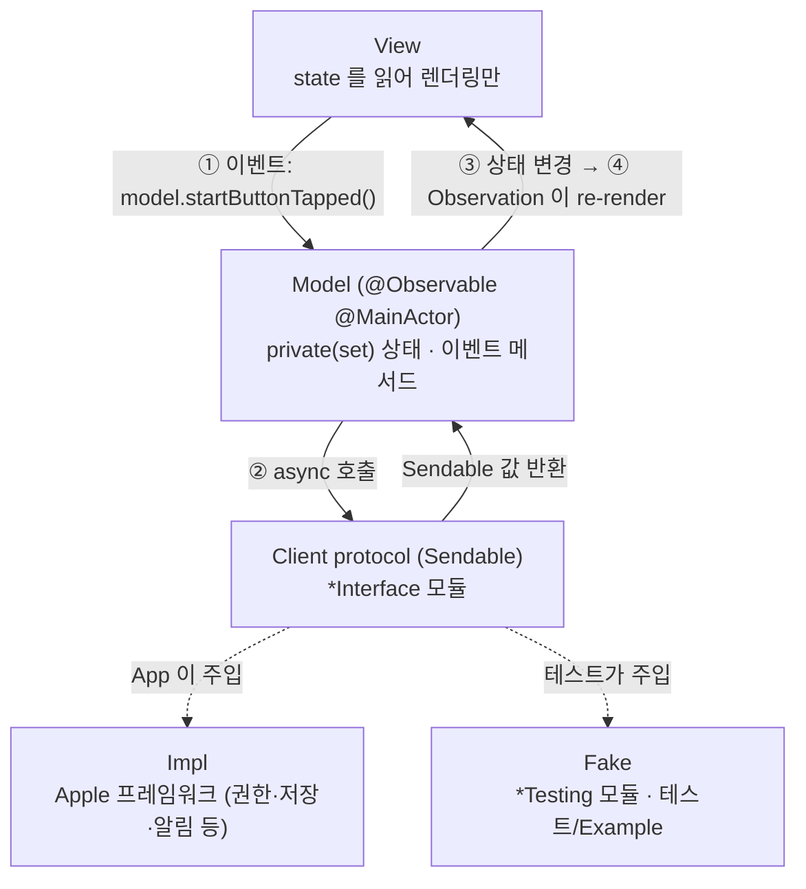
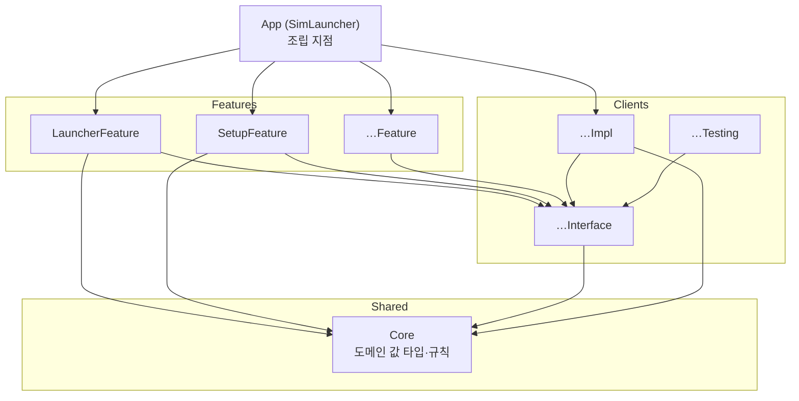

# 아키텍처

두 가지 결정 위에 서 있다.

1. **규칙 기반 단방향 MV.** SwiftUI 의 `@Observable` 모델을 View 에 직접 연결한다(Apple 샘플과 같은 방식). 단방향 흐름은 프레임워크가 아니라 규칙과 lint 로 강제한다.
2. **모듈러 아키텍처.** 외부 시스템은 Client 모듈로 감싸고, 각 Client 를 Interface / Impl / Testing 으로 나눈다. Feature 는 Interface 에만 의존한다.

## 1. 실행 흐름



### 단방향 규칙
| # | 규칙 | lint 로 강제 |
|---|---|---|
| 1 | Model 의 상태 프로퍼티는 모두 `public private(set) var` | 리뷰 |
| 2 | View 는 Model 의 **이벤트 메서드**만 호출한다. 이름은 "무슨 일이 일어났는가"로 짓는다: `onAppear()`, `startButtonTapped()`, `queryChanged(_:)` | 리뷰 |
| 3 | 입력 컨트롤은 `Binding(get: { model.query }, set: { model.queryChanged($0) })` 으로 연결한다. 목록 다중 선택도 같다: `List(selection: Binding(get: { model.selection }, set: { model.selectionChanged($0) }))` (선택은 툴바 동작의 대상이고 목록을 다시 읽을 때 사라진 기기를 빼는 규칙이 있어 Model 상태다, 규칙 8). `$model.query`·`$catalogModel.query` 처럼 Model 프로퍼티의 `$` 바인딩 금지 | `no_two_way_model_binding` (`$model.`·`$…Model.` 을 잡는다) |
| 4 | 부수효과(권한, 저장, 알림, 결제)는 Model 메서드 안에서 Client 를 통해서만 실행한다 (Model 이 소유한 흐름 타입이 그 메서드 안에서 Client 를 부르는 것도 여기에 든다, 아래 흐름 타입 문단). View 에서 `Task { UNUserNotificationCenter… }` 금지 | `system_framework_only_in_impl`, `preferences_only_in_preferences_impl`(사용자 설정 저장) |
| 5 | Model 은 `@MainActor`, Client 가 주고받는 값은 `Sendable`. 비 Sendable 프레임워크 객체는 식별자나 Core 의 `Sendable` 값 타입으로 바꿔서 넘긴다 | 컴파일러 (Swift 6 strict) |
| 6 | Model 끼리 직접 참조하지 않는다. 화면 간 흐름은 App 이 조립하거나 공유 Client 를 거친다. 한 화면의 두 Model 이 서로의 상태를 봐야 하면(예: 시트끼리 서로 막기) App 이 주입한 클로저로 잇는다 (아래 `AndroidAppSheetsModel` 문단) | 모듈 경계 |
| 7 | Model 은 App(또는 Example 앱)이 `@State` 로 **소유**하고, View 는 `let model: XxxModel` 로 **참조**만 한다. View 안에서 Model 을 생성하거나 `@State` 로 다시 감싸지 않는다. 한 View 가 Model 을 둘 받을 수 있다(예: `LauncherView(model:catalogModel:)`). View 의 Model 프로퍼티 이름은 `model` 또는 `…Model` 로 짓는다(lint `no_two_way_model_binding` 이 그 이름으로 잡는다) | 리뷰 |
| 8 | View 전용 일시 상태(애니메이션, 포커스, 시트 표시 여부)는 View 의 `@State private var` 로 둬도 된다. 화면에만 걸린 시스템 UI 설정(예: 자동 잠금 끄기 `isIdleTimerDisabled`)도 View 가 맡는다. 저장·외부로 남지 않고 화면을 떠나면 되돌리므로 규칙 4 의 부수효과가 아니다. 비즈니스 의미가 있으면 Model 로 옮긴다 | 리뷰 |

같은 화면의 상태(기기 목록·진행 작업·알림)를 함께 쓰는 흐름은 하위 Model 로 나누지 않고, 공유 상태와 규칙을 Feature 의 값 타입(예: `LauncherNotices`·`DeviceActivity`(기기별 진행 작업과 URL 설치의 받기 단계. 여러 기기가 한 받기를 함께 보이고 어느 행에서든 함께 취소하는 받기 묶음, 여러 기기 동작을 시작할 때 대상마다 내린 판정 `InstallStart`(시작한 기기·건너뛴 기기와 이유·소유자 번호), 묶음이 시작한 기록만 지우는 소유자 번호)·`ScreenshotActivity`(기기별 촬영 중. 기기 작업과 겹칠 수 있다)·`RecordingActivity`(기기별 녹화 단계: 시작 중·녹화 중(시작 시각)·저장 중과 멈춘 이유. 기기 작업과 겹칠 수 있다), Android 기기 목록의 `AndroidDeviceActivity`(기기별 켜기·끄기·삭제·초기화·앱 설치·앱 실행·링크 열기 작업, URL·카탈로그에서 설치의 받기 단계 `AndroidDownloadStage`(받는 중·취소 중)와 여러 기기가 한 받기를 함께 보이고 어느 행에서든 함께 취소하는 받기 묶음, 여러 기기 설치를 시작할 때 대상마다 내린 판정 `AndroidInstallStart`(시작한 기기·건너뛴 기기와 이유·소유자 번호. 대상은 `AndroidTargetDevice`), 함께 켜기·여러 기기 설치 묶음의 소유자 번호)·`AndroidScreenshotActivity`(기기별 촬영 중)·`AndroidRecordingActivity`(기기별 녹화 단계: 시작 중·녹화 중(시작 시각)·저장 중과 멈춘 이유 `AndroidRecordingStopReason`(중지·기기 꺼짐·앱 종료). 둘 다 기기 작업 중 앱 설치·앱 실행·링크 열기와 겹칠 수 있다). `DeviceActivity`·`ScreenshotActivity`·`RecordingActivity` 와 같은 규칙이지만 Feature 끼리 공유하지 않으므로 따로 둔다))으로 떼어 별도 파일에 둔다. 다른 흐름과 공유하지 않는 독립 상태(예: 생성 시트 초안 `DeviceCreationDraft`, URL 설치 시트 초안 `InstallURLDraft`, Android 의 링크 열기 시트 초안 `AndroidOpenURLDraft`·앱 실행 시트 초안 `AndroidLaunchAppDraft`(기기에서 읽은 설치 앱 목록과 불러오기 번호)·URL 에서 설치 시트 초안 `AndroidInstallURLDraft`·카탈로그에서 설치 시트 초안 `AndroidCatalogInstallDraft`(iOS `CatalogInstallDraft` 와 같은 구역·받기 식별자·선택 유지 규칙을 Android 앱(`BuildCatalog.apps(for: .android)`)에만, 구역에 Android 앱이 없는 이유 `AndroidCatalogEmptyReason`. 화면 세션 상태라 Core 로 옮기지 않는다))도 값 타입으로 둔다. Model 은 그 값을 `public private(set) var` 로 갖고 mutating 메서드만 부른다 (View 는 setter 가 없어 부를 수 없다). `private(set)` 은 같은 파일에서만 바꿀 수 있으므로 Model 상태를 직접 바꾸는 부분(진행 기록의 시작·끝, 시트 초안, Model 이 소유한 Task)은 Model 파일에 둔다. Model 파일이 아래 `file_length` 경고 기준을 넘으면, 흐름에서 Model 상태를 직접 바꾸지 않고(바꾸는 것은 창구로만) Client 호출을 잇는 부분을 같은 Feature 의 흐름 타입으로 뺀다 (예: 앱 설치의 `AppInstallFlow`: 풀기 → 검사·판정 → 켜기 → 설치 → 실행. 여러 기기면 받기·풀기·검사는 한 번만 하고 기기별 판정 → 켜기 → 설치 → 실행을 동시에 돌려 결과를 알림 하나에 모은다. 같은 창구를 쓰는 링크 열기와 받기 결과 해석도 맡는다. 기기 명령의 `DeviceCommandFlow`: 끄기·만들기·삭제·초기화 → 실패면 알림 → 다시 읽기. 창구는 `AppInstallFlow.Host` 를 함께 쓴다. 스크린샷·녹화의 `ScreenCaptureFlow`: 저장 파일 예약 → 캡처 → 실패면 빈 예약 파일 지우기·알림, 성공이면 Finder 보이기. Android 기기의 스크린샷·녹화는 같은 단계를 `AndroidScreenCaptureFlow` 가 한다(녹화 파일은 `.mp4`). Android 앱 설치의 `AndroidAppInstallFlow`: (URL·카탈로그면 받은 결과 해석 →) apk 검사 → 지금 목록으로 대상 확인 → 기기 값(API·ABI) → 판정 → 설치 → 받은 파일 지우기 → 실행 → 다시 읽기. 로컬 apk 와 받은 apk 가 검사 뒤 같은 단계를 돌고, 받은 파일은 모든 경로에서 정확히 한 번(한 기기면 설치 명령이 끝나면 곧바로, 설치 전에 끝나면 알림 전에. 여러 기기면 모든 기기의 흐름이 끝난 뒤) 지운다. 여러 기기면 `AppInstallFlow` 처럼 받기·검사는 한 번만 하고 기기별 대상 확인 → 판정 → 설치 → 실행을 동시에 돌려 결과를 알림 하나에 모은다(꺼진 기기는 켜지 않고 이유와 함께 건너뛴다). 같은 창구를 쓰는 앱 실행·링크 열기·앱 작업 대상 확인도 맡는다 (앱 실행 시트의 설치 앱 목록 읽기는 시트 Model `AndroidAppSheetsModel` 이 한다). Model 파일이 600 줄을 넘기 전에 처음부터 뺐다. Android 기기 명령의 `AndroidDeviceCommandFlow`: 켜기·끄기·만들기·삭제·초기화 → 실패면 알림 → 다시 읽기(만들기는 Model 이 새 기기를 고른 뒤 다시 읽는다). 함께 켜기(여러 대)는 기기마다 동시에 켜기 → 다시 읽기 → `finished` 로 그 행을 풀고, 실패가 있으면 결과 알림 하나에 모은다. 창구는 `AndroidAppInstallFlow.Host` 를 함께 쓴다. 7-D 에서 `AndroidDevicesModel` 을 600 줄 아래로 두려고 동작을 바꾸지 않고 옮겼고, 7-E 에서 함께 켜기도 같은 이유로 옮겼다). 흐름 타입은 필요한 Client 만 갖는 internal `@MainActor struct` 이고, Model 이 `@ObservationIgnored private let` 으로 소유해 진행 기록을 시작한 Model 메서드(이벤트 메서드와 그것이 부르는 private 도우미, 그 메서드가 만들어 Model 이 소유한 Task 안 포함. 예: 녹화) 안에서만 부른다 (그래서 Client 호출은 여전히 Model 메서드 안에서 시작한다, 규칙 4). Model 상태에는 Model 이 부를 때마다 넘기는 창구(`AppInstallFlow.Host`·`ScreenCaptureFlow.Host`, Android 의 `AndroidAppInstallFlow.Host`·`AndroidScreenCaptureFlow.Host`: 알림 쌓기·다시 읽기·지금 목록 읽기·기기별 끝(`finished`: 여러 기기 묶음에서 먼저 끝난 기기의 기록을 소유자 번호로 지워 그 행을 푼다)·녹화 시작 기록·멈춘 이유 읽기 같은 `@MainActor` 클로저. `AppInstallFlow.Host`·`AndroidAppInstallFlow.Host` 는 여러 기기 흐름이 기기별 자식 작업에 넘기므로 `Sendable` 이고 클로저도 `@Sendable` 이다. `AndroidAppInstallFlow.Host` 의 `finished` 는 기록을 지운 뒤 앱 밖 켜는 중으로 남은 기기의 자동 다시 읽기도 정한다)로만 닿고, 창구는 저장하지 않는다 (Model 을 잡는다. 녹화 Task 클로저가 흐름 호출 동안 창구를 잡는 것은 저장이 아니다). 흐름 안의 Client 이음은 다른 Model 메서드도 그 흐름 타입의 메서드로 부를 수 있다 (예: 켜기 → Simulator 앱 열기 단계는 `AppInstallFlow` 안에 있고, 켜기 버튼·툴바 "선택한 기기 켜기"·링크 열기도 그 단계를 부른다). 소유 프로퍼티와 창구가 `private` 이라 View 는 흐름 타입에 닿지 못하고(컴파일러), View·다른 타입이 흐름 타입을 만들지 않는 것과 창구를 저장하지 않는 것은 리뷰로 본다. Model 파일을 나누려고 상태 변경 도우미나 Client 프로퍼티를 internal 로 열어 다른 파일 extension 에 두지 않는다 (View 가 부를 수 있게 돼 규칙 2·4 를 컴파일러가 막지 못한다). 다른 흐름과 상태를 공유하지 않고 자기 비동기 흐름이 있는 시트는 같은 Feature 의 별도 Model 로 둔다(예: 카탈로그에서 설치 시트의 `CatalogInstallModel`. 카탈로그를 받고 고르는 동안 기기 목록·진행 작업·알림을 쓰지 않는다). 그 Model 도 App 이 소유해 View 에 넘기고(규칙 7), 다른 Model 의 흐름으로 이어지는 마지막 동작(고른 버전 설치)은 App 이 주입한 클로저(`installRequested` → `LauncherModel.catalogInstallRequested(_:)`)로 넘긴다(규칙 6). 그 요청(`CatalogInstallRequest`)은 대상 기기를 여러 대 담는다(행 메뉴는 그 기기 한 대, 툴바 "선택한 기기에 앱 설치" 는 고른 기기). 두 Model 의 시트끼리 서로 막는 가드는 없고, 시트가 창을 막는 모달이라는 점, 작업 중인 기기의 행 메뉴 비활성, 설치할 때 `LauncherModel` 이 기기를 지금 목록으로 다시 확인하는 것에 기댄다. 툴바 "카탈로그에서…" 는 고른 기기 중 작업 중인 기기도 대상에 넣고, 그 기기는 설치를 시작할 때 `LauncherModel` 의 시작 판정이 이유(다른 작업 중)와 함께 건너뛴다. Android 기기 목록도 같다: 행 "앱 설치" 메뉴의 "URL 에서…"·"카탈로그에서…" 시트는 별도 Model `AndroidDownloadInstallModel`(App 소유) 하나에 두고(두 시트는 동시에 하나만 연다), 고른 주소·버전은 `installRequested` → `AndroidDevicesModel.downloadInstallRequested(_:)` 로 넘긴다. 요청(`AndroidDownloadInstallRequest`)은 대상 기기 여러 대(`AndroidTargetDevice`. 행 메뉴는 그 기기 한 대, 툴바 "선택한 기기에 앱 설치" 는 고른 기기)와 출처(입력한 주소·카탈로그, 받기·받은 파일 실패 문구만 고른다)를 담는다. 툴바에서 열 때는 iOS 와 같이 고른 기기 중 작업 중인 기기도 대상에 넣고, 설치를 시작할 때 `AndroidDevicesModel` 의 시작 판정이 이유와 함께 건너뛴다. iOS 와 달리 URL 시트도 이 Model 에 둔다 (URL 시트 초안은 기기 목록·진행 기록과 상태를 함께 쓰지 않고, `AndroidDevicesModel.swift` 가 이미 600 줄에 가까웠다). 받기는 `AndroidDevicesModel` 이 소유한 Task 로 하고(행에 진행·취소, View 가 사라져도 계속), 받기 시작과 Task 저장 사이에 await 를 두지 않는다. 행 "앱 실행…"·"링크 열기…" 시트도 별도 Model `AndroidAppSheetsModel`(App 소유) 하나에 둔다(두 시트는 동시에 하나만 연다. 앱 실행 시트가 기기에서 설치 앱 목록을 읽는 자기 비동기 흐름이 있고, 7-E 에서 `AndroidDevicesModel.swift` 를 600 줄 아래로 두려고 동작을 바꾸지 않고 옮겼다). 확정한 앱·링크는 `launchRequested`·`openURLRequested` → `AndroidDevicesModel.launchAppRequested(_:)`·`openURLRequested(_:)` 로 넘기고(요청 `AndroidLaunchAppRequest`·`AndroidOpenURLRequest`: 기기 한 대와 그 라벨, 고른 앱·링크), 그쪽이 지금 목록으로 대상을 다시 확인한 뒤 진행 기록을 시작해 실행한다. 이 두 시트는 다른 시트 Model 과 달리 나누기 전의 서로 막기를 그대로 두려고 App 이 두 Model 을 클로저 둘로 잇는다(규칙 6): `AndroidDevicesModel` 은 `appSheetPresented`(App 이 시트 Model 의 `hasPresentedSheet` 로 잇는다)로 앱 시트가 떠 있으면 만들기 시트·삭제·초기화 확인을 열지 않고(`hasPresentedSheet`·`canCreateDevice`), 시트 Model 은 `target`(App 이 읽기 전용 `AndroidDevicesModel.appSheetTarget(_:for:)` 로 잇는다: 목록에 있고 그 작업을 시작할 수 있으며 만들기 시트·확인 대화상자가 없을 때만 그 기기)이 기기를 돌려줄 때만 연다. 만드는 순서 때문에 App(과 Example·테스트)은 뒤에 만든 시트 Model 을 상자(`final class` 하나, 약한 참조)로 앞 Model 의 클로저에 넘긴다. 상태를 바꾸지 않는 읽기 전용 계산 프로퍼티는 Model 의 다른 파일 extension 에 둘 수 있다 (`private(set)` 은 쓰기만 막는다). 레포 전체의 lint `file_length` 경고 기준은 600 줄이다 (`.swiftlint.yml`. 한 화면에 흐름이 많은 Launcher Model 이 500 줄을 넘기 때문). 넘으면 기준을 올리지 않고 위 흐름 타입으로 뺀다.

메인 창은 App 의 `MainWindow` 가 사이드바(iOS / Android, `NavigationSplitView`)로 나눈다. 고른 칸은 View 일시 상태(규칙 8)라 앱을 다시 켜면 iOS 칸이다. 칸을 옮기면 떠난 칸의 View 가 사라지고, 돌아오면 새로 만들어져 `onAppear` 가 다시 읽는다 (iOS 칸으로 돌아오면 Setup 에서 돌아올 때처럼 기기 목록을 다시 읽는다). Launcher 의 시트를 띄운 채로는 사이드바를 누를 수 없다 (시트가 창을 막는다). iOS 칸 안의 화면 전환(규칙 6)은 App 이 Setup 과 Launcher 사이에서 한다. `SimLauncherApp` 은 `SetupModel.isFinished` 로 둘 중 하나를 보인다: 앱 시작 직후 첫 판정이 Xcode 준비됨이면 곧바로 Launcher(기기 목록. 기본 iOS 런타임 설치 여부는 보지 않는다), 아니면 Setup 의 단계 안내이고, Setup 안에서 Xcode 준비가 끝나면 "기기 목록 열기"로 넘어간다. Setup 은 Xcode 가 준비됨일 때만 같은 확인에서 기본 iOS 런타임도 확인하고(`simctl runtime list`·SDK plist, 네트워크 없음), 없으면 네 번째 단계 "iOS 시뮬레이터 설치"를 보인다. 설치는 사용자가 누를 때만 하고, 설치 중에는 다시 확인·앱 활성화 확인과 "기기 목록 열기"를 막는다. Launcher 의 Setup 진입 버튼(툴바 "개발 환경", 빈 화면(iOS 런타임 없음·만들 수 있는 기기 종류 없음)과 목록 위 안내 줄의 iOS 설치 버튼, 목록 읽기 실패 화면의 "개발 환경 열기")은 모두 `LauncherModel.setupButtonTapped()` 가 App 이 주입한 클로저(`setupRequested`)를 불러 App 이 `SetupModel.reopened()` 로 Setup 을 다시 연다 (Feature 끼리 의존하지 않는다). 판정 전에는 `LauncherView` 를 만들지 않아 기기 목록을 읽는 `simctl` 이 돌지 않고, Launcher 로 돌아올 때마다 View 가 새로 만들어져 목록을 다시 읽는다. Setup 은 보이는 동안 앱 활성화(`NSApplication.didBecomeActiveNotification`. macOS 에서는 다른 앱에 갔다 와도 `scenePhase` 가 바뀌지 않는다)마다 다시 확인한다(설치 중에는 Model 이 무시한다). 앱 종료 요청은 App 의 `AppDelegate`(`applicationShouldTerminate`)가 받는다: 런타임 설치가 준비·내려받기 중이면 먼저 그 확인 대화상자를 띄우고(설치 단계·멈추는 중이면 묻지 않는다), 그다음 Android 도구 설치가 받기·확인·풀기 중이면 "Android 도구 설치를 멈추고 종료할까요?" 를 묻고(마무리 단계·멈추는 중이면 묻지 않는다. 계획 받기·동의 대기는 메모리뿐이라 묻지 않고 끝낸다), 그다음 녹화 중(저장 중 포함. iOS `LauncherModel.isRecording` 과 Android `AndroidDevicesModel.isRecording` 중 어느 쪽이든)이면 "녹화를 멈추고 저장한 뒤 종료할까요?" 를 한 번 묻는다 (여럿이 겹치면 차례로 묻고, 어느 쪽이든 "취소"면 아무것도 멈추지 않고 종료하지 않는다). 기다릴 것이 있으면 `.terminateCancel` 을 돌려주기 전에 네 Model 의 종료 처리를 함께 시작하고(`Task.immediate` 라 첫 대기 전까지 그 호출 안에서 돈다), 모두 끝나기를 기다린 뒤 `NSApp.terminate` 를 다시 부른다: `LauncherModel.appTerminationRequested()` 와 `AndroidDevicesModel.appTerminationRequested()` 는 각자 모든 녹화를 멈추고 저장(Finder 보이기까지. Android 는 기기에서 가져와)하고, `SetupModel.appTerminationRequested()` 는 설치를 멈추고(설치 단계면 기다리고), `AndroidSetupModel.appTerminationRequested()` 는 Android 도구 설치를 단계와 관계없이 취소하고 끝나기를 기다린다(마무리 단계 중이면 그 패키지의 마무리(이름 바꾸기·스테이징 지우기)만 끝내고 남은 패키지는 받지 않는다). 넷을 함께 시작해 녹화 멈춤(iOS 마무리 측정: 짧은 녹화 0.1초 안팎, 15분 녹화 1.54초. 파일 크기에 비례. Android 측정: 기기 안 멈춤 0.27~0.82초 + 가져오기 7.7 MB 0.07초. adb 가 답하지 않아도 멈춤·가져오기마다 시간 제한이 있어 갇히지 않는다, §4 Android 앱 설치 행)과 Android 취소가 런타임 "설치 단계"(수 분) 대기에 묻히지 않고, 설치를 기다리는 동안 녹화가 계속 커지지 않는다 (넷은 공유 자원이 없어 겹쳐도 된다). 그래서 전체 대기는 넷 중 가장 긴 것이다. Setup·Android 는 설치 중이 아니어도 종료를 알려 대기 동안 새 설치를 시작하지 않는다. 종료를 기다리는 동안 "녹화"·설치 버튼을 눌러도 새 녹화·설치를 시작하지 않는다. `.terminateLater` 는 기다리는 동안 다시 종료를 요청하면 AppKit 이 바로 끝내 버려 쓰지 않는다. 그래서 로그아웃·재시동·시스템 종료 중에 기다릴 것(설치·녹화)이 있으면 `.terminateCancel` 이 macOS 의 로그아웃 자체를 취소한다: 설치를 멈추거나 녹화를 저장하고 앱만 끝나며, 사용자가 다시 로그아웃해야 한다. 앱이 비정상 종료(크래시·강제 종료)되면 이 경로를 거치지 않아 Android 도구 설치의 스테이징 폴더(`<SDK>/.simlauncher-staging-<UUID>`)와 받기 폴더가 남고(다음에 Android 화면을 열 때 지운다), 녹화를 멈추지 못하고, 그 기기는 끌 때까지 녹화가 이어진다 (`simctl` 이 남거나 SIGINT 없이 끝나도 CoreSimulatorService 쪽 녹화가 이어진다, 측정. 다시 녹화하려면 기기를 껐다 켠다. 정리는 하지 않는다). Android 녹화는 앱의 녹화 adb 가 끝나면 기기 안 screenrecord 도 곧 끝나지만(측정), adb 가 남으면 API 34 이상(시간 제한 없음)에서는 기기를 끄거나 adb 가 끝날 때까지 이어질 수 있다(adb 가 남는 경우는 확인하지 못했다). 녹화 파일은 기기 안(`/data/local/tmp/simlauncher-recording-*.mp4`)에 남고, 그 기기에서 다음에 녹화를 시작할 때 지운다(아직 녹화 중인 파일은 지워도 공간이 돌아오지 않는다. 기기를 껐다 켜면 녹화가 멈춘다). 창을 닫아도 앱과 설치·녹화는 계속되고, Dock 아이콘으로 다시 열면 진행이 보인다. 녹화 밖의 Launcher 작업(URL 받기·설치 등)은 종료 요청 때 보지 않아 묻지 않고 끝낸다. 그때 남은 임시 폴더(`SimLauncher-Download-*`·`SimLauncher-Unzip-*`)는 다음에 기기 목록 화면이 열릴 때(`onAppear`) 지운다. Android 기기(에뮬레이터)도 녹화 밖에서는 종료 요청 때 보지 않는다: 켜진·켜는 중인 에뮬레이터와 앱의 adb 가 띄운 adb 서버(`ADB_MDNS=0`. Android Studio 와 함께 쓰는 서버라 그 서버가 다시 시작될 때까지 Studio 의 무선 디버깅 기기 탐색이 꺼진다)는 별도 프로세스라 앱이 끝나도 남고(켜기 완료를 기다리던 작업은 그냥 끝난다), 기기는 다음 실행에서 잠금 파일·adb 로 다시 보인다 (iOS 시뮬레이터가 켜진 채 남는 것과 같다, §4 Android 기기 행). Android 앱 받기(URL·카탈로그)·설치·실행·링크 열기도 묻지 않고 끝낸다 (Launcher 의 URL 받기·설치와 같다. 남은 `SimLauncher-Download-*` 는 다음에 iOS 기기 목록·Android 기기 목록·Android 도구 화면 중 하나가 열릴 때 지운다. adb 가 끝나면 기기에서 설치가 끝나거나 취소되고, apk 검사 임시 폴더 `SimLauncher-APK-*` 는 링크 하나뿐이라 남아도 정리하지 않는다, §4 Android 앱 설치 행). 창을 닫아도 Launcher 의 받기·설치는 계속된다. Android 칸은 Xcode 준비 여부와 관계없이 열리고, iOS 칸처럼 App 이 `AndroidSetupModel.isFinished` 로 Android 도구 화면(`AndroidSetupView`)과 Android 기기 목록(`AndroidDevicesView`) 중 하나를 보인다: 앱 시작 뒤 첫 확인 결과가 셋 다 설치됨(위치가 폴더)이면 곧바로 기기 목록, 아니면 도구 화면이고, 도구 화면은 마지막 확인이 셋 다 설치됨이고 확인·계획·설치 중이 아니면(`canOpenDeviceList`) "기기 목록 열기"(`deviceListButtonTapped()`)를 보인다 (자동으로 넘어가지 않는다: 설치 결과 줄을 볼 수 있게). 판정 전에는 `AndroidDevicesView` 를 만들지 않아 기기 목록 읽기·adb 가 돌지 않는다. 기기 목록의 툴바 "Android 도구" 와 실패 화면(Android 도구를 찾지 못함)의 "Android 도구 열기" 는 `AndroidDevicesModel.setupButtonTapped()` 가 App 이 주입한 클로저(`setupRequested`)를 불러 App 이 `AndroidSetupModel.reopened()` 로 도구 화면을 다시 연다 (이미 셋 다 설치돼 있어도 다시 확인한 뒤 "기기 목록 열기" 로 돌아온다). 도구 화면은 보일 때(`onAppear`)와 앱 활성화·"다시 확인" 때 SDK 상태를 파일만 읽어 확인하고(네트워크·명령 없음. 계획 받기·동의 대기·설치 중에는 무시하고, 설치가 끝나면 결과와 관계없이 다시 확인한다), 화면을 열 때 설치 중이 아니면 지금 SDK 위치의 남은 스테이징 폴더와 남은 받기 폴더를 먼저 지운다. "Android 도구 설치" 를 누를 때만 Google 저장소 XML 두 개를 받아 없는 구성 요소의 설치 계획을 만들고, 동의 기록에 없는 라이선스 원문이 있으면 동의 시트를 띄운 뒤 설치한다. 계획 받기·설치 Task 는 `AndroidSetupModel` 이 소유해 칸을 옮기거나 창을 닫아도 계속되고, 동의 시트는 View 상태가 아니라 Model 의 계획 상태로 띄우므로 돌아오면 다시 보인다. 기기 목록(`AndroidDevicesModel`)은 보일 때·"새로 고침"·앱 활성화(3초 뒤 한 번 더: 에뮬레이터 창을 닫은 직후 adb 가 아직 켜짐으로 답하는 경우)·SDK 위치 바뀜·기기 작업이 끝날 때 AndroidEmulator Client 로 다시 읽는다. 읽는 중에 온 요청은 버리지 않고 한 번 더 읽기로 모으고, 늦게 끝난 앞선 읽기가 나중 결과를 덮지 않는다. 다시 읽은 목록에서 녹화 중인 기기가 없어졌거나 꺼짐(`.shutdown`)이면 그 녹화를 멈춘다 (녹화 상태를 따로 폴링하지 않는다. 기기 안 녹화 파일은 꺼진 뒤 가져올 수 없어 "저장하지 못했습니다" 알림을 띄운다). iOS 와 달리 켜는 중(`.booting`)은 멈추지 않는다: Android 의 켜는 중은 켜진 기기에서도 `getprop` 실패·10초 초과나 `emu avd name` 실패로 나와(Mac 메모리가 모자랄 때 생긴다) 녹화를 잘못 끊기 때문이다. 앱 작업 없이 "켜는 중" 인 기기(앱 밖에서 켜거나 끄는 중)가 있으면 2초마다 다시 읽다가, 그런 기기가 없어지거나 칸을 떠나면(`onDisappear` → `viewDisappeared()`) 멈춘다. SDK 위치는 AndroidSDK Client 가 App 이 주입한 provider(Preferences 의 `AndroidSDKPath` 를 Core `AndroidSDKRootChoice.resolve` 로 푼 값)로 공개 메서드마다 한 번 읽는다. 설정 창에서 SDK 위치를 바꾸면 `SettingsModel` 이 App 이 주입한 클로저(`androidSDKLocationChanged`)를 불러 App 이 `AndroidSetupModel.sdkLocationChanged()` 와 `AndroidDevicesModel.sdkLocationChanged()` 로 함께 넘긴다 (설정 창은 같은 앱의 다른 창이라 앱 활성화 알림이 오지 않는다. Feature 끼리 의존하지 않는다, 규칙 6): 도구 화면은 계획 받기·동의 대기 중이면 계획을 버리고, 설치 중이면 원래 위치에 끝까지 설치한 뒤 새 위치로 다시 확인하고(결과 줄이 원래 위치를 알린다), 아니면 바로 다시 확인한다. 기기 목록은 보이는 중이면 새 위치로 다시 읽고, 보이지 않으면 다음에 보일 때 읽는다. 설정 창은 SwiftUI `Settings` 씬이고(⌘,), App 이 `SettingsModel` 을 `@State` 로 소유한다. 사이드바의 어느 칸·화면이든, 메인 창을 닫았어도 열린다. 씬 내용과 Model 은 앱 시작 때 한 번 만들어지고 창을 닫았다 열어도 다시 만들어지지 않으므로, 목록 읽기는 창이 열릴 때(`onAppear()`) 한다. 설정 창은 앱 시작 때 카탈로그를 받지 않고, 사용자가 "등록" 을 누를 때 한 번 받아 확인한다. 확인 중 창을 닫으면(`onDisappear` → `windowClosed()`) 확인을 취소하고 저장하지 않는다. 종료 요청 때도 묻지 않는다(메모리로만 받아 남는 것이 없다). 받기 Client 는 Launcher 와 같은 인스턴스를 쓰고, 설정 Client 도 하나를 설정 창(등록·삭제)과 카탈로그에서 설치 시트(읽기만)가 함께 쓴다. 기기 행 "앱 설치" 메뉴나 툴바 "선택한 기기에 앱 설치" 의 "카탈로그에서…" 시트는 열 때와 "새로 고침" 을 누를 때만 설정을 읽고 등록된 카탈로그를 동시에 받아(해석은 메인 밖) 카탈로그마다 결과를 보이며, 앱 시작 때·기기 목록을 볼 때는 받지 않는다. 시트를 연 채 설정 창에서 등록·삭제하면 시트의 "새로 고침" 으로 반영된다. 시트의 Model(`CatalogInstallModel`)은 App 이 `@State` 로 소유하고, 고른 버전은 App 이 주입한 `installRequested` 로 `LauncherModel` 이 URL 설치와 같은 경로(받기 → 풀기 → 검사 → 설치 → 실행. 여러 기기면 한 번 받고 기기별로 동시에)로 설치한다. 등록된 카탈로그가 없으면 시트가 설정 창을 여는 버튼(SwiftUI `openSettings`)을 보인다(관리자가 잠근 빈 목록이면 담당자 문의 안내만).

### 예시 (알림 권한을 묻는 OnboardingFeature)
```swift
@MainActor
@Observable
public final class OnboardingModel {
  public private(set) var access: NotificationAccess

  @ObservationIgnored private let notification: any NotificationClient

  public func startButtonTapped() async {
    self.access = await self.notification.requestAccess()
  }
}

// View
Button("시작하기") { Task { await self.model.startButtonTapped() } }

// App: 화면 간 흐름은 App 이 정한다 (규칙 6)
if self.onboardingModel.access == .authorized {
  LauncherView(model: self.launcherModel, catalogModel: self.catalogInstallModel)
} else {
  OnboardingView(model: self.onboardingModel)
}
```

## 2. 모듈 구조



### 모듈 종류와 타깃
| 종류 | 위치 | 타깃 | 역할 |
|---|---|---|---|
| App | `Projects/App` | `SimLauncher` | 유일한 조립 지점. Impl 을 생성해 Model 에 주입. 메인 창의 사이드바(`MainWindow`: iOS / Android), 화면 간 흐름과 앱 종료 요청 처리(`AppDelegate`: 런타임 설치가 준비·내려받기 중이면 확인을 받아 설치를 멈추고, 설치 단계이거나 이미 멈추는 중이면 묻지 않고 끝나기를 기다린다. Android 도구 설치가 받기·확인·풀기 중이면 확인을 받고, 단계와 관계없이 설치를 취소해 끝나기를 기다린다(녹화·런타임 설치 대기와 겹치게 함께 시작. 마무리 단계·멈추는 중이면 묻지 않는다). iOS·Android 어느 쪽이든 녹화 중이면 확인을 한 번 받아 두 기기 목록의 모든 녹화를 멈추고 저장한 뒤(설치 멈춤과 함께) 종료. Launcher 의 URL 받기·설치 중에는 묻지 않고 끝내고, 남은 임시 폴더는 다음에 기기 목록을 열 때 지운다. Android 기기의 apk 받기·설치·실행·링크 열기도 묻지 않고 끝내고, 남은 받기 폴더는 다음에 iOS 기기 목록·Android 기기 목록·Android 도구 화면 중 하나가 열릴 때 지운다), 설정 창(`Settings` 씬), 카탈로그에서 설치 시트의 Model(`CatalogInstallModel`) 조립과 그 설치 요청을 `LauncherModel` 로 넘기기, Android 기기 행의 URL·카탈로그 시트 Model(`AndroidDownloadInstallModel`, `makeAndroid` 안에서 만든다) 조립과 그 설치 요청을 `AndroidDevicesModel` 로 넘기기, Android 기기 행의 앱 실행·링크 열기 시트 Model(`AndroidAppSheetsModel`, `makeAndroid` 안에서 만든다) 조립과 그 실행·열기 요청을 `AndroidDevicesModel` 로 넘기기와 두 Model 의 서로 막기 잇기(`appSheetPresented`·`target`, §1 별도 Model 문단), AndroidSDK Client 의 SDK 위치 provider 와 설정 창의 SDK 위치 바뀜을 `AndroidSetupModel`·`AndroidDevicesModel` 로 넘기기, Android 칸의 도구 화면(AndroidSetup) ↔ 기기 목록(AndroidDevices) 전환(`AndroidSetupModel.isFinished`), `AndroidEmulatorClientImpl` 조립(AndroidSDK 와 같은 `CommandClientImpl`·SDK 위치 provider, 홈 폴더, `AndroidHostArchitecture(AppBundleClientImpl.hostArchitecture)`), `AndroidPackageClientImpl` 조립(같은 `CommandClientImpl`)과 `AndroidDevicesModel` 주입(Launcher·Settings·AndroidSDK 와 같은 `DownloadClientImpl` 인스턴스도 넣는다. 지금 받는 폴더 목록을 그 안에서 함께 써, 한쪽의 남은 폴더 정리가 다른 쪽이 받는 중인 폴더를 지우지 않는다) |
| Feature | `Projects/Features/<Name>` | `<Name>Feature` · `<Name>FeatureTests` · `<Name>FeatureExample` | 화면 하나 또는 흐름 하나. Model + View |
| Client | `Projects/Clients/<Name>` | `<Name>Interface` · `<Name>Impl` · `<Name>Testing` · `<Name>Tests` | 외부 시스템 경계 |
| Shared | `Projects/Shared/<Name>` | `<Name>` · `<Name>Tests` | 여러 모듈이 함께 쓰는 코드. `Core`(도메인 값 타입·규칙), 필요해지면 `DesignSystem`(공용 UI) |

- **Interface**: 프로토콜과 값 타입만. 부수효과 프레임워크(`.swiftlint.yml` 의 `system_framework_only_in_impl` 목록)를 import 하지 않는다.
- **Impl**: 프로토콜 구현. 구현 타입 이름은 `<Name>ClientImpl`. 부수효과 프레임워크(Photos·SwiftData·StoreKit·UserNotifications 등, 목록은 lint 규칙) import 는 여기서만. 그 밖의 부수효과 없는 Apple 프레임워크(CoreGraphics·ImageIO 등)는 Core 를 포함한 모든 레이어에서 쓸 수 있다. 제한은 권한·저장·외부 서비스 같은 부수효과를 Impl 에 가두기 위한 것이므로, 부수효과 없는 프레임워크를 피하려고 실행 비용을 들이지 않는다.
- **Testing**: `<Name>ClientFake`. 고정 값을 돌려주는 `struct` 로 시작하고, 호출 기록이 필요하거나 호출 사이에 상태가 남아야 하면(저장 결과, 바뀐 권한) 그때 상태를 `Mutex` 로 보호하는 `final class` 로 확장한다.
- **Example**: Fake 로 Feature 를 단독 실행하는 데모 앱. **`#Preview` 도 여기에 둔다** (Feature 모듈이 Testing 에 의존하지 않도록).
- **플랫폼**: iOS 전용은 `Simulator`·`AppBundle`·`DevEnvironment` Client, `Setup`·`Launcher` Feature 다 (이름은 바꾸지 않는다). Android 는 `AndroidSDK`·`AndroidEmulator`·`AndroidPackage` Client, `AndroidSetup`·`AndroidDevices` Feature 다. 두 플랫폼이 함께 쓰는 것은 `Command`·`Download`·`Preferences`·`Workspace` Client, `Settings` Feature, Core 다.
- **Shared**: 부수효과 프레임워크와 Client 모듈을 import 하지 않는다. Core 는 부수효과 없는 순수 코드이고(SwiftUI·UIKit·AppKit 도 쓰지 않는다. lint `core_no_ui_framework`), 여러 Client 의 Interface 가 함께 쓰는 값 타입을 둔다. DesignSystem 은 SwiftUI 까지 쓴다.
- Core 에는 기기·런타임·기기 종류 값 타입(`VirtualDevice`·`DeviceRuntime`·`DeviceType`·`DeviceInventory`)과 규칙을 둔다: 화면 목록(`DeviceList`: iOS 런타임 기기만 OS 별로 묶어 정렬하고, 보일 기기가 없으면 그 이유(iOS 런타임 없음 / 만들 수 있는 기기 종류 없음 / 기기 없음)), 생성 선택지(`DeviceCreationOptions`: 쓸 수 있는 iOS 런타임과 그 런타임이 지원하는 iPhone·iPad 종류. Model 의 시트 기본값과 Impl 의 실행 전 재확인이 함께 쓴다), 이름 검사(`DeviceName`: 앞뒤 공백을 뺀 1~100 자, 제어 문자 금지), 링크 검사(`DeepLink`: 앞뒤 공백을 빼고 `URL(string:)` 로 읽어 스킴이 있어야 한다. 경로·쿼리의 공백·한글은 퍼센트 인코딩), 내려받을 주소 검사(`DownloadURL`: 앞뒤 공백을 빼고 `URL(string:)` 로 읽어 https 스킴(대소문자 무시)과 호스트가 있어야 하고, 사용자 이름·비밀번호가 든 주소는 거절한다. 빌드 zip·카탈로그 주소에 함께 쓴다), 행별 허용 동작(`VirtualDevice.deleteAvailability`·`eraseAvailability` 가 돌려주는 `DeviceActionAvailability`: 삭제·초기화는 꺼진 기기만, 쓸 수 없는 기기는 삭제만). 앱 번들 값 타입(`AppBundleInfo`·`AppBundleID`·`CPUArchitecture`·`AppBundlePlatform`)과 설치 판정(`AppBundleInfo.installProblem`: 시뮬레이터용 플랫폼 → 이 Mac 아키텍처 → MinimumOSVersion 순서), 행별 설치 허용(`VirtualDevice.appInstallAvailability`: 쓸 수 있고 꺼짐·켜짐인 기기만. 꺼져 있으면 켜고 설치한다. URL 설치·링크 열기도 같은 규칙)도 Core 에 둔다. 스크린샷 파일 이름(`ScreenshotFileName`: `<기기 이름> (<런타임 이름>) <yyyy-MM-dd> <HH.mm.ss>.png`, 시각은 그레고리력·주어진 시간대. 기기·런타임 이름은 `/`·`:`·제어 문자·줄 구분자·방향 제어 문자를 `-` 로 바꾸고 앞뒤 공백을 빼고 맨 앞 `.` 을 `-` 로 바꾼 뒤 UTF-8 120·40 바이트에서 글자 경계로 자른다(저장 폴더 밖이나 숨김 파일이 되지 않는다). 같은 이름이면 확장자 앞에 ` 2`…` 99`)와 행별 촬영 허용(`VirtualDevice.screenshotAvailability`: 쓸 수 있고 켜진 기기만. 꺼진 기기는 켜지 않는다), 녹화 파일 이름(`RecordingFileName`: 규칙은 `ScreenshotFileName` 과 같고 확장자만 담는 형식 `RecordingContainer` 로 정한다(iOS 시뮬레이터 `.mov`, Android 기기 `.mp4`). 시각은 "녹화"를 누른 시각)도 Core 에 둔다. 녹화를 허용하는 기기 규칙은 따로 두지 않고 `screenshotAvailability` 를 함께 쓴다. Xcode 값 타입(`XcodeInstallation`: 번들 경로·버전·개발자 디렉터리)과 쓸 Xcode 선택 규칙(`XcodeSelection.choose`: xcode-select 가 가리키는 Xcode, 없으면 `/Applications` 의 가장 높은 버전(같은 버전이면 `Xcode.app` 먼저, 그다음 경로순)), 준비 상태 판정(`DevEnvironmentStatus`: Xcode 없음(Command Line Tools 만 선택됨이면 따로) → 라이선스 미동의 → 첫 실행 준비 필요 → 준비됨 순서)도 Core 에 둔다. 런타임 디스크 이미지 값 타입(`RuntimeImage`: `simctl runtime list -j` 의 이미지 하나와 상태 ready·preparing·unusable·removing·unknown)과 기본 iOS 런타임(`DefaultIOSRuntime`: 고른 Xcode 의 iOS Simulator SDK 버전·build), 그 설치 여부 판정(`DefaultIOSRuntimeStatus`: 같은 major.minor 의 iOS 이미지 중 ready > preparing > unusable 순서로 하나를 골라, ready 면 설치됨, preparing·unusable 이면 각각 그 상태. patch·build 는 보지 않는다. removing·unknown 은 없는 것으로 본다), 런타임 설치 진행·결과(`RuntimeInstallProgress`: 준비·내려받기(퍼센트·바이트)·설치 단계, `RuntimeInstallOutcome`: 설치함·이미 있음)도 Core 에 둔다. 빌드 카탈로그(`BuildCatalog`: `catalog.json` 규격 schemaVersion 1·2(docs/CATALOG.md)를 해석해 읽은 `schemaVersion` 과 앱(파일 순서, 모든 플랫폼) → 버전(생성 시각 최신순, 같으면 id) 으로 만든다. v2 는 앱마다 `platform`(`BuildCatalogPlatform`: `ios`·`android`, 소문자 정확히 일치, 아니면 `unsupportedPlatform`)이 필수이고 id 는 같은 platform 안에서만 유일하면 된다. v1 은 모든 앱을 iOS 로 보고 `platform` 필드는 무시한다. 화면은 플랫폼 거르기 `apps(for:)`·`app(_:for:)` 로 iOS 시트는 iOS 앱만, Android 시트는 Android 앱만 보인다. 모르는 schemaVersion·id 중복·날짜 형식·절대 https 가 아닌 빌드 URL(`DownloadURL`)·중첩 32 단계 초과 등은 첫 문제 하나(`BuildCatalogProblem`)로 거절한다. 모르는 필드는 무시(읽지 못하는 숫자·문자열과 중첩 상한은 예외, CATALOG.md 1절). 크기 상한 `BuildCatalog.maxByteCount`(5 MiB). 해석은 5 MiB 에서 약 0.3초 걸리므로 Model 은 메인 밖에서 도는 `@concurrent` 진입점 `BuildCatalog.decoded(from:)` 를 부른다)도 Core 에 둔다. 카탈로그 주소 목록 규칙(`CatalogURLList`: 저장된 문자열마다 쓸 수 있음·주소 문제(`DownloadURL` 검사)·앞 항목과 같은 카탈로그 상태를 매기고, 새 주소와 같은 카탈로그를 찾고, 저장할 문자열을 정한다)과 같은 카탈로그 판정 키(`DownloadURL.comparisonKey`: RFC 3986 6.2.2·6.2.3 정규화(스킴·호스트 소문자, 기본 포트 443·빈 경로, 퍼센트 인코딩 대문자·예약되지 않은 문자 풀기, 점 세그먼트) 뒤 조각을 뺀 문자열. 경로 대소문자·끝 슬래시·쿼리 순서는 구분한다, docs/CATALOG.md 9절)도 Core 에 둔다. Android SDK 의 값 타입과 규칙도 Core 에 둔다: 저장소 XML 해석(`AndroidRepository`: Google 의 `repository2-3.xml`·`sys-img2-3.xml` 을 Foundation `XMLParser` 로 읽어 라이선스 원문·패키지(path·revision·채널·obsolete·시스템 이미지 정보·의존·archive)를 만들고, 모르는 요소는 무시하고 필수 값이 없는 패키지·archive 는 건너뛴다. 크기 상한 `AndroidRepository.maxByteCount`(4 MiB), 메인 밖에서 도는 `@concurrent` 진입점 `AndroidRepository.decoded(from:)`), 설치할 패키지 선택(`AndroidSDKSelection.plan`: 호스트 arch(`AndroidHostArchitecture`, App 이 `AppBundleClientImpl.hostArchitecture` 로 정한다)·stable 채널에서 platform-tools·emulator 는 가장 높은 revision, 시스템 이미지는 tag 가 `google_apis` 하나·호스트 abi·숫자 API 중 가장 높은 것(emulator 의존을 만족하지 않으면 다음 API), 없는 구성 요소만 담고 라이선스는 그 패키지가 있는 XML 의 원문을 지문으로 중복 제거. archive 주소는 파일 이름 하나만 받아 XML 폴더 기준 `DownloadURL` 로 만든다), revision 비교(`AndroidRevision`)·패키지 경로 구성 요소 검사(`AndroidPackagePath`), 라이선스 지문(`AndroidLicense.fingerprint`: 원문 UTF-8 의 SHA-256 소문자 hex), SDK 상태 판정(`AndroidSDKStatus.judge`: Impl 이 모은 파일 사실로 SDK 위치(없음·폴더·쓸 수 없음)와 구성 요소 셋(platform-tools·emulator·시스템 이미지) 각각의 설치됨·없음·쓸 수 없음을 정한다. 실행 파일·`system.img` 의 존재와 실행 권한만 보고 package.xml 은 보지 않는다), SDK 위치 해석(`AndroidSDKRootChoice.resolve`: 저장 값이 없으면 기본 `~/Library/Android/sdk`, 절대 경로·`~/` 만 받고 그 밖은 잘못된 설정)과 설정 창에서 고른 폴더 판정(`AndroidSDKFolderCandidate.judge`: 빈 폴더·SDK 폴더만 저장할 수 있다), 설치 진행·결과(`AndroidSDKInstallProgress`·`AndroidSDKInstallOutcome`).
- Android 기기(AVD)의 값 타입과 규칙도 Core 에 둔다: 기기 값 타입(`AndroidVirtualDevice`: AVD 이름(ID)·표시 이름·시스템 이미지 참조 `AndroidSystemImageRef`(`image.sysdir.1` 해석)·기기 모양(짧은 변 600dp 이상이면 태블릿)·상태(꺼짐·켜는 중·켜짐)·쓸 수 있는지와 이유), AVD 설정 파일 형식(`AVDIniFile`: Studio 의 `key=value` 와 emulator 가 다시 쓴 `key = value` 를 모두 읽고, 64 KiB 상한, 같은 키는 처음 값), AVD 이름 규칙(`AndroidAVDName`: `^[A-Za-z0-9][A-Za-z0-9._-]{0,99}$` 검사와 표시 이름에서 이름 만들기, 대소문자 무시 충돌이면 `_2`…`_99`), 새 기기 화면 모양 목록(`AndroidDeviceProfile`: 휴대전화·작은 휴대전화·태블릿 셋. SDK 에는 기기 정의가 없어(Studio 안에만 있다, 실측) 앱이 갖는다), 만들기 선택지(`AndroidDeviceCreationOptions`: Impl 이 넘긴 설치된 이미지 중 호스트 abi 만, API 내림차순), 새 기기의 두 파일 내용(`AndroidAVDConfig`), 판정(`AndroidDeviceJudge`: Impl 이 모은 파일 사실 `AndroidAVDFacts` 로 쓸 수 있는지(이름 → 폴더 → config → 이미지 경로 → abi·`hw.cpu.arch` → 이미지 설치 순서)와 상태(잠금 + adb)를 정한다), 초기화로 지울 파일 목록(`AndroidAVDReset`), 화면 목록(`AndroidDeviceList`: 표시 이름 순서)과 행별 허용(`canBoot`·`canShutdown`·`deleteAvailability`·`eraseAvailability`, 앱 설치·실행·링크 열기는 `appActionAvailability`: 쓸 수 없으면 먼저 막고, 켜진 기기만). Android 앱 패키지 값 타입과 판정도 Core 에 둔다: 패키지 이름(`AndroidPackageName`: `.` 로 나눈 구성 요소 2개 이상, 구성 요소마다 `[A-Za-z][A-Za-z0-9_]*`, 255 자까지. 이 문자만 허용해 adb 원격 셸 인자에 인용 없이 넣는다), 검사한 apk(`AndroidPackageInfo`: 실제 경로·패키지 이름·minSdk(`AndroidMinSDK`: 정수 또는 앱이 풀지 않는 값)·네이티브 코드 ABI), 켜진 기기 값(`AndroidDeviceTraits`: API 수준·`ro.product.cpu.abilist`), 설치 판정(`AndroidPackageInfo.installProblem`: ABI → API 순서. 네이티브 코드가 없으면 ABI 를, minSdk 를 모르면 API 를 보지 않고 기기에 맡긴다).

### 의존 규칙
| from ↓ / to → | Feature | Interface | Impl | Testing | Shared |
|---|---|---|---|---|---|
| App | ✅ | ✅ | ✅ | ❌ | ✅ |
| Feature | ❌ | ✅ | ❌ | ❌ | ✅ |
| Feature Tests / Example | 자기 Feature | ✅ | ❌ | ✅ | ✅ |
| Client Interface | ❌ | ❌ | ❌ | ❌ | ✅ |
| Client Impl | ❌ | 자기 Interface (+ 다른 Interface) | ❌ | ❌ | ✅ |
| Client Tests | ❌ | ✅ | 자기 Impl | 자기 Testing (+ Impl 이 쓰는 다른 Client 의 Testing) | ✅ |
| Shared | ❌ | ❌ | ❌ | ❌ | ❌ (필요해지면 템플릿에 인자를 추가하고 연다) |

### 빌드 설정
- 모든 모듈은 static framework. Mac 전용, macOS 26.0+, Swift 6 언어 모드, `SWIFT_STRICT_CONCURRENCY=complete`.
- 설정은 `Tuist/ProjectDescriptionHelpers/Project+Templates.swift` 의 `Env` 에서만 바꾼다. 개별 매니페스트에서 덮어쓰지 않는다.
- 서명: 모든 타깃이 Xcode 자동 서명(`CODE_SIGN_STYLE=Automatic`)과 `Env.developmentTeam`(XHV4ZL5K8T)을 쓴다. 앱 타깃의 서명 인증서는 Tuist 기본 `-`(Sign to Run Locally)라 개발 실행·archive 는 ad-hoc 이고, 배포는 `make release` 가 developer-id 로 내보내며 Xcode 가 클라우드 관리 Developer ID 인증서로 다시 서명한다(dmg 는 로컬 Developer ID 인증서, docs/RELEASING.md). Hardened Runtime·버전(`MARKETING_VERSION`·`CURRENT_PROJECT_VERSION`)은 앱 타깃만 `Env.appTargetSettings` 로 주고, 앱 Info.plist 의 버전·저작권 문구는 `Env.appVersionInfoPlist` 로 준다(Debug ad-hoc 빌드에서는 Xcode 가 Hardened Runtime 을 끈다, 실측). `make build`/`make test` 와 CI 는 `CODE_SIGNING_ALLOWED=NO` 로 서명 없이 빌드한다.
- 타깃 소스·리소스는 Xcode 동기화 폴더(`buildableFolders`)로 연결한다. 리소스가 없는 모듈의 폴더와 Tests 폴더(테스트 번들이 리소스를 직접 담는다)는 파일을 추가·삭제해도 다시 생성하지 않고 Xcode 와 빌드에 반영된다. 리소스가 있는 모듈(String Catalog 가 있는 Feature 등)은 static framework 라 Tuist 가 같은 폴더를 쓰는 리소스 번들 타깃(`<모듈>_<모듈>`)을 만들고, 생성할 때 있던 Swift 파일만 그 타깃에서 빼 둔다(pbxproj 의 `membershipExceptions`). 그래서 이런 모듈의 소스 폴더에 Swift 파일을 추가하면 `make project` 를 다시 돌린다. 돌리지 않으면 새 파일이 번들 타깃에서도 컴파일되어 `Unable to resolve module dependency` 로 빌드가 깨진다. 그 밖에 모듈·타깃·의존성을 바꿀 때와, 리소스가 없던 모듈에 첫 리소스(String Catalog 등)를 넣을 때도 다시 돌린다 (리소스 번들 타깃과 `Bundle.module` 접근자는 생성할 때 만들어진다).
- 예외: `Examples/SampleApp` 은 모듈이 아니라 카탈로그 예시 워크플로(`.github/workflows/sample-catalog.yml`, docs/CATALOG.md 11절)가 빌드하는 샘플 iOS 앱이다. 워크스페이스(`Workspace.swift` 의 `Projects/**`)·`make test` 밖의 독립 Tuist 프로젝트라 이 절의 static framework·Mac 전용·macOS 26.0+·`Env`·자동 서명 설정을 따르지 않는다: iOS 17.0+ iPhone·iPad 앱이고, 설정은 `Env` 를 쓰지 않는 자기 매니페스트(`Examples/SampleApp/Project.swift`)에 두고, 서명 없이(`CODE_SIGNING_ALLOWED=NO`) 시뮬레이터용으로만 빌드한다(`make sample`). Swift 6 언어 모드·`SWIFT_STRICT_CONCURRENCY=complete`·동기화 폴더·개발 언어 `ko`(§4)는 따른다. `Examples/SampleAndroidApp` 도 같은 워크플로가 빌드하는 샘플 Android 앱(Java 한 파일·의존성 없음, Gradle 단일 프로젝트)으로 모듈이 아니다. Gradle 래퍼를 커밋하지 않고(바이너리라 검토할 수 없다) 워크플로가 Gradle 버전을 고정하며, 로컬에서는 빌드하지 않는다(Java·Gradle 을 로컬에 두지 않는다. Swift 파일이 없어 lint·`make sample` 대상도 아니다). 샘플 전용 서명 키(`sample-signing.pem`)는 공개해도 되는 값이라 커밋한다(그 폴더 README).

## 3. 모듈 추가 방법

### Client 추가 (예: Notification)
1. `Tuist/ProjectDescriptionHelpers/Module.swift` 의 `extension Client` 에 `static let notification = Client("Notification")` 추가.
2. 디렉터리 생성: `Projects/Clients/Notification/{Interface,Impl,Testing,Tests}` + `Project.swift`:
   ```swift
   import ProjectDescription
   import ProjectDescriptionHelpers

   let project = Project.client(.notification, shared: [.core])
   ```
   Impl 이 다른 Client 를 조합하면 `clients: [.storage, …]` 를 더한다. Impl 에는 그 Interface 가, Tests 에는 Interface 와 Testing(Fake)이 연결된다. 조합되는 Client 의 Impl 도 App 이 `.client(impl:)` 로 의존해 만들고, 조합하는 Impl 의 생성자로 넘긴다.
3. Interface 에 `public protocol NotificationClient: Sendable` 과 입출력 값 타입, Impl 에 `NotificationClientImpl`, Testing 에 `NotificationClientFake`, Tests 에 Impl 의 순수 로직 테스트.
4. 사용하는 Feature 매니페스트의 `clients:` 에 추가하고, App 매니페스트에 `.client(impl: .notification)` 추가.
5. `make project && make test`.

### Shared 추가 (예: DesignSystem)
1. `Module.swift` 의 `Shared` 에 `case designSystem = "DesignSystem"` 추가.
2. `Projects/Shared/DesignSystem/{Sources,Tests}` + `Project.swift`:
   ```swift
   let project = Project.shared(.designSystem)
   ```
3. 쓰는 모듈의 매니페스트에 연결한다: Feature 는 `Project.feature(_, clients:, shared: [.designSystem])`, Client 는 `Project.client(_, shared: [...])`, App 은 `dependencies` 에 `.shared(.designSystem)`.
   DesignSystem 같은 공용 UI 모듈은 Feature 와 App 에서만 쓴다 (Interface 는 프로토콜과 값 타입만).

### Feature 추가 (예: Onboarding)
1. `Feature` 에 `case onboarding = "Onboarding"` 추가.
2. `Projects/Features/Onboarding/{Sources,Tests,Example}` + `Project.swift`:
   ```swift
   let project = Project.feature(.onboarding, clients: [.notification], shared: [.core])
   ```
3. `Sources` 에 `OnboardingModel`, `OnboardingView`. `Tests` 에 Model 테스트. `Example` 에 `@main` 데모 앱과 `#Preview`.
4. App 매니페스트 dependencies 에 `.feature(.onboarding)` 추가, `SimLauncherApp` 에서 Model 을 만들어 연결.

## 4. 확정된 기술 결정
| 결정 | 이유 |
|---|---|
| TCA 등 외부 아키텍처 라이브러리 | 사용하지 않음. 외부 의존성 0 을 유지하고, 추가하려면 사전 합의 |
| 시뮬레이터 제어는 `xcrun simctl` 을 `Process` 로 실행 | 공개 API 가 없다. `simctl` 인자 구성·출력 해석은 Simulator Client Impl 에만 두고, Feature 는 Interface 의 값 타입(기기·OS·상태)만 본다. `Process` 생성·호출(프로세스 실행)과 프로세스 신호(`kill`)는 Command Client Impl 한 곳에만 두고 Feature·Core·다른 Client Impl 에서는 하지 않으며(lint `process_only_in_command_impl` 는 `Process(`·`Process.` 만 잡고, `kill` 은 리뷰), 명령이 필요한 Client Impl(Simulator·AppBundle·DevEnvironment·AndroidSDK·AndroidEmulator·AndroidPackage)은 생성 때 `CommandClient` 를 주입받아 실행한다(App 이 `CommandClientImpl` 하나를 만들어 함께 넘긴다). 실행은 세 가지다: 끝날 때까지 기다리고 Task 취소를 프로세스에 전하지 않는 `run`(`simctl` 등 대부분), Task 취소나 시간 제한이 오면 SIGINT → (10초) SIGTERM → (5초) SIGKILL 순서로 멈추고 프로세스가 끝난 뒤 돌아오며 출력을 받는 대로 넘기는 `runCancellable`(런타임 설치 `-downloadPlatform`, DevEnvironment 의 확인 명령, 화면 녹화 `simctl io recordVideo`: 시간 제한 없이 Task 취소가 멈춤이다. SIGINT 로 마무리해 저장하고, SIGTERM·SIGKILL 까지 가면 기기를 껐다 켤 때까지 그 기기의 녹화가 막힌다(측정)), 오래 사는 프로세스를 띄우고 곧바로 돌아오는 `launch`(Android `emulator`. stdin·stdout·stderr 는 /dev/null 이라 출력을 읽지 않는다: 오래 켜 두면 파이프가 차 자식이 막힐 수 있고, 출력으로 원인을 가르지 않는다. 앱이 끝나도 프로세스는 남는다. 돌려준 `LaunchedProcess` 는 이 앱 안에서만 뜻이 있는 id 이고(pid 는 노출하지 않아 신호를 Command Impl 밖에서 보내지 못한다), `waitForExit`·`exitStatus` 로 종료 상태(신호로 끝나면 128+신호 번호)를 보고 `interrupt` 로 SIGINT 하나만 보낸다. 에뮬레이터는 SIGINT 를 받으면 스냅샷을 저장하고 끝나며 늦어지면 스스로 강제 종료하므로(실측) SIGTERM·SIGKILL 단계를 두지 않는다. Foundation 이 프로세스를 거둔 뒤 종료 처리가 오기 전의 짧은 틈에 보낸 SIGINT 는 재사용된 pid 에 갈 수 있다(막지 못하는 한계)). Command Client 는 다른 Client Impl 만 조합해 쓰고, Feature·Core 는 의존하지 않는다. 다른 명령(`ditto`·`zipinfo`·`unzip`·`xcode-select`·`xcodebuild -checkFirstLaunchStatus`·`-license check`·`-downloadPlatform`, Xcode·App Store 를 여는 `open`)도 인자 구성·결과 해석은 그 일을 맡은 Client Impl 이 하고, 실행은 `CommandClient` 로 한다. Android SDK 패키지 zip 은 AndroidSDK Client Impl 이 `/usr/bin/zipinfo -s -T` 로 목록을 검사하고 `/usr/bin/unzip -q -n` 으로 SDK 폴더 안의 스테이징 폴더에 푼다(`runCancellable`, 시간 제한 없이 Task 취소가 멈춤이다. 종료 코드 50 은 저장 공간 부족). `ditto -x -k` 는 Zip64 인 시스템 이미지 zip 을 풀지 못해(종료 코드 1·파일 빠짐·권한 미적용, 실측) 세 패키지 모두 unzip 으로 푼다. iOS 빌드 zip 은 ditto 그대로다: Finder·`ditto -c -k` 로 만든 .app 묶음의 리소스 포크(`__MACOSX`·`._*`)를 ditto 가 확장 속성으로 되돌려야 서명된 .app 이 깨지지 않고, Google 이 만든 Android 패키지 zip 에는 리소스 포크 항목이 없다 (입력이 달라 경로가 다르다). 7단계의 지금 범위에서 AndroidSDK Impl 은 adb·emulator 를 실행하지 않는다 (`adb version` 만 실행해도 `~/.android` 를 만든다, 실측. 상태 판정은 파일만 본다). Android 기기는 AndroidEmulator Client Impl 이 SDK 의 `emulator` 를 `launch` 로(인자 `-avd <이름> -no-metrics -crash-report-mode disabled`, 환경은 `HOME`·`ANDROID_EMULATOR_WAIT_TIME_BEFORE_KILL=120` 만), `adb` 를 `runCancellable` 로(10초 제한: adb 서버가 멈춰도 목록 읽기가 갇히지 않게. apk 설치(`adb install`)와 녹화 파일 가져오기(`adb pull`)는 10분, 스크린샷(`adb exec-out screencap -p`. 출력 PNG 를 그대로 받는다)은 30초, 녹화(`adb shell 'echo $$; exec screenrecord …'`)는 시간 제한 없이 Task 취소가 멈춤이다. 환경은 `HOME`·`ADB_MDNS=0` 만) 실행한다. 녹화를 멈출 때는 호스트 adb 에 신호를 보내지 않고 기기 안 screenrecord 에 `adb shell kill -2 <pid>` 를 보낸다: 호스트 adb 에 SIGINT 를 보내면 adb 는 곧바로 끝나지만 기기 쪽 마무리는 그 뒤에 끝나 언제 끝났는지 알 수 없고, 기기 안 SIGINT 는 녹화 adb 가 끝나는 때가 파일 마무리가 끝난 때다(실측). pid 는 녹화 셸이 처음 찍는 줄(`echo $$` 뒤 `exec` 라 셸 pid = screenrecord pid)에서 숫자만 받아 넣고, 녹화 adb 가 이미 끝났으면 보내지 않는다(pid 재사용 방지). 이것은 adb 원격 명령의 인자라 위 프로세스 신호 규칙에 들지 않는다 (pid 를 받기 전에 멈추거나 멈춤이 30초 안에 끝나지 않을 때만 녹화 adb 의 Task 를 취소해 `runCancellable` 의 신호 단계로 간다). adb 는 `shell` 뒤 인자를 공백으로 이어 기기의 `sh` 에 넘기므로(인용 없이 `…&c=2;id` 를 넘기면 `id` 가 실행된다, 실측) 링크·component 처럼 사용자·기기에서 온 값은 작은따옴표로 인용하고(`'` → `'\''`), 패키지 이름은 Core `AndroidPackageName` 이 셸 특수 문자를 허용하지 않아 그대로 넣는다. 로컬 .apk 는 AndroidPackage Client Impl(`AndroidPackageClientImpl`)이 Mac 에 풀지 않고 `/usr/bin/zipinfo -s -T` 로 목록을, `/usr/bin/unzip -p` 로 AndroidManifest.xml 하나만 메모리로 읽는다(`run`, 빈 환경). 두 명령은 zip 이름을 와일드카드로 해석하므로(`d[x].apk` 를 넘기면 옆의 `dx.apk` 를 연다, 실측) 새 임시 폴더 `SimLauncher-APK-<UUID>` 에 고정 이름 링크 `source.apk` 를 만들어 넘기고 검사가 끝나면 지운다. emulator 는 켜기에 실패하면 0.5초 안에 종료 코드 1 로 끝나는데 문구가 원인과 맞지 않아(config 없음·깨짐·`path` 틀림이 모두 `CPU Architecture 'arm' is not supported` 다, 실측) 출력·종료 코드로 원인을 가르지 않고 켜기 전에 파일로 검사한다 (아래 Android 기기 행). Simulator 앱 열기도 Simulator Client Impl 이 맡는다: provider 가 없으면 `xcode-select -p` 로 읽고(provider 가 `nil` 을 돌려주면 열지 않는다), 그 안의 Simulator 앱(`Developer/Applications/Simulator.app`, 없으면 `Contents/Applications/DeviceHub.app`. Xcode 27.1 은 DeviceHub)을 `open` 으로 연다 |
| 네트워크는 사용자가 등록한 카탈로그(`catalog.json`)와 사용자가 고르거나 입력한 빌드(.app·zip·apk) URL 을 내려받을 때, 사용자가 설치를 고를 때 쓸 Xcode 의 기본 iOS 시뮬레이터 런타임을 Apple 서버에서 설치할 때(`xcodebuild -downloadPlatform iOS`, 버전 지정 없음), 사용자가 Android 도구 설치를 고를 때 Google 의 Android SDK 저장소(`https://dl.google.com/android/repository/` 의 `repository2-3.xml`·`sys-img/google_apis/sys-img2-3.xml` 과 그 XML 이 가리키는 패키지 zip)에서 받을 때만. 다만 Android 기기를 켤 때(와 에뮬레이터 창의 확장 컨트롤에서 위치 지도 같은 기능을 쓸 때) Android 에뮬레이터가 스스로 하는 Google 접속(`dl.google.com` 등: 업데이트 정보·기능 설정 파일·지도)은 끌 수 없어 그대로 두고, 끌 수 있는 것은 끈다: 사용 통계(`-no-metrics`), 크래시 보고(`-crash-report-mode disabled`), adb 서버의 LAN mDNS 탐색(`ADB_MDNS=0`. 앱의 adb 가 서버를 띄울 때만이고, Android Studio 등이 먼저 띄운 서버는 그대로다). 에뮬레이터 안 Android 의 인터넷(테스트하는 앱과 Android 의 Google 서비스)은 실기기와 같고 SimLauncher 가 보내는 데이터가 아니다 | 공개 레포로 어느 회사든 자기 빌드 저장소를 연결해 쓰게 하기 위해. 카탈로그 형식은 이 프로젝트의 공개 규격이고(docs/CATALOG.md), 카탈로그·빌드·Android SDK 다운로드는 Download Client Impl 에만, 런타임 설치는 DevEnvironment Client Impl 에만 둔다. Android SDK 저장소 주소는 앱이 정한 고정 주소이고, 패키지 주소는 XML 의 파일 이름 하나만 받아 XML 폴더 기준으로 만든다(다른 호스트·경로는 거절). AndroidSDK Client Impl 은 XML 두 개를 메모리로(상한 `AndroidRepository.maxByteCount`), 패키지 zip 은 임시 폴더로 받아 크기·sha1 을 XML 값과 대조한다. `URLSession` 등 네트워크 API 는 Download Client Impl 에서만 쓰고(lint `network_only_in_download_impl`. lint 가 잡지 못해 리뷰로 보는 경로는 CONVENTIONS §4 네트워크 행), Feature(Launcher 의 URL 설치·카탈로그에서 설치, AndroidDevices 의 URL·카탈로그에서 apk 설치, Settings 의 카탈로그 등록 확인)·다른 Client(AndroidSDK Impl 의 저장소 목록·패키지 받기)는 `DownloadClient` 를 주입받는다. Download Client 는 Core `DownloadURL` 을 통과한 https 주소만 받아, 큰 파일(빌드 zip·apk)은 임시 폴더 `SimLauncher-Download-<UUID>` 의 고정 이름 파일(`DownloadedFileName`: 빌드 zip·SDK 패키지는 `download`, apk 는 adb 가 `.apk` 로 끝나는 경로만 받아 `download.apk`)로(서버가 준 파일 이름은 쓰지 않는다. 진행률·취소, Content-Length 가 있으면 시작 전에 디스크 여유와 비교하고 실패·취소면 폴더를 지운다), 작은 파일(카탈로그. 설정 창은 사용자가 등록할 때 한 번 받아 형식을 확인하고, 카탈로그에서 설치 시트는 열 때와 새로 고칠 때 받는다)은 크기 상한(`BuildCatalog.maxByteCount`)을 두고 메모리로 받는다. 리다이렉트는 https 로만 따라가고, 쿠키·캐시·자격 증명을 쓰거나 남기지 않으며 서버의 인증 요구에 응하지 않는다. 에뮬레이터의 Google 접속은 켤 때마다 게스트가 뜨기 전에도 생기는 호스트 쪽 통신이고(`-no-metrics`·`-crash-report-mode disabled` 를 줘도 `dl.google.com` 443 연결 1~2개, 실측), 끄는 옵션이 `-help-all`·실행 파일 문자열에 없다. 업데이트 확인 기록 파일(`~/.android/emu-update-last-check.ini`)을 앱이 미리 써서 막는 방법은 내부 형식에 기대고, 기능 설정 접속은 남으며, 함께 쓰는 Android Studio 의 업데이트 알림까지 막아 쓰지 않는다. emulator·adb 의 인자·환경은 lint 가 볼 수 없어 AndroidEmulator Impl 단위 테스트(정확히 비교)와 리뷰로 강제한다. 업데이트 확인(이 레포의 최신 릴리스 조회, 로드맵 '이후')은 그 작업에서 이 줄에 추가한다 |
| 쓸 Xcode(`DEVELOPER_DIR`)는 DevEnvironment Client 한 곳에서 정하고, 다른 Client Impl 은 생성 때 그 경로를 돌려주는 provider 를 주입받는다. 쓸 Xcode 는 xcode-select 가 가리키는 Xcode, 아니면 `/Applications` 의 가장 높은 버전이다. provider 가 경로를 주면 그것을 `DEVELOPER_DIR` 로 넣는다. provider 가 `nil` 을 돌려주면(쓸 Xcode 없음) 명령을 실행하지 않고 실패한다(Simulator 는 `.developerToolsUnavailable`). provider 자체가 없으면(`nil`, 테스트용) 물려받은 `DEVELOPER_DIR` 를 지우고 `xcode-select` 기본값으로 실행한다. 공개 메서드 한 번에 provider 도 한 번만 불러, 그 안의 재조회와 앱 열기도 같은 개발자 디렉터리를 쓴다. provider 는 준비 여부(라이선스·첫 실행)와 관계없이 고른 Xcode 를 주고, 준비 안내는 App 흐름(Setup)이 맡는다. DevEnvironment Impl 은 shim(`/usr/bin/xcrun`·`/usr/bin/xcodebuild`)을 실행하지 않고, 고른 Xcode 안의 `xcodebuild` 를 직접 실행한다. DevEnvironment 의 확인 명령(`xcode-select -p`·`-checkFirstLaunchStatus`·`-license check`)은 30초가 지나면 멈추기 시작하고 실패로 본다: xcode-select 는 선택이 없는 것으로 보고 `/Applications` 로 계속하고, 확인(xcodebuild)은 시간 초과나 Task 취소로 멈추면 확인 실패다. xcode-select 는 호출한 Task 의 취소를 받지 않는다 | 환경 확인·런타임 설치·`simctl` 이 서로 다른 Xcode 를 쓰면, 확인을 통과했는데도 실행이 실패하거나 설치한 런타임이 보이지 않는다. 비개발자는 이런 문제를 풀 수 없다. 값 대신 provider 를 주입하는 이유는, 앱을 켜 둔 채 Xcode 를 설치하거나 준비해도 다시 켜지 않고 다음 호출부터 반영하기 위해서다. 연결은 App 에서 하므로 DevEnvironment Client 와 그 경로를 쓰는 Client 는 서로 의존하지 않는다. 쓸 Xcode 가 없을 때 실행하지 않는 이유: 개발자 도구가 없는 Mac 에서 `/usr/bin/xcrun` 같은 shim 은 Command Line Tools 설치 대화상자를 띄우고, Command Line Tools 로는 시뮬레이터를 쓸 수 없다. 이 판정을 실행하는 Impl 에 두어 App 흐름이 확인을 빠뜨리거나 확인 뒤 Xcode 가 지워져도 대화상자가 뜨지 않는다. 확인 명령의 시간 제한은 멈춘 명령 때문에 화면이 "확인하는 중"에 갇히지 않게 하기 위해서이고, xcode-select 를 취소와 떼어 두는 이유는 취소로 "선택 없음"이 되면 xcode-select 와 다른 Xcode(`/Applications` 의 가장 높은 버전)를 고르게 되기 때문이다 |
| 사용자 설정(빌드 카탈로그 주소 목록 키 `CatalogURLs`, Android SDK 위치 키 `AndroidSDKPath`, 동의한 Android SDK 라이선스 원문의 지문 키 `AcceptedAndroidLicenses`)은 Preferences Client Impl 이 UserDefaults 표준 도메인(앱 번들 ID `com.zopandagom.simlauncher`)에만 저장한다. Feature·App·다른 Client 는 `PreferencesClient` 를 주입받고 `UserDefaults`·`@AppStorage`·`CFPreferences*`·`NSUbiquitousKeyValueStore` 를 직접 쓰지 않는다(lint `preferences_only_in_preferences_impl`). 관리자가 구성 프로필로 키를 강제하면(`objectIsForced`) 그 키의 값 전체가 잠기고 Impl 은 쓰지 않는다 (카탈로그 목록·SDK 위치는 설정 창에서 바꿀 수 없고, 잠긴 동의 기록에는 더하지 않은 채 설치는 계속한다). 추가·삭제는 쓰기 직전에 최신 값을 다시 읽고 같은 프로세스 안에서는 `Mutex` 로 묶는다. Android SDK 라이선스 동의는 이 앱 설정에만 기록하고 SDK 의 `licenses/` 에는 쓰지 않는다: Android Studio·sdkmanager·Gradle 은 SimLauncher 의 동의 기록을 보지 않으므로, 같은 SDK 로 Studio 에서 다른 패키지를 설치하거나 Gradle 이 빠진 패키지를 받을 때는 그쪽에서 따로 라이선스에 동의해야 한다 (Studio 의 SDK Manager 또는 `sdkmanager --licenses`) | 관리자가 `defaults write`·MDM 으로 같은 도메인·키에 미리 넣은 값을 앱이 그대로 읽게 하고(docs/CATALOG.md 9절), 강제 값 판정을 한 곳에 둔다. 강제 중에 쓰면 오류 없이 사용자 도메인에 저장되어 화면에는 변화가 없다가 프로필을 제거하는 순간 나타나므로(실측) 쓰기 전에 잠금을 본다 |
| 사용자 폴더 쓰기(스크린샷 저장 폴더 `~/Pictures/SimLauncher`·녹화 저장 폴더 `~/Movies/SimLauncher` 준비·이름 예약)와 Finder 열기는 Workspace Client Impl 에만 둔다 (`NSWorkspace`·사진·동영상 폴더 경로). Feature 는 `WorkspaceClient` 를 주입받는다. 저장 폴더는 묻지 않는 고정 폴더이고(디렉터리를 가리키는 심볼릭 링크면 따라간다) 파일을 덮어쓰지 않는다: 빈 파일을 독점 생성으로 예약하고(같은 이름이면 다음 번호) 촬영(`simctl io screenshot`)·녹화(`simctl io recordVideo --force`)가 그 파일에 쓰며, Android 기기는 AndroidEmulator Client Impl 이 스크린샷(`adb exec-out screencap -p` 출력 PNG)을 그 파일에 쓰고(만들지 않고 링크를 따르지 않게 연다: `O_CREAT` 없이 `O_NOFOLLOW`) 녹화는 기기 안 파일을 `adb pull` 로 가져와 그 자리에 바꿔 넣는다(Workspace 밖에서 사용자 폴더에 쓰는 예외는 이 넷과 아래 Android SDK 폴더·Android 기기(AVD) 폴더 `~/.android/avd` 뿐이다. Simulator·AndroidEmulator Client 는 Workspace 가 예약해 넘긴 파일에만 쓴다), 실패하면 **빈** 예약 파일만 지운다 (크기 0 인 일반 파일만. 내용이 있는 파일은 녹화·스크린샷 모두 지우지 않는다: 녹화가 스스로 실패로 끝나도 끝난 데까지 저장된 파일을 남긴다. Android 의 스크린샷 쓰기나 녹화 가져오기가 중간에 실패하면 Impl 이 일부만 쓴 예약 파일을 0 으로 잘라 빈 파일로 지우게 한다: 화면이 담긴 원본 녹화는 기기 안에 남아 그 기기에서 다음 녹화를 시작할 때 지운다). 녹화 멈춤이 SIGTERM 까지 가면 저장 폴더에 남는 `<이름>.sb-…` 임시 파일과 그 예약 파일은 지우지 않는다 (기기를 끄면 CoreSimulatorService 가 임시 파일을 예약 경로로 옮겨 마무리한다, 측정). 강제는 리뷰 | 비개발자가 저장 위치를 고르지 않고 결과를 바로 Finder 에서 보게 하고(사용자 결정), 사진 폴더는 TCC 보호 폴더가 아니라 권한 팝업이 없다(측정. Desktop 은 보호 폴더). 동영상 폴더도 TCC 보호 폴더 범주에 없고 터미널에서 팝업 없이 폴더·파일을 만들고 녹화한 측정(Full Disk Access 가 있는 터미널이라 이것만으로는 판정할 수 없다)에 더해, 배포 서명·공증 빌드(1.0.0)에서 녹화를 저장할 때도 권한 팝업이 뜨지 않았다(2026-10-27 사용자 수동 확인). 동영상 파일은 앱이 아니라 CoreSimulatorService 가 쓰고, 앱이 쓰는 것은 폴더와 빈 예약 파일뿐이다. Android 의 PNG 는 앱이, 동영상은 앱이 띄운 adb 가 쓴다(배포 서명 빌드에서 권한 팝업이 없는지는 사용자 수동 확인 항목). `adb pull` 은 이미 있는 0바이트 파일 위로 덮어쓰지 않고 새 파일로 바꿔 넣고(inode 가 바뀐다), 그 자리가 링크면 링크 대상이 아니라 링크 자체를 일반 파일로 바꾼다(측정. `--force` 와 같은 성질). PNG 는 simctl 이 아니라 CoreSimulatorService 가 쓰고 있는 파일을 묻지 않고 덮어쓰므로(측정) 이름 경쟁은 앱이 예약으로 막는다. 녹화는 `--force` 없이는 있는 파일(빈 파일 포함)에 쓰지 않고(exit 17) `--force` 는 그 자리가 심볼릭 링크면 링크 대상이 아니라 링크 자체를 일반 파일로 바꾸므로(측정) 예약 파일에 `--force` 로 쓴다 |
| Android SDK 폴더 쓰기는 AndroidSDK Client Impl 에만 둔다. SDK 위치는 하나다: 기본 `~/Library/Android/sdk`(Android Studio 의 기본 위치와 같아 함께 쓴다), 설정 창에서 다른 폴더를 고르거나 기본으로 되돌린다. `ANDROID_HOME`·`ANDROID_SDK_ROOT` 는 보지 않는다. 설치 대상은 "없음" 인 구성 요소(platform-tools·emulator·기본 시스템 이미지)뿐이고 이미 있는 폴더는 고치거나 덮어쓰지 않는다: 패키지마다 받기 → 크기·sha1 확인 → zipinfo 목록 검사·SDK 볼륨 여유 → SDK 안 스테이징 폴더 `.simlauncher-staging-<UUID>` 에 풀기 → 푼 트리 검사(맨 위 폴더 하나, 모든 링크가 그 안) → 최종 경로로 `renamex_np(RENAME_EXCL)`. 최종 경로는 Core `AndroidPackagePath` 의 구성 요소로만 만든다. 기본 위치가 없으면 중간 폴더까지 만들고, 고른 폴더가 없으면 만들지 않는다(분리된 외장 디스크 대신 내장 디스크에 설치되지 않게). 심볼릭 링크나 `RENAME_EXCL` 을 지원하지 않는 볼륨(`volumeSupportsSymbolicLinks`·`volumeSupportsExclusiveRenaming`)에는 설치하지 않고 설정 창도 저장하지 않는다 (실측 2026-10-28: APFS·Mac OS 확장은 둘 다 true, exFAT·FAT 는 링크 true·`RENAME_EXCL` false). package.xml·`licenses/` 는 쓰지 않는다. 남은 스테이징은 Android 화면을 열 때 이름(`.simlauncher-staging-` + UUID)·부모(SDK 루트의 실제 경로)·링크가 아닌 디렉터리를 확인한 것만 지우고, 그 밖의 SDK 안 항목은 지우지 않는다. 정리는 지금 SDK 위치만 본다: 풀기 중 강제 종료된 뒤 Android 화면을 다시 열기 전에 설정에서 위치를 바꾸면 이전 위치의 스테이징(최대 약 5.7 GB)은 그 위치로 되돌아올 때까지 남는다 (알려진 한계) | 비개발자가 Studio·Java 없이 Android 도구를 갖추게 하고(사용자 결정), Studio 가 이미 설치한 SDK 를 그대로 쓴다. Finder·Dock 으로 연 앱은 셸 설정의 `export` 를 받지 않아 `ANDROID_HOME` 을 따르면 터미널에서 연 앱과 다른 SDK 를 쓸 수 있으므로 경로를 고정하고 화면에 보인다. 스테이징과 `RENAME_EXCL` 은 디스크 부족·취소로 반쯤 푼 패키지가 SDK 에 남거나 Studio 가 같은 순간 만든 폴더를 덮어쓰는 것을 막는다 (`rename(2)` 은 대상이 빈 폴더면 대체한다). package.xml 을 쓰지 않는 것은 형식을 Studio 로 검증할 수 없어서다: 에뮬레이터는 package.xml 없이 이미지를 찾고 켜졌다(실측). 그래서 Studio 가 SimLauncher 가 설치한 패키지를 설치되지 않은 것으로 보거나 `source.properties` 로 읽어 업데이트·다시 받기를 권할 수 있다 (확인하지 못한 값. 다시 받아도 SimLauncher 의 판정은 "설치됨" 그대로다) |
| Android 기기(AVD) 폴더 읽기·쓰기와 emulator·adb 실행은 AndroidEmulator Client Impl 에만 둔다. AVD 폴더는 Android Studio 와 함께 쓰는 `$HOME/.android/avd` 하나다 (`ANDROID_AVD_HOME` 은 보지 않는다. emulator·adb 에는 `HOME` 만 주고, adb 서버도 Studio 와 함께 쓴다). 목록은 `<이름>.ini`(일반 파일만. 링크·디렉터리는 건너뛴다)와 그 `path`(절대 경로)·`path.rel`(`~/.android` 기준. `..`·절대 경로는 거절한다)로 찾은 기기 폴더의 `config.ini` 를 읽어 Studio 가 만든 기기도 보이고, 켜기 전에 파일로 쓸 수 있는지 정한다 (이름 → 폴더 → config → 이미지 경로 → abi·`hw.cpu.arch` → 이미지 설치 순서, Core `AndroidDeviceJudge`). 실행 중 판정은 기기 폴더 `multiinstance.lock` 의 잠그지 않는 `fcntl(F_GETLK)` 조회이고(잠금을 잡지 않아 그 순간 켜지는 emulator 를 막지 않는다), 잠금이 있는 기기가 있을 때만 adb(`devices` → serial 마다 `emu avd name` → `getprop sys.boot_completed`)로 켜는 중·켜짐을 가른다 (adb 가 실패하면 잠금만으로 켜짐). 켜기는 실행 직전에 다시 읽어 확인한 뒤, 띄우기 직전에 `adb devices` 를 한 번 부르고(결과·실패는 무시) emulator 를 `launch` 하고(이미 잠금이 있으면 띄우지 않고 기다린다) `sys.boot_completed=1` 까지 1초 간격으로 최대 10분 기다린다 (시간 초과·취소여도 에뮬레이터는 끄지 않는다). 끄기는 그 AVD 의 serial 로 `adb emu kill`, serial 이 없고 이 앱이 띄운 프로세스면 SIGINT, 둘 다 없으면 10초 동안 serial 을 다시 찾고, 잠금이 풀릴 때까지 최대 150초 기다린다. 다시 찾아도 없는데 adb 가 답했으면 앱 밖에서 끄는 중으로 보고 실패하지 않고 같은 150초까지 잠금 풀림을 기다린다(adb 가 답하지 않으면 실패). `emu kill` 이 실패했는데 이 앱이 띄운 프로세스가 없으면, 잠금이 풀렸거나 잠금이 잡힌 채 그 기기가 이름에 답하지 않을 때는 기다리고, adb 가 답하지 않거나 그 기기가 이름에 답하거나 잠금을 알 수 없으면(기기 폴더 없음 등. 기다림은 잠금 풀림으로 끝을 판정하므로 확인 없이 성공하게 된다) 실패한다. 앱이 켜는 중인 기기는 끄기를 막고, 앱 밖에서 켜는 중이거나 켜기 대기가 시간 초과된 기기는 끌 수 있게 하고 끈 뒤 켜지지 않으면 초기화를 안내한다. 녹화 중인 기기의 끄기·삭제·초기화는 Impl 이 아니라 AndroidDevices Feature 가 막는다(`AndroidRecordingActivity`, "녹화를 먼저 멈추세요". 기기 안 녹화 파일은 꺼진 뒤 가져올 수 없다). 만들기는 사용자가 표시 이름(한글 가능, `avd.ini.displayname`)을 넣으면 앱이 ASCII AVD 이름(Core `AndroidAVDName`)을 만들고, 지금 SDK 에 있는 이미지로만 만들며, `<이름>.avd` 폴더(mkdir) → `config.ini` → `<이름>.ini` 순서로 덮어쓰지 않게(`O_EXCL`) 쓴다 (ini 가 마지막이라 반쯤 만든 기기가 목록에 보이지 않는다. 그사이 같은 이름이 생기면 만든 것을 지우고 다음 번호로, 세 번까지). 쓰는 키는 켜서 확인한 것뿐이다 (`avd.ini.encoding`·`avd.ini.displayname`·`image.sysdir.1`·`abi.type`·`hw.cpu.arch`·`tag.id`·`hw.lcd.width`·`hw.lcd.height`·`hw.lcd.density`·`hw.keyboard=yes`, ini 는 `avd.ini.encoding`·`path`·`target`). 삭제는 다시 읽은 폴더 목록의 `<이름>.ini` 항목으로 찾고(이름으로 경로를 만들지 않아 공백·한글 이름의 Studio 기기도 지운다), 기기 폴더가 `.avd` 로 끝나는 실제 디렉터리(링크 아님)일 때만 폴더를 지우고, 아니면 ini 만 지우고 남긴 폴더 위치를 알린다. 초기화는 켜지 않고 사용자 데이터·스냅샷(Core `AndroidAVDReset`)만 지우며(링크는 링크만 지우고, 중간 폴더가 링크면 그 아래는 건너뛴다) `config.ini`·`AVD.conf`·`hardware-qemu.ini`·`sdcard.img` 는 남긴다. 기기 폴더가 삭제와 같은 조건을 통과하지 못하면 아무것도 지우지 않는다. 삭제·초기화는 실행 직전에 잠금·adb 로 다시 확인해 켜진 기기를 거절한다. 목록 읽기·삭제·초기화 모두 SDK(emulator·adb 실행 파일)를 쓸 수 없으면 `.sdkUnavailable` 로 실패 화면("Android 도구 열기")이 되어, SDK 를 지우거나 외장 디스크를 뺀 뒤에는 앱에서 기기를 지울 수 없다(알려진 한계. SDK 없이 잠금만으로 판정해 지우기는 후속). 앱 종료 때 에뮬레이터는 묻지 않고 남긴다(§1). 권한(TCC): 앱이 만든 기기의 기본값은 호스트 카메라·마이크를 쓰지 않아(카메라는 가상 장면·없음, 호스트 마이크 연결 꺼짐, 실측) Info.plist 사용 설명 문구·entitlement 를 두지 않는다. 사용자가 에뮬레이터 창에서 호스트 마이크를 켜거나, 웹캠을 쓰는 Studio 기기의 앱이 카메라를 열거나, 게스트가 LAN 에 접속할 때의 동작은 확인하지 못했다 (배포 서명 빌드 수동 확인) | Studio 와 같은 기기를 보고, 첫 사용 뒤 4.6~5.1 GB 인 AVD(실측)를 두 번 만들지 않으려고 SDK 처럼 함께 쓴다 (분리해도 adb 서버·키는 함께 쓰게 되어 얻는 것이 적다). 실측(emulator 37.2.12, Apple 실리콘): 이름에 공백·한글이 있으면 `-list-avds` 에는 보이지만 켜면 SIGSEGV(종료 코드 139)라 이름은 ASCII 로 만들고 그런 기기는 삭제만 허용한다. `-avd` 다음 인자가 옵션으로 읽히지 않게 첫 글자는 영문·숫자로 정했다. `hw.cpu.arch` 가 없으면 켜지지 않고, 화면 크기 키가 없으면 320x480 이 되며, `hw.keyboard` 기본값은 꺼짐이라 Mac 키보드 입력이 안 된다. emulator 는 config.ini 를 `key = value` 로 다시 쓴다. 기기 정의 목록은 SDK 에 없어(Studio 안) 화면 모양 셋을 앱이 갖는다. 실행 중이면 qemu 가 `multiinstance.lock` 에 잠금을 잡고, pid 파일(`hardware-qemu.ini.lock`)은 SIGKILL 뒤에도 남아 쓰지 않는다. `sys.boot_completed` 는 adb 가 `device` 가 된 뒤 한참 뒤에 1 이 된다 (콜드 부팅 30~58초, 두 대 동시 첫 부팅 81~197초. 그래서 10분). 정상 끄기(`emu kill`·SIGINT)는 스냅샷을 저장하는데, emulator 의 감시가 기본 20초 뒤 강제 종료해 첫 부팅 직후 저장이 반쯤 끊기므로 `ANDROID_EMULATOR_WAIT_TIME_BEFORE_KILL=120` 을 준다 (그러면 정상 종료). 앱 밖에서 끄는 중(창 닫기·Studio)에는 저장이 끝날 때까지(실측 10.6~22.6초) adb 목록에는 online 으로 남고 `emu avd name`·`emu kill` 이 막힌다 → 이름을 모르는 채 잠금이 남으면 끄는 중으로 보고 기다린다. 첫 부팅 도중 끄면 다음 켜기가 300초 넘게 끝나지 않았고 초기화로 복구됐다. 부모(앱)가 강제 종료돼도 에뮬레이터는 살아남는다. 파일을 직접 지우는 초기화는 `-wipe-data`(켜면서 지운다)와 같은 결과로 정상 부팅하고, iOS 초기화처럼 켜지 않는다. emulator 는 `~/.android/adbkey` 가 없으면 키를 만들고 0777 로 바꾼다(qemu `adbkey.cpp` 소스와 37.2.12 바이너리 문자열로 판정, 37.2.12 에서 직접 재현은 하지 않음. 배포 서명 빌드 수동 확인 결과가 나오면 함께 적는다), adb 는 umask 와 상관없이 0600 으로 만든다(실측). 둘 다 이미 있는 키의 권한은 바꾸지 않는다 → 앱은 첫 띄우기 전에 adb 가 먼저 키를 만들게 한다. 앱이 띄운 adb 서버(`ADB_MDNS=0`)는 앱 종료 뒤에도 남아 그 서버가 다시 시작될 때까지 Studio 의 무선 디버깅 탐색이 꺼진다 (mDNS 를 끄는 것과 맞바꿈). 알려진 한계: 실행 중 확인과 삭제·초기화 사이에 켜지는 드문 경우는 막지 못한다(iOS 와 같다). 콘솔이 이름에 답하지 않는 채 켜져 있는 기기(앱 밖에서 막 켜 10초 넘게 adb 에 안 보이는 경우 등)는 끄기가 약 170초 기다린 뒤 실패한다. 앱 밖(Studio·명령줄)에서 키가 없을 때 emulator 를 먼저 켰거나 이미 0777 인 `~/.android/adbkey` 는 그대로 둔다(함께 쓰는 파일이라 고치지 않는다). 띄우기 전 adb 호출이 실패하면 그 켜기에서는 emulator 가 키를 만든다. 만들기 도중 앱이 죽으면 ini 없는 `<이름>.avd` 폴더가 남을 수 있다 (다음 만들기의 이름 집합에 들어가 겹치지 않는다. 정리하지 않는다). Intel Mac(`x86_64` 이미지·`hw.cpu.arch=x86_64`)과 SDK 위치 경로의 공백·한글은 확인하지 못했다 |
| Android 앱 설치·실행·링크 열기와 화면 스크린샷·녹화는 켜진(`sys.boot_completed=1`) 기기에만 한다. apk 는 로컬 파일(고르기·드롭)이나 URL·카탈로그(`platform` 이 android 인 앱의 버전)에서 받은 파일이다. 받은 apk 는 Download Client 가 `download.apk` 로 받고(받기 전 주소 확장자는 보지 않는다. .aab·zip·웹 페이지는 받은 뒤 아래 검사가 내용으로 거절하고, 웹 페이지 여부는 응답 형식으로 문구만 고른다), 로컬 apk 와 같은 검사·판정·설치를 거친 뒤 설치 명령이 끝나면(성공·실패) 곧바로, 설치 전에 끝나면 그때 지운다(`--no-incremental` 이라 설치가 끝난 뒤 호스트 파일을 읽지 않는다. 실측: 설치 직후 지워도 실행된다). 툴바 "선택한 기기에 앱 설치"(파일에서 고르기·URL·카탈로그)는 고른 기기에 같은 단계를 한다: 켜진 기기에만 설치하고 꺼진 기기는 켜지 않고 이유와 함께 건너뛰며(행 설치와 같다), 받기·apk 검사는 한 번, 기기별 대상 확인·판정·설치·실행은 동시에(상한 없음) 돌리고, 받은 apk 는 모든 기기의 흐름이 끝난 뒤 한 번 지우고, 실패·건너뜀이 있을 때만 결과 알림 하나를 띄운다 (받는 동안은 대상 행 모두에 진행이 보이고 어느 행에서 취소해도 모두 멈춘다). apk 검사는 AndroidPackage Client Impl, adb 앱 명령은 AndroidEmulator Client Impl 이 맡고, 둘을 잇는 흐름은 AndroidDevices Feature 의 `AndroidAppInstallFlow` 다. 검사(첫 실패에서 멈춘다): 파일 URL → 실제 경로·일반 파일 → 확장자(.aab 는 App Bundle, .apks·.xapk·.apkm 은 분할 묶음으로 거절) → 임시 폴더·고정 이름 링크 → `zipinfo` 목록(링크·`..`·절대 경로 거절, 맨 위 AndroidManifest.xml 정확히 하나·선언 4 MiB 이하. 없고 `base/manifest/AndroidManifest.xml` 이 있으면 이름만 바꾼 App Bundle) → 서명 유무(`META-INF/` 바로 아래 `.RSA`·`.DSA`·`.EC` 또는 파일 끝 EOCD 로 찾은 중앙 디렉터리 앞 16 바이트의 `APK Sig Block 42`. 끝을 읽지 못하거나 Zip64 면 기기에 맡긴다) → `unzip -p` 로 AndroidManifest.xml → 바이너리 XML(AXML) 에서 package·minSdk 만 읽기(청크마다 크기만큼 전진·깊이 64·4 MiB 상한으로 임의 바이트에도 범위 넘침·무한 루프 없이 거절. 리소스 참조·코드명 minSdk 는 모름) → (끝나면 늘) 임시 폴더 지우기. 그다음 지금 목록으로 대상을 다시 확인하고, `getprop ro.build.version.sdk`·`ro.product.cpu.abilist` 로 기기 값을 읽어 Core `installProblem` 으로 판정한 뒤 `adb -s <serial> install -r -t -d --no-incremental <apk>` 로 설치하고, 검사한 패키지 이름으로 실행한다. 실행할 화면은 AXML 에서 풀지 않고 기기의 `cmd package resolve-activity --brief -a android.intent.action.MAIN -c android.intent.category.LAUNCHER <패키지>` 가 고른 component(launcher 가 둘 이상이라 기기가 고르기 화면을 돌려주면 같은 인자의 `cmd package query-activities --brief` 목록의 첫 화면)를 `am start -n '<component>'` 로 연다 (없으면 `pm path` 로 설치 안 됨과 실행할 화면 없음을 가른다). 행 "앱 실행…" 은 `pm list packages -3` 목록에서 고른 패키지를 같은 방식으로, "링크 열기…" 는 `am start -a android.intent.action.VIEW -d '<링크>'` 로 연다. 실패 출력은 경로(사용자 폴더 포함)가 들어 있어 화면에 보이지 않고 `Failure [<코드>` 의 코드와 adb 문구 형태로만 원인을 가른다. 스크린샷은 `adb -s <serial> exec-out screencap -p` 한 번으로 stdout 의 PNG(시그니처 확인)를 받아 Workspace 가 예약한 파일에 쓴다(§4 사용자 폴더 행). 녹화는 기기 안 `/data/local/tmp/simlauncher-recording-<UUID>.mp4` 에 `screenrecord` 로 쓰고(H.264 mp4·기기 해상도·소리 없음. API 34 이상은 `--time-limit 0` 으로 멈출 때까지, 33 이하는 기본 3분에 스스로 멈추고 저장한 뒤 알린다), 셸이 먼저 찍은 pid 줄을 받으면 녹화 중으로 보이고, 중지하면 기기 안 `kill -2 <pid>` 로 마무리한 뒤 `adb pull` 로 예약 파일에 가져와 기기 파일을 지운다. 화면이 담긴 녹화를 Mac 에 쓰지 못했거나 가져오기가 10분을 넘으면 기기 파일을 남기고, 기기가 꺼지거나 adb 가 끊겨 가져오지 못하면 "저장하지 못했습니다" 로 알린다. 이 앱이 남긴 기기 녹화 파일(`simlauncher-recording-*`)은 그 기기에서 다음 녹화를 시작할 때 지운다. 스크린샷·녹화는 같은 기기의 앱 설치·실행·링크 열기와 겹쳐도 된다. 앱 종료 때 앱 작업은 묻지 않고, 녹화는 묻고 저장한다(§1) | 실측(emulator 37.2.12, platform-tools 37.0.1, android-37.0 google_apis arm64-v8a userdebug): `-r` 없이도 같은 apk 를 덮어쓰지만 명시한다. `-d` 는 iOS `simctl install` 처럼 버전과 관계없이 덮어쓰려고 준다(userdebug 이미지에서는 debuggable 이 아닌 앱도 된다. user 빌드 이미지에서는 `VERSION_DOWNGRADE` 로 안내). `-t` 가 없으면 testOnly apk 가 `INSTALL_FAILED_TEST_ONLY` 로 거절된다. v1 만 서명된 apk 는 옵션 없이 증분 설치를 먼저 시도하는데, 증분 설치는 설치 뒤에도 호스트 파일을 읽을 수 있어 `--no-incremental` 로 끈다. `-g`(권한 자동 허용)는 실기기와 다른 권한 흐름이 되어 쓰지 않는다. adb 는 .apk 로 끝나지 않는 경로를 거절한다. 설치 10분은 실측 최대(48 MB, 11.3초)에서 크게 잡은 값이다. AXML 의 launcher 는 activity-alias·리소스 참조·비활성 화면을 풀어야 해(Camera2 는 alias, F-Droid 는 alias 3개 중 켜진 것을 기기가 고른다) 기기 PackageManager 에 맡겼고, 행 "앱 실행…" 도 apk 없이 같은 경로가 된다. 켜진 launcher 가 둘 이상이면(디버그 빌드의 LeakCanary alias 등. 꺼진 alias 는 세지 않는다) resolve 가 고르지 않고 기기의 고르기 화면 `android/com.android.internal.app.ResolverActivity` 를 돌려준다(`am start -n` 에 넘기면 그 화면이 떠서 넘기지 않는다. 패키지를 지정한 질의라 다른 패키지의 component 는 모두 고르기 화면으로 본다). 그때 `query-activities` 의 순서는 manifest 선언 순서였고, 같은 priority 라 기기도 고르지 못하므로 첫 번째를 여는 정해진 규칙을 쓴다(디버그 라이브러리의 alias 는 manifest 병합에서 앱 자신의 요소 뒤에 붙는다). `am start -W` 는 시작 직후 죽는 앱도 `Status: ok` 라 가르지 못하고 1~3초 늦어 쓰지 않는다. `monkey` 는 인자를 메아리치고 launcher 가 없으면 252 로 끝나며 둘 이상이면 무작위로 골라 쓰지 않는다. 켜는 중에는 `Can't find service`·`device is still booting`·`Too early to start activity` 를 거쳐, `boot_completed` 전 약 30초 동안 설치된 앱의 화면도 `does not exist` 로 오판하므로 켜진 기기에서만 시작하고 그 문구들은 켜는 중으로 본다. targetSdk 하한(API 37 은 24)은 기기 버전마다 달라 사전 판정하지 않고 `INSTALL_FAILED_DEPRECATED_SDK_VERSION` 으로 안내한다. 임시 폴더 `SimLauncher-APK-*` 는 링크 하나뿐이라 강제 종료로 남아도 내용이 없어 남은 것을 정리하지 않는다 (iOS `SimLauncher-Unzip-*` 와 다른 점). 화면 캡처 실측(같은 환경, AVD 1080x2400): screencap PNG 약 0.45 MB 1.0~1.5초(녹화 중에도 되고 3.0초), 화면이 꺼져 있으면 실패가 아니라 검은 PNG 다. `adb shell screencap` 은 옛 adb·pty 에서 줄바꿈 변환이 알려져 있어 `exec-out` 을 쓴다. screenrecord v1.4 는 `--time-limit 0` 으로 202초 넘게 끊김 없이 녹화했고(기본은 180초), 화면이 바뀔 때만 프레임을 쓴다(정지 화면 140초에 7 프레임). 호스트 adb 에 SIGINT 를 보내면 adb 는 곧바로 끝나고 기기 쪽은 약 0.8초 뒤에 끝나 마무리 시점을 알 수 없고, 기기 안 `kill -2` 는 0.27~0.82초 안에 녹화 adb 가 종료 코드 0 으로 끝나며 그때 파일이 마무리돼 있다(AVFoundation 재생 가능). 셸 pid 줄은 0.03초 만에 온다. 같은 기기를 두 녹화가 함께 해도 둘 다 된다(iOS 의 "다른 도구가 녹화 중" 오류가 없다). 쓸 수 없는 경로면 pid 줄 뒤 종료 코드 1 로 끝나고 파일이 없다. 없는 원격 파일의 pull 은 `failed to stat remote object`·종료 코드 1 이다. 스트리밍(`exec-out screenrecord --output-format=h264 -`)은 컨테이너·프레임 시각이 없는 H.264 라 Mac 에서 다시 감싸야 하고 가변 프레임의 시간이 틀어져 쓰지 않는다. 여러 기기 설치에서 꺼진 기기를 켜지 않는 것은 사용자 결정이다(첫 켜기 수십 초~수 분, 두 대 동시 첫 부팅 81~197초, 기기 하나 켠 16 GB Mac 에서 swap 13.3 GB 중 12.97 GB 사용). 확인하지 못한 것: API 33 이하에서 `--time-limit 0` 을 받는지(34 경계), 가로 화면 캡처, 켜는 중·도중 꺼짐의 screencap, 녹화 중 기기 꺼짐·adb 끊김, pid 줄과 녹화 파일 생성 사이 간격, 정지 화면만 녹화한 파일이 QuickTime 에서 열리는지, 두 기기 동시 설치 시간과 메모리, `INSUFFICIENT_STORAGE`·`CONFLICTING_PROVIDER`·`DUPLICATE_PERMISSION`·`MISSING_SHARED_LIBRARY` 의 출력 형식(일반 규칙 `Failure [<코드>` 에 기댄다), Gradle 디버그 서명 apk, user 빌드 이미지의 `-d`, 수백 MB apk 설치 시간, Intel Mac(x86_64) 의 판정, 파일 고르기 대화상자의 .apk 동적 타입, 고르기 화면 component 가 Android 버전·제조사마다 다른지, Gradle manifest 병합 뒤에도 앱의 기본 화면이 `query-activities` 목록의 첫 번째인지, `query-activities --brief` 가 어느 API 수준부터 되는지 |
| 배포: Developer ID 서명·공증 dmg, GitHub Releases (`make release`, docs/RELEASING.md). Homebrew Cask 는 하지 않는다 | `simctl` 같은 다른 프로세스 실행에 App Sandbox 밖 동작이 필요해 Mac App Store 는 어렵다. Apple Developer Program 은 가입되어 있다. Hardened Runtime 만 켜고 entitlement·App Sandbox 는 쓰지 않는다: simctl·xcodebuild·ditto·녹화 SIGINT·URLSession 이 entitlement 없이 돈다(실측) |
| 앱 업데이트(로드맵 '이후')는 외부 의존성 없이 직접 구현 | 외부 의존성 0 원칙. 먼저 새 버전 알림만, 자동 교체는 서명·팀 ID 검증과 함께 후속 |
| 화면 문자열은 그 모듈 `Sources` 의 String Catalog(`Localizable.xcstrings`)에 한국어로 두고, Feature·DesignSystem 코드는 `Text("…", bundle: .module)`·`String(localized: "…", bundle: .module)` 로 찾는다. 모든 프로젝트의 개발 언어는 `ko` 이고(템플릿 `Env`), Xcode 에서 빌드하면 코드의 새 문자열이 카탈로그에 추가된다. `xcodebuild`(make·CI)는 카탈로그를 고치지 않으므로 CLI 로만 작업하면 항목과 `ko` 값을 직접 넣는다. Xcode 가 붙이는 `"extractionState" : "stale"` 은 커밋하지 않는다(CONVENTIONS §5). 두 Feature 가 같은 뜻의 문맥 없는 문구 조각(예: 카탈로그 형식 문제의 위치·필드 설명, 주소 문제 이유)을 쓰면 각자 카탈로그에 같은 키·값으로 두고, 한쪽 Feature 테스트가 `#filePath` 로 다른 쪽 원본 `Localizable.xcstrings` 를 읽어 자기 문구 함수의 결과와 같은지 확인한다(Launcher `CatalogFragmentSyncTests` ↔ Settings, AndroidDevices `LauncherTextSyncTests` ↔ Launcher: URL·카탈로그 시트 공통 문구, 받기 실패, 카탈로그 읽기 실패) | 한국어 먼저 내고 영어를 나중에 추가한다. 모듈은 static framework 라 Tuist 가 리소스 번들(`<모듈>_<모듈>.bundle`)을 따로 만들어 앱에 복사하므로, `bundle` 을 빼면 앱 번들에서 찾다가 원문(한국어)으로 돌아가 영어를 추가해도 바뀌지 않는다. 앱 이름처럼 번역하지 않는 문자열은 `Text(verbatim:)`. 항목마다 `ko` 값을 채워 둔다(값이 없는 원문 항목은 번들에 컴파일되지 않아 테스트로 확인할 수 없다). 같은 문구 조각을 공용 모듈로 옮기지 않는 이유: Feature 끼리 의존하지 않고, 받기 실패 문구(`DownloadError`)는 Client 를 import 하지 않는 Shared 에 둘 수 없으며, 다음 할 일은 문맥(방금 입력한 주소 / 등록해 둔 주소)마다 달라 함께 쓸 수 있는 것이 조각뿐이다. 동기화 테스트가 있어 한쪽만 고치면 실패한다 |
| iOS 시뮬레이터 먼저(0~6단계), Android 에뮬레이터는 7단계에서 별도 모듈(`AndroidSDK`·`AndroidEmulator`·`AndroidPackage` Client, `AndroidSetup`·`AndroidDevices` Feature …)로 더한다. 메인 창은 사이드바로 iOS / Android 를 나눈다 | 기기·런타임 값 타입과 Client 이름을 iOS 전용으로 굳히지 않아 Android Client 를 나중에 더할 수 있게 했다. 이미 있는 iOS 전용 모듈(`Setup`·`Launcher` 등)의 이름은 바꾸지 않는다 (§2 "플랫폼", 2026-10-28 사용자 결정) |
