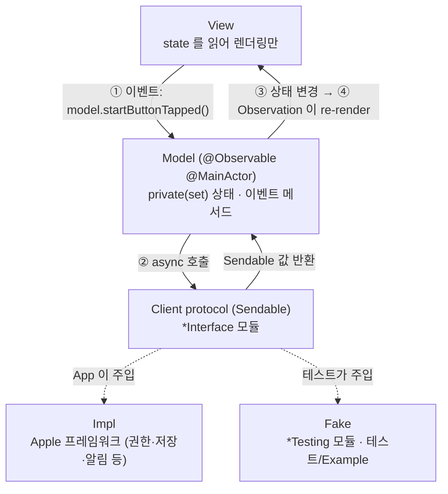
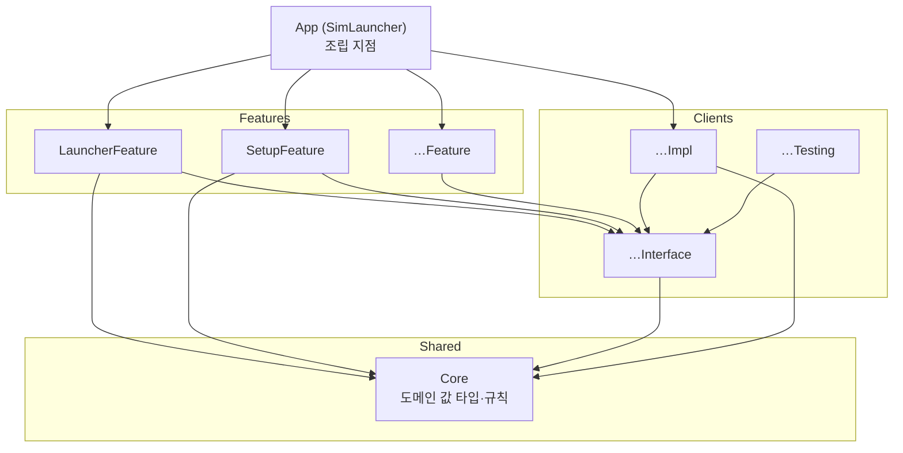

# 아키텍처

두 가지 결정 위에 서 있다.

1. **규칙 기반 단방향 MV.** SwiftUI 의 `@Observable` 모델을 View 에 직접 연결한다(Apple 샘플과 같은 방식). 단방향 흐름은 프레임워크가 아니라 규칙과 lint 로 강제한다.
2. **모듈러 아키텍처.** 외부 시스템은 Client 모듈로 감싸고, 각 Client 를 Interface / Impl / Testing 으로 나눈다. Feature 는 Interface 에만 의존한다.

## 1. 실행 흐름



### 단방향 규칙
| # | 규칙 | lint 로 강제 |
|---|---|---|
| 1 | Model 의 상태 프로퍼티는 모두 `public private(set) var` | 리뷰 |
| 2 | View 는 Model 의 **이벤트 메서드**만 호출한다. 이름은 "무슨 일이 일어났는가"로 짓는다: `onAppear()`, `startButtonTapped()`, `queryChanged(_:)` | 리뷰 |
| 3 | 입력 컨트롤은 `Binding(get: { model.query }, set: { model.queryChanged($0) })` 으로 연결한다. `$model.query` 금지 | `no_two_way_model_binding` |
| 4 | 부수효과(권한, 저장, 알림, 결제)는 Model 메서드 안에서 Client 를 통해서만 실행한다. View 에서 `Task { UNUserNotificationCenter… }` 금지 | `system_framework_only_in_impl` |
| 5 | Model 은 `@MainActor`, Client 가 주고받는 값은 `Sendable`. 비 Sendable 프레임워크 객체는 식별자나 Core 의 `Sendable` 값 타입으로 바꿔서 넘긴다 | 컴파일러 (Swift 6 strict) |
| 6 | Model 끼리 직접 참조하지 않는다. 화면 간 흐름은 App 이 조립하거나 공유 Client 를 거친다 | 모듈 경계 |
| 7 | Model 은 App(또는 Example 앱)이 `@State` 로 **소유**하고, View 는 `let model: XxxModel` 로 **참조**만 한다. View 안에서 Model 을 생성하거나 `@State` 로 다시 감싸지 않는다 | 리뷰 |
| 8 | View 전용 일시 상태(애니메이션, 포커스, 시트 표시 여부)는 View 의 `@State private var` 로 둬도 된다. 화면에만 걸린 시스템 UI 설정(예: 자동 잠금 끄기 `isIdleTimerDisabled`)도 View 가 맡는다. 저장·외부로 남지 않고 화면을 떠나면 되돌리므로 규칙 4 의 부수효과가 아니다. 비즈니스 의미가 있으면 Model 로 옮긴다 | 리뷰 |

같은 화면의 상태(기기 목록·진행 작업·알림)를 함께 쓰는 흐름은 하위 Model 로 나누지 않고, 공유 상태와 규칙을 Feature 의 값 타입(예: `LauncherNotices`·`DeviceActivity`)으로 떼어 별도 파일에 둔다. 다른 흐름과 공유하지 않는 독립 상태(예: 생성 시트 초안 `DeviceCreationDraft`)도 값 타입으로 둔다. Model 은 그 값을 `public private(set) var` 로 갖고 mutating 메서드만 부른다 (View 는 setter 가 없어 부를 수 없다). `private(set)` 은 같은 파일에서만 바꿀 수 있으므로 Model 의 async 흐름은 Model 파일에 둔다.

화면 전환(규칙 6)은 App 이 Setup 과 Launcher 사이에서 한다. `SimLauncherApp` 은 `SetupModel.isFinished` 로 둘 중 하나를 보인다: 앱 시작 직후 첫 판정이 준비됨이면 곧바로 Launcher(기기 목록), 아니면 Setup 의 단계 안내이고, Setup 안에서 준비가 끝나면 "기기 목록 열기"로 넘어간다. Launcher 의 툴바 "개발 환경"은 `LauncherModel.setupButtonTapped()` 가 App 이 주입한 클로저(`setupRequested`)를 불러 App 이 `SetupModel.reopened()` 로 Setup 을 다시 연다 (Feature 끼리 의존하지 않는다). 판정 전에는 `LauncherView` 를 만들지 않아 `simctl` 이 돌지 않고, Launcher 로 돌아올 때마다 View 가 새로 만들어져 목록을 다시 읽는다. Setup 은 보이는 동안 앱 활성화(`NSApplication.didBecomeActiveNotification`. macOS 에서는 다른 앱에 갔다 와도 `scenePhase` 가 바뀌지 않는다)마다 다시 확인한다.

### 예시 (알림 권한을 묻는 OnboardingFeature)
```swift
@MainActor
@Observable
public final class OnboardingModel {
  public private(set) var access: NotificationAccess

  @ObservationIgnored private let notification: any NotificationClient

  public func startButtonTapped() async {
    self.access = await self.notification.requestAccess()
  }
}

// View
Button("시작하기") { Task { await self.model.startButtonTapped() } }

// App: 화면 간 흐름은 App 이 정한다 (규칙 6)
if self.onboardingModel.access == .authorized {
  LauncherView(model: self.launcherModel)
} else {
  OnboardingView(model: self.onboardingModel)
}
```

## 2. 모듈 구조



### 모듈 종류와 타깃
| 종류 | 위치 | 타깃 | 역할 |
|---|---|---|---|
| App | `Projects/App` | `SimLauncher` | 유일한 조립 지점. Impl 을 생성해 Model 에 주입 |
| Feature | `Projects/Features/<Name>` | `<Name>Feature` · `<Name>FeatureTests` · `<Name>FeatureExample` | 화면 하나 또는 흐름 하나. Model + View |
| Client | `Projects/Clients/<Name>` | `<Name>Interface` · `<Name>Impl` · `<Name>Testing` · `<Name>Tests` | 외부 시스템 경계 |
| Shared | `Projects/Shared/<Name>` | `<Name>` · `<Name>Tests` | 여러 모듈이 함께 쓰는 코드. `Core`(도메인 값 타입·규칙), 필요해지면 `DesignSystem`(공용 UI) |

- **Interface**: 프로토콜과 값 타입만. 부수효과 프레임워크(`.swiftlint.yml` 의 `system_framework_only_in_impl` 목록)를 import 하지 않는다.
- **Impl**: 프로토콜 구현. 구현 타입 이름은 `<Name>ClientImpl`. 부수효과 프레임워크(Photos·SwiftData·StoreKit·UserNotifications 등, 목록은 lint 규칙) import 는 여기서만. 그 밖의 부수효과 없는 Apple 프레임워크(CoreGraphics·ImageIO 등)는 Core 를 포함한 모든 레이어에서 쓸 수 있다. 제한은 권한·저장·외부 서비스 같은 부수효과를 Impl 에 가두기 위한 것이므로, 부수효과 없는 프레임워크를 피하려고 실행 비용을 들이지 않는다.
- **Testing**: `<Name>ClientFake`. 고정 값을 돌려주는 `struct` 로 시작하고, 호출 기록이 필요하거나 호출 사이에 상태가 남아야 하면(저장 결과, 바뀐 권한) 그때 상태를 `Mutex` 로 보호하는 `final class` 로 확장한다.
- **Example**: Fake 로 Feature 를 단독 실행하는 데모 앱. **`#Preview` 도 여기에 둔다** (Feature 모듈이 Testing 에 의존하지 않도록).
- **Shared**: 부수효과 프레임워크와 Client 모듈을 import 하지 않는다. Core 는 부수효과 없는 순수 코드이고(SwiftUI·UIKit·AppKit 도 쓰지 않는다. lint `core_no_ui_framework`), 여러 Client 의 Interface 가 함께 쓰는 값 타입을 둔다. DesignSystem 은 SwiftUI 까지 쓴다.
- Core 에는 기기·런타임·기기 종류 값 타입(`VirtualDevice`·`DeviceRuntime`·`DeviceType`·`DeviceInventory`)과 규칙을 둔다: 화면 목록(`DeviceList`: iOS 런타임 기기만 OS 별로 묶어 정렬하고, 보일 기기가 없으면 그 이유(iOS 런타임 없음 / 만들 수 있는 기기 종류 없음 / 기기 없음)), 생성 선택지(`DeviceCreationOptions`: 쓸 수 있는 iOS 런타임과 그 런타임이 지원하는 iPhone·iPad 종류. Model 의 시트 기본값과 Impl 의 실행 전 재확인이 함께 쓴다), 이름 검사(`DeviceName`: 앞뒤 공백을 뺀 1~100 자, 제어 문자 금지), 링크 검사(`DeepLink`: 앞뒤 공백을 빼고 `URL(string:)` 로 읽어 스킴이 있어야 한다. 경로·쿼리의 공백·한글은 퍼센트 인코딩), 행별 허용 동작(`VirtualDevice.deleteAvailability`·`eraseAvailability` 가 돌려주는 `DeviceActionAvailability`: 삭제·초기화는 꺼진 기기만, 쓸 수 없는 기기는 삭제만). 앱 번들 값 타입(`AppBundleInfo`·`AppBundleID`·`CPUArchitecture`·`AppBundlePlatform`)과 설치 판정(`AppBundleInfo.installProblem`: 시뮬레이터용 플랫폼 → 이 Mac 아키텍처 → MinimumOSVersion 순서), 행별 설치 허용(`VirtualDevice.appInstallAvailability`: 쓸 수 있고 꺼짐·켜짐인 기기만. 꺼져 있으면 켜고 설치한다. 링크 열기도 같은 규칙)도 Core 에 둔다. Xcode 값 타입(`XcodeInstallation`: 번들 경로·버전·개발자 디렉터리)과 쓸 Xcode 선택 규칙(`XcodeSelection.choose`: xcode-select 가 가리키는 Xcode, 없으면 `/Applications` 의 가장 높은 버전(같은 버전이면 `Xcode.app` 먼저, 그다음 경로순)), 준비 상태 판정(`DevEnvironmentStatus`: Xcode 없음(Command Line Tools 만 선택됨이면 따로) → 라이선스 미동의 → 첫 실행 준비 필요 → 준비됨 순서)도 Core 에 둔다.

### 의존 규칙
| from ↓ / to → | Feature | Interface | Impl | Testing | Shared |
|---|---|---|---|---|---|
| App | ✅ | ✅ | ✅ | ❌ | ✅ |
| Feature | ❌ | ✅ | ❌ | ❌ | ✅ |
| Feature Tests / Example | 자기 Feature | ✅ | ❌ | ✅ | ✅ |
| Client Interface | ❌ | ❌ | ❌ | ❌ | ✅ |
| Client Impl | ❌ | 자기 Interface (+ 다른 Interface) | ❌ | ❌ | ✅ |
| Client Tests | ❌ | ✅ | 자기 Impl | 자기 Testing (+ Impl 이 쓰는 다른 Client 의 Testing) | ✅ |
| Shared | ❌ | ❌ | ❌ | ❌ | ❌ (필요해지면 템플릿에 인자를 추가하고 연다) |

### 빌드 설정
- 모든 모듈은 static framework. Mac 전용, macOS 26.0+, Swift 6 언어 모드, `SWIFT_STRICT_CONCURRENCY=complete`.
- 설정은 `Tuist/ProjectDescriptionHelpers/Project+Templates.swift` 의 `Env` 에서만 바꾼다. 개별 매니페스트에서 덮어쓰지 않는다.
- 서명: 모든 타깃이 Xcode 자동 서명(`CODE_SIGN_STYLE=Automatic`)과 `Env.developmentTeam` 팀을 쓴다. 배포 빌드는 Xcode 가 인증서·프로파일을 관리한다(팀 ID 필요). 팀이 비어 있으면 이 Mac 에서 실행할 때만 ad-hoc 서명으로 돌고, `make build`/`make test` 와 CI 는 `CODE_SIGNING_ALLOWED=NO` 로 서명 없이 빌드한다.
- 타깃 소스·리소스는 Xcode 동기화 폴더(`buildableFolders`)로 연결한다. 리소스가 없는 모듈의 폴더와 Tests 폴더(테스트 번들이 리소스를 직접 담는다)는 파일을 추가·삭제해도 다시 생성하지 않고 Xcode 와 빌드에 반영된다. 리소스가 있는 모듈(String Catalog 가 있는 Feature 등)은 static framework 라 Tuist 가 같은 폴더를 쓰는 리소스 번들 타깃(`<모듈>_<모듈>`)을 만들고, 생성할 때 있던 Swift 파일만 그 타깃에서 빼 둔다(pbxproj 의 `membershipExceptions`). 그래서 이런 모듈의 소스 폴더에 Swift 파일을 추가하면 `make project` 를 다시 돌린다. 돌리지 않으면 새 파일이 번들 타깃에서도 컴파일되어 `Unable to resolve module dependency` 로 빌드가 깨진다. 그 밖에 모듈·타깃·의존성을 바꿀 때와, 리소스가 없던 모듈에 첫 리소스(String Catalog 등)를 넣을 때도 다시 돌린다 (리소스 번들 타깃과 `Bundle.module` 접근자는 생성할 때 만들어진다).

## 3. 모듈 추가 방법

### Client 추가 (예: Notification)
1. `Tuist/ProjectDescriptionHelpers/Module.swift` 의 `extension Client` 에 `static let notification = Client("Notification")` 추가.
2. 디렉터리 생성: `Projects/Clients/Notification/{Interface,Impl,Testing,Tests}` + `Project.swift`:
   ```swift
   import ProjectDescription
   import ProjectDescriptionHelpers

   let project = Project.client(.notification, shared: [.core])
   ```
   Impl 이 다른 Client 를 조합하면 `clients: [.storage, …]` 를 더한다. Impl 에는 그 Interface 가, Tests 에는 Interface 와 Testing(Fake)이 연결된다. 조합되는 Client 의 Impl 도 App 이 `.client(impl:)` 로 의존해 만들고, 조합하는 Impl 의 생성자로 넘긴다.
3. Interface 에 `public protocol NotificationClient: Sendable` 과 입출력 값 타입, Impl 에 `NotificationClientImpl`, Testing 에 `NotificationClientFake`, Tests 에 Impl 의 순수 로직 테스트.
4. 사용하는 Feature 매니페스트의 `clients:` 에 추가하고, App 매니페스트에 `.client(impl: .notification)` 추가.
5. `make project && make test`.

### Shared 추가 (예: DesignSystem)
1. `Module.swift` 의 `Shared` 에 `case designSystem = "DesignSystem"` 추가.
2. `Projects/Shared/DesignSystem/{Sources,Tests}` + `Project.swift`:
   ```swift
   let project = Project.shared(.designSystem)
   ```
3. 쓰는 모듈의 매니페스트에 연결한다: Feature 는 `Project.feature(_, clients:, shared: [.designSystem])`, Client 는 `Project.client(_, shared: [...])`, App 은 `dependencies` 에 `.shared(.designSystem)`.
   DesignSystem 같은 공용 UI 모듈은 Feature 와 App 에서만 쓴다 (Interface 는 프로토콜과 값 타입만).

### Feature 추가 (예: Onboarding)
1. `Feature` 에 `case onboarding = "Onboarding"` 추가.
2. `Projects/Features/Onboarding/{Sources,Tests,Example}` + `Project.swift`:
   ```swift
   let project = Project.feature(.onboarding, clients: [.notification], shared: [.core])
   ```
3. `Sources` 에 `OnboardingModel`, `OnboardingView`. `Tests` 에 Model 테스트. `Example` 에 `@main` 데모 앱과 `#Preview`.
4. App 매니페스트 dependencies 에 `.feature(.onboarding)` 추가, `SimLauncherApp` 에서 Model 을 만들어 연결.

## 4. 확정된 기술 결정
| 결정 | 이유 |
|---|---|
| TCA 등 외부 아키텍처 라이브러리 | 사용하지 않음. 외부 의존성 0 을 유지하고, 추가하려면 사전 합의 |
| 시뮬레이터 제어는 `xcrun simctl` 을 `Process` 로 실행 | 공개 API 가 없다. `simctl` 인자 구성·출력 해석은 Simulator Client Impl 에만 두고, Feature 는 Interface 의 값 타입(기기·OS·상태)만 본다. `Process` 생성·호출(프로세스 실행)은 Command Client Impl 한 곳에만 두고 Feature·Core·다른 Client Impl 에서는 하지 않으며(lint `process_only_in_command_impl`), 명령이 필요한 Client Impl(Simulator·AppBundle·DevEnvironment)은 생성 때 `CommandClient` 를 주입받아 실행한다(App 이 `CommandClientImpl` 하나를 만들어 함께 넘긴다). Command Client 는 다른 Client Impl 만 조합해 쓰고, Feature·Core 는 의존하지 않는다. 다른 명령(`ditto`·`zipinfo`·`xcode-select`·`xcodebuild -checkFirstLaunchStatus`·`-license check`·`-downloadPlatform`, Xcode·App Store 를 여는 `open`)도 인자 구성·결과 해석은 그 일을 맡은 Client Impl 이 하고, 실행은 `CommandClient` 로 한다. Simulator 앱 열기도 Simulator Client Impl 이 맡는다: provider 가 없으면 `xcode-select -p` 로 읽고(provider 가 `nil` 을 돌려주면 열지 않는다), 그 안의 Simulator 앱(`Developer/Applications/Simulator.app`, 없으면 `Contents/Applications/DeviceHub.app`. Xcode 27.1 은 DeviceHub)을 `open` 으로 연다 |
| 네트워크는 사용자가 등록한 카탈로그(`catalog.json`)와 사용자가 고르거나 입력한 빌드(.app·zip) URL 을 내려받을 때, 사용자가 고른 iOS 런타임을 Apple 서버에서 설치할 때(`xcodebuild -downloadPlatform`)만 | 공개 레포로 어느 회사든 자기 빌드 저장소를 연결해 쓰게 하기 위해. 카탈로그 형식은 이 프로젝트의 공개 규격이고(DEVELOPMENT_PLAN "빌드 카탈로그"), 카탈로그·빌드 다운로드는 Download Client Impl 에만, 런타임 설치는 DevEnvironment Client Impl 에만 둔다. 6단계의 업데이트 확인(이 레포의 최신 릴리스 조회)은 그때 이 줄에 추가한다 |
| 쓸 Xcode(`DEVELOPER_DIR`)는 DevEnvironment Client 한 곳에서 정하고, 다른 Client Impl 은 생성 때 그 경로를 돌려주는 provider 를 주입받는다. 쓸 Xcode 는 xcode-select 가 가리키는 Xcode, 아니면 `/Applications` 의 가장 높은 버전이다. provider 가 경로를 주면 그것을 `DEVELOPER_DIR` 로 넣는다. provider 가 `nil` 을 돌려주면(쓸 Xcode 없음) 명령을 실행하지 않고 실패한다(Simulator 는 `.developerToolsUnavailable`). provider 자체가 없으면(`nil`, 테스트용) 물려받은 `DEVELOPER_DIR` 를 지우고 `xcode-select` 기본값으로 실행한다. 공개 메서드 한 번에 provider 도 한 번만 불러, 그 안의 재조회와 앱 열기도 같은 개발자 디렉터리를 쓴다. provider 는 준비 여부(라이선스·첫 실행)와 관계없이 고른 Xcode 를 주고, 준비 안내는 App 흐름(Setup)이 맡는다. DevEnvironment Impl 은 shim(`/usr/bin/xcrun`·`/usr/bin/xcodebuild`)을 실행하지 않고, 고른 Xcode 안의 `xcodebuild` 를 직접 실행한다 | 환경 확인·런타임 설치·`simctl` 이 서로 다른 Xcode 를 쓰면, 확인을 통과했는데도 실행이 실패하거나 설치한 런타임이 보이지 않는다. 비개발자는 이런 문제를 풀 수 없다. 값 대신 provider 를 주입하는 이유는, 앱을 켜 둔 채 Xcode 를 설치하거나 준비해도 다시 켜지 않고 다음 호출부터 반영하기 위해서다. 연결은 App 에서 하므로 DevEnvironment Client 와 그 경로를 쓰는 Client 는 서로 의존하지 않는다. 쓸 Xcode 가 없을 때 실행하지 않는 이유: 개발자 도구가 없는 Mac 에서 `/usr/bin/xcrun` 같은 shim 은 Command Line Tools 설치 대화상자를 띄우고, Command Line Tools 로는 시뮬레이터를 쓸 수 없다. 이 판정을 실행하는 Impl 에 두어 App 흐름이 확인을 빠뜨리거나 확인 뒤 Xcode 가 지워져도 대화상자가 뜨지 않는다 |
| 배포: Developer ID 서명·공증, GitHub Releases (Homebrew Cask 는 선택) | `simctl` 같은 다른 프로세스 실행에 App Sandbox 밖 동작이 필요해 Mac App Store 는 어렵다. Apple Developer Program 은 가입되어 있다 |
| 앱 업데이트는 외부 의존성 없이 직접 구현 | 외부 의존성 0 원칙. 먼저 새 버전 알림만, 자동 교체는 서명·팀 ID 검증과 함께 후속 |
| 화면 문자열은 그 모듈 `Sources` 의 String Catalog(`Localizable.xcstrings`)에 한국어로 두고, Feature·DesignSystem 코드는 `Text("…", bundle: .module)`·`String(localized: "…", bundle: .module)` 로 찾는다. 모든 프로젝트의 개발 언어는 `ko` 이고(템플릿 `Env`), Xcode 에서 빌드하면 코드의 새 문자열이 카탈로그에 추가된다. `xcodebuild`(make·CI)는 카탈로그를 고치지 않으므로 CLI 로만 작업하면 항목과 `ko` 값을 직접 넣는다. Xcode 가 붙이는 `"extractionState" : "stale"` 은 커밋하지 않는다(CONVENTIONS §5) | 한국어 먼저 내고 영어를 나중에 추가한다. 모듈은 static framework 라 Tuist 가 리소스 번들(`<모듈>_<모듈>.bundle`)을 따로 만들어 앱에 복사하므로, `bundle` 을 빼면 앱 번들에서 찾다가 원문(한국어)으로 돌아가 영어를 추가해도 바뀌지 않는다. 앱 이름처럼 번역하지 않는 문자열은 `Text(verbatim:)`. 항목마다 `ko` 값을 채워 둔다(값이 없는 원문 항목은 번들에 컴파일되지 않아 테스트로 확인할 수 없다) |
| iOS 시뮬레이터 먼저, Android 에뮬레이터는 후속 | 기기·런타임 값 타입과 Client 이름을 iOS 전용으로 굳히지 않아 Android Client 를 나중에 더할 수 있게 한다 |
