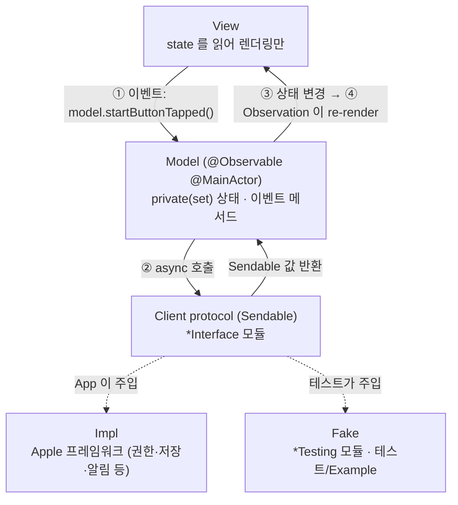
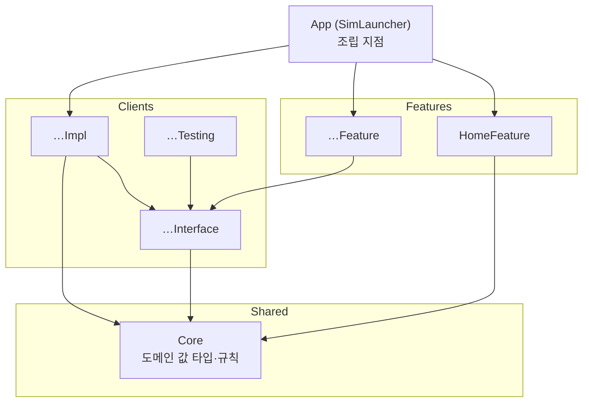

# 아키텍처

두 가지 결정 위에 서 있다.

1. **규칙 기반 단방향 MV.** SwiftUI 의 `@Observable` 모델을 View 에 직접 연결한다(Apple 샘플과 같은 방식). 단방향 흐름은 프레임워크가 아니라 규칙과 lint 로 강제한다.
2. **모듈러 아키텍처.** 외부 시스템은 Client 모듈로 감싸고, 각 Client 를 Interface / Impl / Testing 으로 나눈다. Feature 는 Interface 에만 의존한다.

## 1. 실행 흐름



### 단방향 규칙
| # | 규칙 | lint 로 강제 |
|---|---|---|
| 1 | Model 의 상태 프로퍼티는 모두 `public private(set) var` | 리뷰 |
| 2 | View 는 Model 의 **이벤트 메서드**만 호출한다. 이름은 "무슨 일이 일어났는가"로 짓는다: `onAppear()`, `startButtonTapped()`, `queryChanged(_:)` | 리뷰 |
| 3 | 입력 컨트롤은 `Binding(get: { model.query }, set: { model.queryChanged($0) })` 으로 연결한다. `$model.query` 금지 | `no_two_way_model_binding` |
| 4 | 부수효과(권한, 저장, 알림, 결제)는 Model 메서드 안에서 Client 를 통해서만 실행한다. View 에서 `Task { UNUserNotificationCenter… }` 금지 | `system_framework_only_in_impl` |
| 5 | Model 은 `@MainActor`, Client 가 주고받는 값은 `Sendable`. 비 Sendable 프레임워크 객체는 식별자나 Core 의 `Sendable` 값 타입으로 바꿔서 넘긴다 | 컴파일러 (Swift 6 strict) |
| 6 | Model 끼리 직접 참조하지 않는다. 화면 간 흐름은 App 이 조립하거나 공유 Client 를 거친다 | 모듈 경계 |
| 7 | Model 은 App(또는 Example 앱)이 `@State` 로 **소유**하고, View 는 `let model: XxxModel` 로 **참조**만 한다. View 안에서 Model 을 생성하거나 `@State` 로 다시 감싸지 않는다 | 리뷰 |
| 8 | View 전용 일시 상태(애니메이션, 포커스, 시트 표시 여부)는 View 의 `@State private var` 로 둬도 된다. 화면에만 걸린 시스템 UI 설정(예: 자동 잠금 끄기 `isIdleTimerDisabled`)도 View 가 맡는다. 저장·외부로 남지 않고 화면을 떠나면 되돌리므로 규칙 4 의 부수효과가 아니다. 비즈니스 의미가 있으면 Model 로 옮긴다 | 리뷰 |

### 예시 (알림 권한을 묻는 OnboardingFeature)
```swift
@MainActor
@Observable
public final class OnboardingModel {
  public private(set) var access: NotificationAccess

  @ObservationIgnored private let notification: any NotificationClient

  public func startButtonTapped() async {
    self.access = await self.notification.requestAccess()
  }
}

// View
Button("시작하기") { Task { await self.model.startButtonTapped() } }

// App: 화면 간 흐름은 App 이 정한다 (규칙 6)
if self.onboardingModel.access == .authorized {
  HomeView(model: self.homeModel)
} else {
  OnboardingView(model: self.onboardingModel)
}
```

## 2. 모듈 구조



### 모듈 종류와 타깃
| 종류 | 위치 | 타깃 | 역할 |
|---|---|---|---|
| App | `Projects/App` | `SimLauncher` | 유일한 조립 지점. Impl 을 생성해 Model 에 주입 |
| Feature | `Projects/Features/<Name>` | `<Name>Feature` · `<Name>FeatureTests` · `<Name>FeatureExample` | 화면 하나 또는 흐름 하나. Model + View |
| Client | `Projects/Clients/<Name>` | `<Name>Interface` · `<Name>Impl` · `<Name>Testing` · `<Name>Tests` | 외부 시스템 경계 |
| Shared | `Projects/Shared/<Name>` | `<Name>` · `<Name>Tests` | 여러 모듈이 함께 쓰는 코드. `Core`(도메인 값 타입·규칙), 필요해지면 `DesignSystem`(공용 UI) |

- **Interface**: 프로토콜과 값 타입만. 부수효과 프레임워크(`.swiftlint.yml` 의 `system_framework_only_in_impl` 목록)를 import 하지 않는다.
- **Impl**: 프로토콜 구현. 구현 타입 이름은 `<Name>ClientImpl`. 부수효과 프레임워크(Photos·SwiftData·StoreKit·UserNotifications 등, 목록은 lint 규칙) import 는 여기서만. 그 밖의 부수효과 없는 Apple 프레임워크(CoreGraphics·ImageIO 등)는 Core 를 포함한 모든 레이어에서 쓸 수 있다. 제한은 권한·저장·외부 서비스 같은 부수효과를 Impl 에 가두기 위한 것이므로, 부수효과 없는 프레임워크를 피하려고 실행 비용을 들이지 않는다.
- **Testing**: `<Name>ClientFake`. 고정 값을 돌려주는 `struct` 로 시작하고, 호출 기록이 필요하거나 호출 사이에 상태가 남아야 하면(저장 결과, 바뀐 권한) 그때 상태를 `Mutex` 로 보호하는 `final class` 로 확장한다.
- **Example**: Fake 로 Feature 를 단독 실행하는 데모 앱. **`#Preview` 도 여기에 둔다** (Feature 모듈이 Testing 에 의존하지 않도록).
- **Shared**: 부수효과 프레임워크와 Client 모듈을 import 하지 않는다. Core 는 부수효과 없는 순수 코드이고(SwiftUI·UIKit·AppKit 도 쓰지 않는다. lint `core_no_ui_framework`), 여러 Client 의 Interface 가 함께 쓰는 값 타입을 둔다. DesignSystem 은 SwiftUI 까지 쓴다.
- 템플릿이 만든 `HomeFeature` 와 Core 의 `Greeting` 은 구조를 보여 주는 시작점이다. 앱에 맞는 화면·타입이 생기면 바꾸거나 지운다.

### 의존 규칙
| from ↓ / to → | Feature | Interface | Impl | Testing | Shared |
|---|---|---|---|---|---|
| App | ✅ | ✅ | ✅ | ❌ | ✅ |
| Feature | ❌ | ✅ | ❌ | ❌ | ✅ |
| Feature Tests / Example | 자기 Feature | ✅ | ❌ | ✅ | ✅ |
| Client Interface | ❌ | ❌ | ❌ | ❌ | ✅ |
| Client Impl | ❌ | 자기 Interface (+ 다른 Interface) | ❌ | ❌ | ✅ |
| Client Tests | ❌ | ✅ | 자기 Impl | 자기 Testing (+ Impl 이 쓰는 다른 Client 의 Testing) | ✅ |
| Shared | ❌ | ❌ | ❌ | ❌ | ❌ (필요해지면 템플릿에 인자를 추가하고 연다) |

### 빌드 설정
- 모든 모듈은 static framework. Mac 전용, macOS 26.0+, Swift 6 언어 모드, `SWIFT_STRICT_CONCURRENCY=complete`.
- 설정은 `Tuist/ProjectDescriptionHelpers/Project+Templates.swift` 의 `Env` 에서만 바꾼다. 개별 매니페스트에서 덮어쓰지 않는다.
- 서명: 모든 타깃이 Xcode 자동 서명(`CODE_SIGN_STYLE=Automatic`)과 `Env.developmentTeam` 팀을 쓴다. 배포 빌드는 Xcode 가 인증서·프로파일을 관리한다(팀 ID 필요). 팀이 비어 있으면 이 Mac 에서 실행할 때만 ad-hoc 서명으로 돌고, `make build`/`make test` 와 CI 는 `CODE_SIGNING_ALLOWED=NO` 로 서명 없이 빌드한다.
- 타깃 소스·리소스는 Xcode 동기화 폴더(`buildableFolders`)로 연결한다. 기존 폴더 안에서 파일을 추가·삭제하면 다시 생성하지 않아도 Xcode 와 빌드에 반영된다. 모듈·타깃·의존성을 바꿀 때만 `make project` 를 다시 돌린다.

## 3. 모듈 추가 방법

### Client 추가 (예: Notification)
1. `Tuist/ProjectDescriptionHelpers/Module.swift` 의 `extension Client` 에 `static let notification = Client("Notification")` 추가.
2. 디렉터리 생성: `Projects/Clients/Notification/{Interface,Impl,Testing,Tests}` + `Project.swift`:
   ```swift
   import ProjectDescription
   import ProjectDescriptionHelpers

   let project = Project.client(.notification, shared: [.core])
   ```
   Impl 이 다른 Client 를 조합하면 `clients: [.storage, …]` 를 더한다. Impl 에는 그 Interface 가, Tests 에는 Interface 와 Testing(Fake)이 연결된다. 조합되는 Client 의 Impl 도 App 이 `.client(impl:)` 로 의존해 만들고, 조합하는 Impl 의 생성자로 넘긴다.
3. Interface 에 `public protocol NotificationClient: Sendable` 과 입출력 값 타입, Impl 에 `NotificationClientImpl`, Testing 에 `NotificationClientFake`, Tests 에 Impl 의 순수 로직 테스트.
4. 사용하는 Feature 매니페스트의 `clients:` 에 추가하고, App 매니페스트에 `.client(impl: .notification)` 추가.
5. `make project && make test`.

### Shared 추가 (예: DesignSystem)
1. `Module.swift` 의 `Shared` 에 `case designSystem = "DesignSystem"` 추가.
2. `Projects/Shared/DesignSystem/{Sources,Tests}` + `Project.swift`:
   ```swift
   let project = Project.shared(.designSystem)
   ```
3. 쓰는 모듈의 매니페스트에 연결한다: Feature 는 `Project.feature(_, clients:, shared: [.designSystem])`, Client 는 `Project.client(_, shared: [...])`, App 은 `dependencies` 에 `.shared(.designSystem)`.
   DesignSystem 같은 공용 UI 모듈은 Feature 와 App 에서만 쓴다 (Interface 는 프로토콜과 값 타입만).

### Feature 추가 (예: Onboarding)
1. `Feature` 에 `case onboarding = "Onboarding"` 추가.
2. `Projects/Features/Onboarding/{Sources,Tests,Example}` + `Project.swift`:
   ```swift
   let project = Project.feature(.onboarding, clients: [.notification], shared: [.core])
   ```
3. `Sources` 에 `OnboardingModel`, `OnboardingView`. `Tests` 에 Model 테스트. `Example` 에 `@main` 데모 앱과 `#Preview`.
4. App 매니페스트 dependencies 에 `.feature(.onboarding)` 추가, `SimLauncherApp` 에서 Model 을 만들어 연결.

## 4. 확정된 기술 결정
| 결정 | 이유 |
|---|---|
| TCA 등 외부 아키텍처 라이브러리 | 사용하지 않음. 외부 의존성 0 을 유지하고, 추가하려면 사전 합의 |
| 시뮬레이터 제어는 `xcrun simctl` 을 `Process` 로 실행 | 공개 API 가 없다. 실행·출력 해석은 Simulator Client Impl 에만 두고, Feature 는 Interface 의 값 타입(기기·OS·상태)만 본다 |
| 네트워크는 사용자가 입력한 URL 에서 빌드(.app·zip)를 내려받을 때만 | 로컬 .app 과 네트워크에 올려진 .app 을 둘 다 지원하기 위해. 다운로드는 Download Client Impl 에만 둔다 |
| 배포: Developer ID 서명·공증 (미확정, 팀 ID 입력 후 결정) | `simctl` 같은 다른 프로세스 실행에 App Sandbox 밖 동작이 필요해 Mac App Store 는 어렵다 |
